# 数据链路层

## 数据链路层的功能

### 主要任务

- 发送方的**网络层**将数据包发给**数据链路层**，**数据链路层**通过**物理层**提供的服务将数据传输给接收方的**数据链路层**，接收方的**数据链路层**再将数据提供给**网络层**。

- 在这个过程中，数据链路层需要考虑的问题有：

    - 物理层传输的是**比特流**，因此需要**区分不同的数据包的界限（成帧）**

    - 传输过程中可能发生的**错误（Error control）**

    - 发送方和接收方**处理数据速率的不同（Flow control）**

- 为了方便解决这些问题，数据链路层将网路层提供的每个数据包通过一些增加和修改封装成 帧 frame（也有可能拆分并封装成多个帧），在接收方的数据链路层，这些修改被还原。

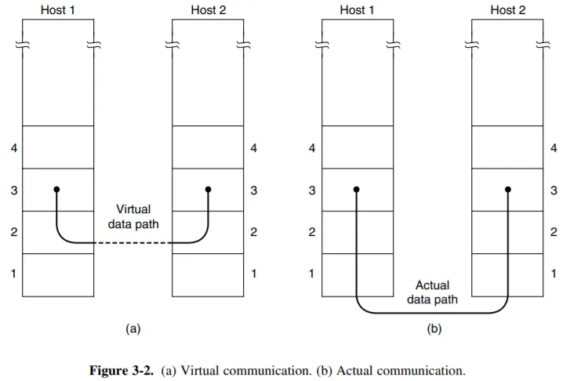

### 提供给网络层的服务

- 数据链路层可以根据需要设计**不同的协议**，提供的具体服务根据不同的协议有所差异。（这与物理层不同，因为**物理层提供给数据链路层的服务是单一的**：将发送方数据链路层发来的帧想办法发送给接收方的数据链路层。）通常，数据链路层可能会提供如下 3 种服务之一：

    - **无确认的无连接服务 (Unacknowledged Connectless Service)**这种服务不会尝试对丢帧情况进行检查，因此也不可能试图对丢失的数据进行恢复。这种服务适合**错误率很低的情况（如光纤传输）**，或者即时通讯、直播等对**即时性要求很高**，且偶尔的丢失和错误关系不大的情况。

    - **有确认的无连接服务 (Acknowledged Connectless Service)**这种服务发送的每一帧需要单独确认；如果发送方发送一个帧后在指定的时间内还没有得到确认，则重新发送该帧。适用于**不可靠信道**，比如无线系统（**802.11 WiFi**）。

    - **有确认的面向连接服务 (Acknowledged Connect-Oriented Service)**这种服务在传输数据前在发送方和接收方之间建立一个连接，保证每个帧都按序、不重复地被接收方接收，传输结束后连接和维护连接的资源被释放。为了保证正确性，双方需要维护一些变量和计数器，记录哪些帧已经收到，哪些还没有收到。适用于**长距离且不可靠**的链路，如**卫星信道和长途电话电路**。

### Framing 成帧

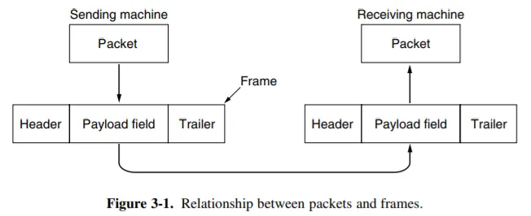

- 成帧 Framing 的核心任务是设计一种方案使得**接收方很容易找到每个帧的开始**，从而将比特流**还原成一个个帧**；同时不**能占用太多带宽**。我们考察 4 种定界方式。

1. **字节计数法（byte count）**

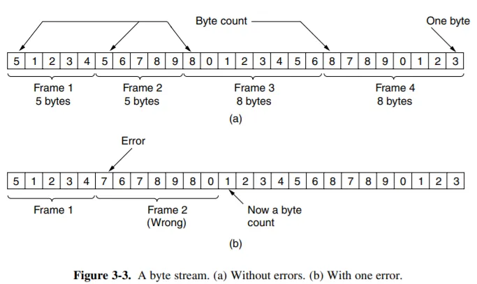

- 在每个 frame 的开头**用一个 byte 保存这个 frame 的 byte 数目**。但是当这个计数值出现错误时，即使接收方通过错误检验发现了错误，也再也**无法知道下一帧的开始位置**（**失去同步 get out of sync**）。因此，字节计数法一般不会被采用。

2. **标志字节法（byte stuffing / Flag bytes ）**

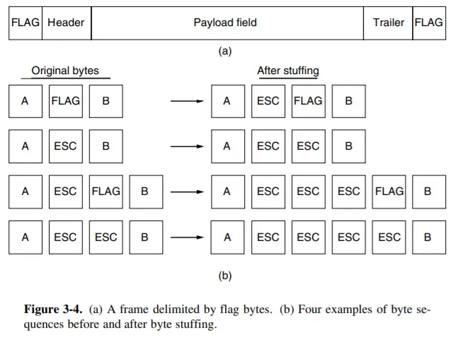

- 这种方式用一个固定的**特殊字节标明帧的头部和尾部**，如上图 (a)。这个字节称为 **flag byte (FLAG)**。当传输的数据内部出现 FLAG 时，用一个**转义字节 escape byte (ESC)** 在其前面进行**标识**（防止这些byte真的是数据里的byte）；同时需要**发送 ESC 本身**时也在其前面**增加一个 ESC**，如上图 (b)。这种技术称为 **字节填充 byte stuffing**。

3. **标志比特法（bit stuffing / Flag bits）**

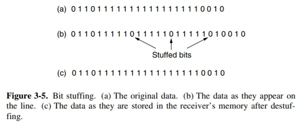

- 考虑到帧的划分也可以是比特级的，这种标志和填充也可以**精确到比特级**。

- 一些协议，例如 *HDLC protocal*的标志方式是：每个帧的开始和结束用序列 **01111110 (0x7E)** 标识；问题在于，如果这个 `01111110` 模式恰好出现在需要传输的数据（Payload）中，接收方会错误地认为帧已经结束了。为了解决这个问题，就需要使用比特填充技术。

- 比特填充的规则非常简单，分为发送方和接收方两个部分：

1. **发送方 (填充)**:

- 在发送数据时，发送方的数据链路层会持续监控整个数据流。一旦在数据中检测到有**连续5个“1”**，它就会自动在后面**填充 (stuff) 一个“0”** 。

- 这个过程确保了在原始数据中，绝**不会出现连续6个“1”**的情况（除非它是一个真正的标志位 01111110）。

2. **接收方 (去填充/Destuffing)**:

- 接收方在接收数据时，同样会监控比特流。当它看到**连续5个“1”**时，会检查紧随其后的下一位 。

- 如果第6位是**0**，**接收方就知道这是一个被填充的位，于是会自动将其删除 (destuff)**，从而恢复出原始数据 。

- 如果第6位是**1**（并且前后比特构成了标志 01111110），接收方就知道这是一个**真正的帧边界标志**。

- 这种方式的overhead比较小，实际用的例子就有 USB

4. **物理层编码违禁法（Physical layer coding violations）**

- 对于 4B/5B 编码方式或者 Manchester 编码，有相当一部分信号组合是不可能出现的。我们可以使用这样的**不可能出现的信号组合作为帧的开始和结束**。相对于上面两种填充方法，这种方法不再需要填充数据。**IEEE 802** 标准就采用了这种方法。

### 检错和纠错

- 信号在传输中有可能出现错误或者丢失。如果我们需要排除丢失的情况，我们可以在协议中要求**接收方在收到帧后发回一个确认**；**发送方得到确认后才可以发下一帧**，如果一段时间内没有收到确认则需重新发送。如果我们需要排除错误的情况，我们可以尝试直接对错误进行恢复；也可以尝试只检查错误，如果发现错误则要求发送方重传。

#### 基本定义和原理

- 如果想要检查一串数据是否出现过错误，我们显然需要一些额外的信息。如果一帧有 $m$ 个数据位存储信息，有 $r$ 个冗余位 (redundant / check bits) 用来校验，那么这个包含了数据位和冗余位的 $n = m + r$ 位数据块就称为一个 $n$ 位 **码字（codeword）**。

- 定义 **码率（code rate）** 为 codeword 中**数据位所占的比例**，即 $m/n$。通常在**越高质量的信道上设计的 code rate 越高**，因为相比于有噪声的信道，高质量的信道通常**需要更少的冗余位**用来检错或纠错。

- 两个等长的码字中不相同的位的个数称为这两个码字的 **海明距离（Hamming distance d）**，表征一个码字需要出现 **d 个 1bit 的错误**才会变成另一个码字。

- 如果我们想可靠地**检测**可能的 **e 个错误**，我们需要一个海明距离为 **e + 1** 的编码方案（即，**任意两个合法码字之间的距离不小于 e + 1**）。因为这样任意 e 个错误不可能将一个合法码字变成另一个合法码字；当我们发现一个非法码字时，我们就知道出现了错误。

- 如果我们想可靠地**纠正可能的 e 个错误**，我们需要一个海明距离为 **2e + 1** 的编码方案。因为这样任意的 e 个错误发生后，原来的码字仍然是现在的码字距离最近的那一个。

#### 纠错码

1. **海明码（Hamming codes）**

- 假设我们需要设计一种编码方案，每个码字有 $m$ 个信息位和 $r$ 个冗余位，并且能够**纠正所有的 1bit 错误**。那么对于 $2^m$ 种合法的信息，每个信息都应唯一对应 $n$ 个非法码字，它们与该信息的**距离为 1**。因此这里就共有 $(n+1)2^m$ 种情况，因此有 $(n+1)2^m≤2^n$，亦即 $(m+r+1)≤2^r$。在 $m$ 给定的情况下，我们可以通过这一不等式确定 $r$ 的下界。海明码给出了这一下界的一个获得方式。编码方式见下图。

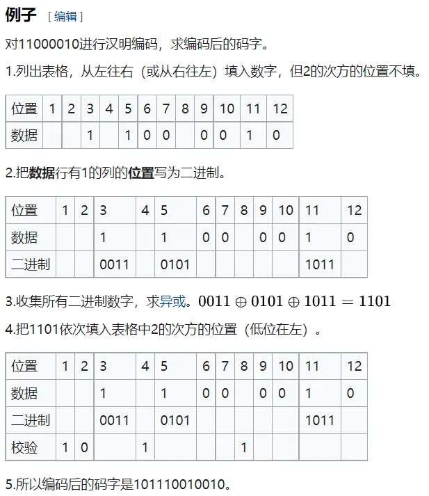

- 当我们纠错时，可以把所有置1的位（用二进制表示）的数拿来异或

- 如果结果全0，则无错；如果仅有一个1说明是冗余位出错，不需要correct；如果超过一个1，说明对应那个位出错了

2. **卷积码（convolutional codes）**

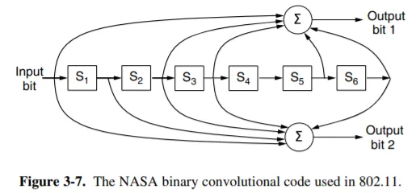

- 卷积码的输出由**当前输入**和**之前若干位输入**决定，影响当前输出的此前输入位数称为 **约束长度（constraint length）**。

#### 检错码

- 光纤和高品质铜线的错误率较低，因此对偶现的错误进行检错和重传更加有效。下面介绍三种检错码，它们都是线性的系统块码。

1. **奇偶校验位（parity bit）**

- n-1 位信息，1 位冗余。奇校验码：在加上该位后 1 的个数为奇数；偶校验码则为偶数。

- **交错校验（interleaving）** 技术可以一定程度上防止突发的若干比特范围内的错误。将数据块作为 $k$ 行 $n$ 列处理，每列计算一个 **parity bit** 后附在数据块最后发送。这样**除非突发错误持续 n 个 bit 以上，否则仍然可以被检测出来**。

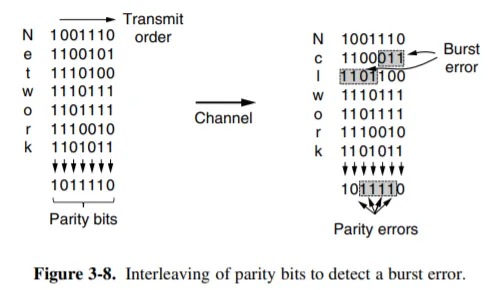

2. **校验和（checksum）**

- 对数据进行一些求和运算。奇偶校验位也可以看做校验和的一个例子。

- 另一个实际例子是 Internet Checksum。规则是：首先将数据分割成 16 bit 的若干段（最后一段不足 16 bit 则在末尾补 0）；然后将这些段相加，最高位进位 wrap around（见下图）；最后将结果按位取反 (?) 作为校验。检查时再次计算数据之和，加上校验，如果结果不为全 1 则发生过错误。

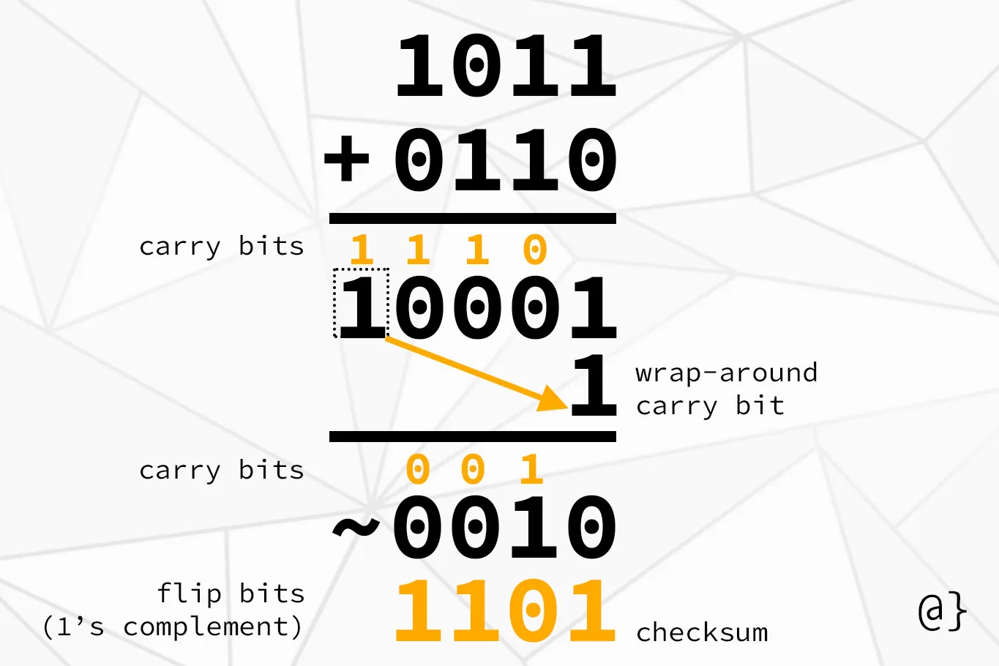

3. **循环冗余码（Cyclic Redundancy Code, CRC）**

- 又称 **多项式码（polynomial code）**，计算方式见下图。其中 G(x) 是发送方和接收方预先商定的一个多项式，称为 **生成多项式 generator polynomial**，其最高位和最低位一定是 1。

- 在CRC计算中，除法实际上是二进制长除法，并且所有的减法都由**异或（XOR）**操作代替。

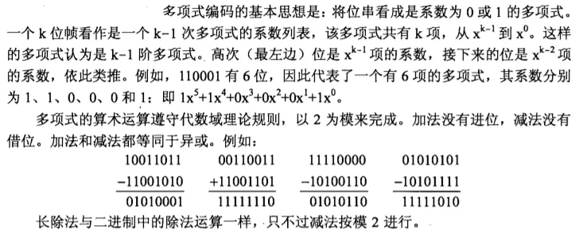

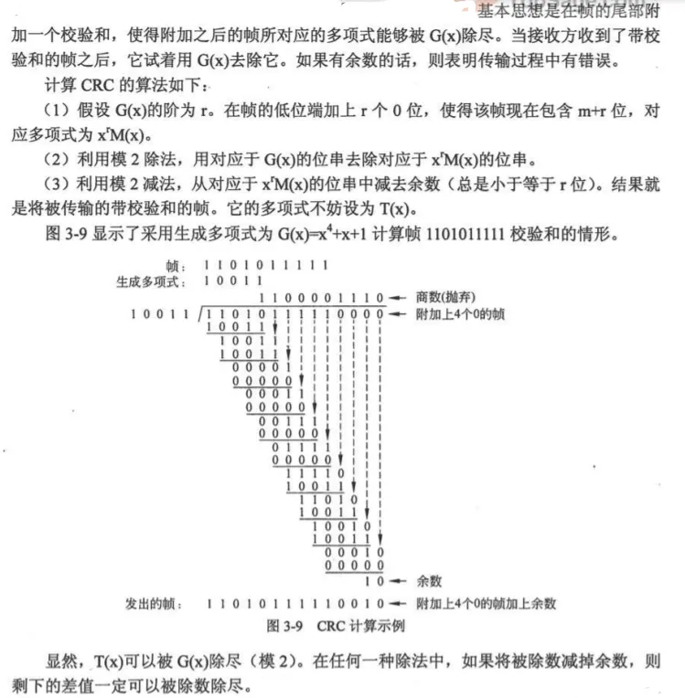

### 流量控制与一些基本协议 

#### 单工协议

1. **一个乌托邦式的单工协议 (A Utopian Simplex Protocol)**

- 发送方不断地从网络层获取数据包并构造一个帧，通过物理层发送该帧；接收方不断等待唯一可能的事件 FRAME_ARRIVAL 发生，将该帧从物理层取得，并将数据部分发送给网络层。

- 这种方案的问题是，**如果发送方发送帧的速度大于接收方处理的速度，接收方就会被淹没 (flood)**。

2. **无错信道上的单工停-等协议 (A Simplex Stop-and-Wait Protocol for an Error-Free Channel)**

- 接收方每当接收一个帧并处理完成后，发回一个**确认帧**；发送方在收到确认帧后（不需要处理，因为此时唯一的可能就是确认帧），则可以发送下一帧。

- 这种协议在数据传输上是单工的，但是接收方需要发回消息，因此需要使用**半双工**信道。这种方案的实际问题在于，没有考虑出现错误的情况。

3. **有错信道上的单工停-等协议 （A Simplex Stop-and-Wait Protocol for a Noisy Channel）**

- 这种协议在上一种的基础上考虑 3 种可能的错误 

    1. **接收到的帧检出错误**
    
    - 为了解决第 1 种错误，我们引入一个新的事件 CKSUM_ERR 表示校验和有误；因而接收方在收到一个帧后应当**校验正确性**，发回一个**表示正确或者错误的确认帧**；如果检出错误，则直接抛弃该帧等待重传。如果发送方收到了表示错误的确认帧导致事件 CKSUM_ERR 发生，那么发送方将重新发送上一帧。

    2. **发送方发送的帧完全丢失**
    
    - 对于第 2 种错误，接收方完全没有接到一个帧，因而也不可能对此作出确认。为了避免这种情况，发送方每次发送一个帧后**启动或重置一个计时器**，这个计时器的时间应当长于预期正常情况下收到确认帧的时间。如果计时器超时发送方仍未收到确认帧（事件 **TIMEOUT**），那么第 2 种错误有可能发生，此时发送方会将（缓存下来的）刚刚发出去的那一帧重新发出一次。直至发送方收到一个积极的确认帧，此时发送方再加载下一帧，上一帧的缓存即可以被覆盖掉。

    3. **接收方的确认帧丢失**
    
    - 但是需要考虑的是，除了第 2 种错误，这种问题也可能导致发送方没有收到确认帧，因此可能会将一个正确收到（没有被抛弃）的帧重发，**导致接收方收到两个该帧**；如果不加限制，接收方的网络层则可能收到重复两次的该数据段，引起错误。
    
    - 我们需要防止这种重复的发生。考虑到发送方发送第 `i + 1 `帧的充要条件是第 `i` 帧已经收到了正确的确认，而这一确认的必要条件是接收方已经正确收到了第 i 帧。因此我们只需**记录每一帧序号的奇偶性**，并将其包含在帧头中（称为字段 **seq**）。**如果接收方接收到了预期的（与前一帧相反的）奇偶标记，那么就将其保存；否则就说明前一帧被重复发送了，此时则直接抛弃该帧，同时发回一个确认（作为对前一个丢失确认帧的补充）。**

    - 这种在接收到肯定确认之前定时重传的协议也称为 **自动重复请求 ARQ, Automatic Repeat reQuest 或 带重传的肯定确认 PAR, Positive Acknowledgement with Retransmission**。

#### 捎带确认（Piggybacking）

- 需要注意的一个问题是，前面两种带有确认的协议都需要使用半双工传输，而这种传输和全双工传输一样都需要往返两条信道；因此实际上同一条链路最好用来往返传输数据。这种情况下，**某一帧的接收方就可以把该帧的确认包含在它发回的另一帧的帧头中**，这种方式就称为**捎带确认**。

??? tip "为什么需要piggybacking——**提高网络效率和信道利用率**"

    - 在许多网络协议中，通信是双向的。站点A向站点B发送数据的同时，站点B也可能正准备向站点A发送数据。

    - 没有捎带确认的情况：

        1. A 向 B 发送一个数据帧 (Data_A)。

        2. B 收到后，需要发送一个确认帧 (ACK_A) 来告诉 A 它收到了。

        3. 同时，B 碰巧也有自己的数据要发给 A，于是它又发送一个数据帧 (Data_B)。

        4. A 收到 Data_B后，再发送一个确认帧 (ACK_B)。

        - 结果：总共发送了 4 个帧。

    - 有捎带确认的情况：

        1. A 向 B 发送一个数据帧 (Data_A)。

        2. B 收到后，准备向 A 发送自己的数据帧 (Data_B)。

        3. B 不是立即发送一个独立的 ACK_A，而是将对 Data_A 的确认信息（比如一个确认号 ack_num）放入 Data_B 的帧头中，然后将这个“混合”帧发送出去。

        4. A 收到这个帧后，一次性完成了两件事：接收了 B 的数据，并且知道了自己之前发的 Data_A 已被成功接收。

        - 结果：总共只发送了 2 个帧。

- 捎带确认虽然高效，但它引入了一个核心问题：**延迟（Delay）**。

- 这个问题主要出现在**单向数据流**或者**数据流不频繁**的情况下。

- **核心矛盾**：接收方收到了一个数据帧，它需要尽快发送确认，但它自己暂时没有数据要发往对方。

- 这时接收方面临一个两难选择：

    1. **立即发送一个独立的ACK帧**：

        - 优点：发送方可以快速收到确认，不会因为超时而进行不必要的重传。

        - 缺点：牺牲了捎带确认带来的效率优势。

    2. **等待一段时间，期望能有自己的数据产生，以便捎带确认**：

        - 优点：如果等到了数据，就可以高效地捎带确认。

        - 缺点：如果等得太久，发送方的超时计时器可能会到期。**发送方会误以为数据帧丢失了，从而进行不必要的重传。这不仅浪费了带宽，也完全违背了捎带确认提高效率的初衷**。

- 为了解决这个延迟问题，实际的协议通常采用一种折中的策略：**设置一个捎带确认的等待计时器**。在计时器结束前如果网络层交付了一个数据包让它发送，那么就将确认包含在其中；否则就直接发送一个**单独的确认帧**。

#### 滑动窗口协议（Sliding Window Protocols）

- 滑动窗口协议是一类数据传输协议，它允许发送方在**收到确认（ACK）之前**，可以**连续发送多个数据分组（帧）**。它在发送方和接收方都维持一个“窗口”，这个窗口定义了哪些序号的分组可以被发送或接收。

- 它包含三个关键部分：

1. **发送窗口 (Sender's Window)**：发送方维护的一个连续序号的集合，代表了发送方被允许发送但尚未收到确认的帧。

2. **接收窗口 (Receiver's Window)**：接收方维护的一个连续序号的集合，代表了接收方准备接收的帧。

3. **确认机制 (Acknowledgement)**：接收方通过发送确认（ACK）来告诉发送方哪些帧已经成功接收，从而让发送方的窗口可以向前“滑动”。

- **one-bit sliding window protocols实际上就是stop-wait protocols，是窗口大小为1时的情况，信道利用率是十分低的**

- 根据上面的理论分析，我们定义 **链路利用率** 

$$
\text{Line Utilization} = \frac{\text{Frame Length}}{\text{(Frame Length + 2 * Bandwidth * Propagation Delay)}}\\
$$

更常见的表述是：

$$
\text{Line Utilization} = \frac{\text{Frame Length}}{\text{(Frame Length + Bandwidth * Round-Trip Delay)}}
$$

##### 回退N协议（Go-Back-N, GBN）

- **发送方**：可以连续发送最多 $W_s$（发送窗口大小）个帧。它维护一个计时器，通常只针对**最早发送但尚未被确认**的那个帧。

- **接收方**：只按顺序接收帧。它的接收窗口大小**恒为1** ($W_r=1$)。它只关心下一个期望到达的帧（例如，它刚收到2号帧，那么它只等待3号帧）。

- 如果收到了期望的帧（比如3号），它就接收该帧，并发送对该帧的确认（ACK 3），然后开始等待下一个（4号）。

- 如果收到了一个**非期望的帧**（比如收到了4号或5号，但它还在等3号），它会**直接丢弃**这个帧，并且通常会重新发送它最近一次成功接收的帧的确认（比如再次发送 ACK 2）。

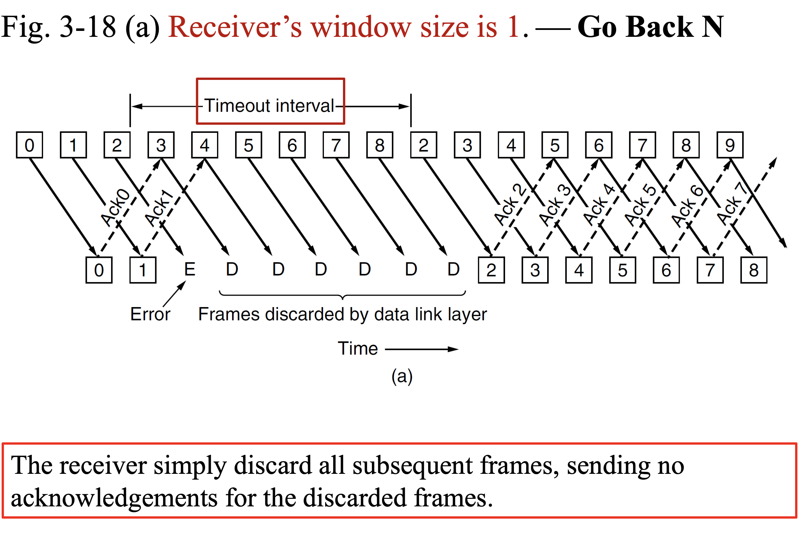

**优点**：

- **接收方逻辑简单**：接收方不需要缓存任何失序的帧，实现起来非常简单，对内存要求低。

**缺点**：

- **效率低下**：当网络误码率高或延迟大时，一个单独的丢包就会导致大量本已成功到达的帧被重传，这极大地浪费了网络带宽。

---

!!! warning "**考虑 GBN 中 seq 段 bit 数和 N 的关系**"

    - 如果 **seq** 的取值为 `0~MAX_SEQ`，即共有 1 + MAX_SEQ = $2^\text{size_in_bit}$(seq) 种取值，**那么 N 最大为 MAX_SEQ 而不能是 1 + MAX_SEQ**。
    
    - 考虑这样的一个情况。假如 MAX_SEQ 是 7，而 N (i.e. sending window size) 是 8；发送方一次性发出了 0~7 这 8 个帧，此时，如果发送方再次收到一个对7号帧的确认，就会产生歧义。发送方无法判断这个确认是指第一批的7号帧（说明第二批所有帧都丢失了），还是指第二批的7号帧（说明第二批所有帧都成功到达）。

??? note "Example"

    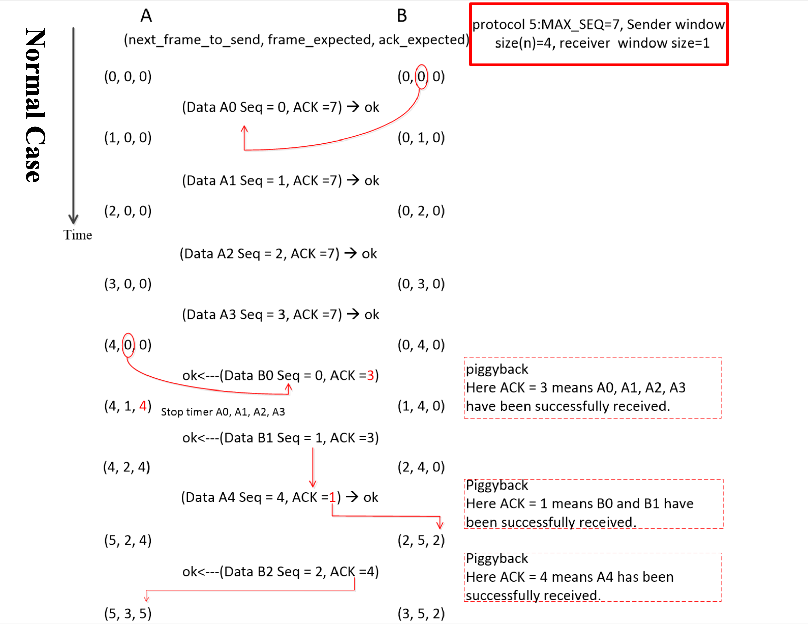

    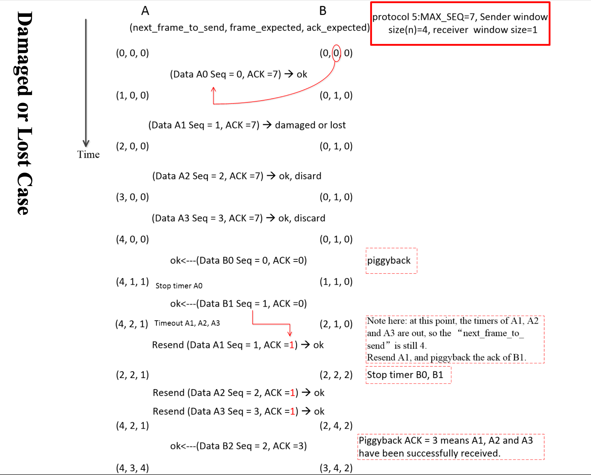

##### 选择重传协议（Selective Repeat, SR）

- **发送方**：可以连续发送最多 $W_s$（发送窗口大小）个帧。它为**每一个已发送但未确认的帧**都维护一个独立的**计时器**。

- **接收方**：只按顺序接收帧。它的接收窗口大小$W_r$通常与$W_s$相同。

- 它会接收并**缓存**所有落在其接收窗口内的帧，无论它们是否按顺序到达。

- 对于每一个成功接收的帧，它都会发送一个独立的确认（例如，收到5号就发 ACK 5，收到7号就发 ACK 7）。

- 当它收齐了一段连续的帧后（比如收到了缺失的4号，而5、6、7号已在缓存中），它会将这一整批数据（4, 5, 6, 7）按顺序提交给上层，并向前滑动窗口。

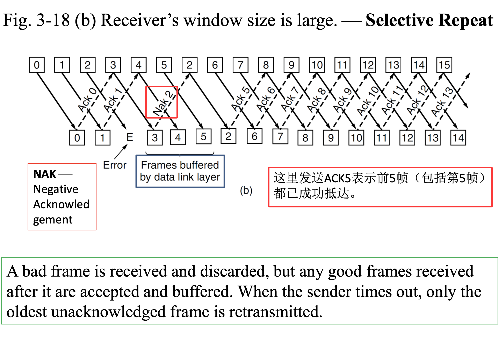

!!! warning "**考虑 SR 中 seq 段 bit 数和 接收窗口大小 的关系**"

    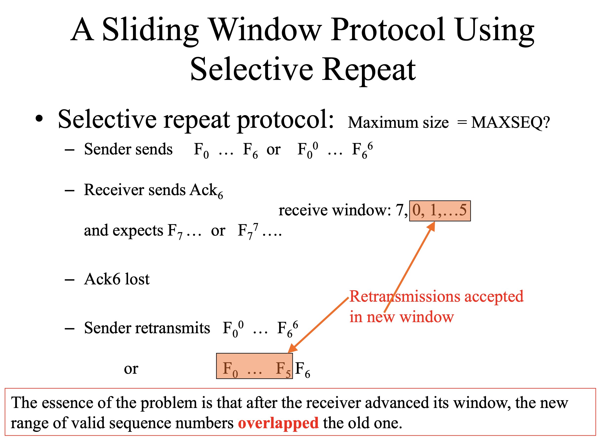

    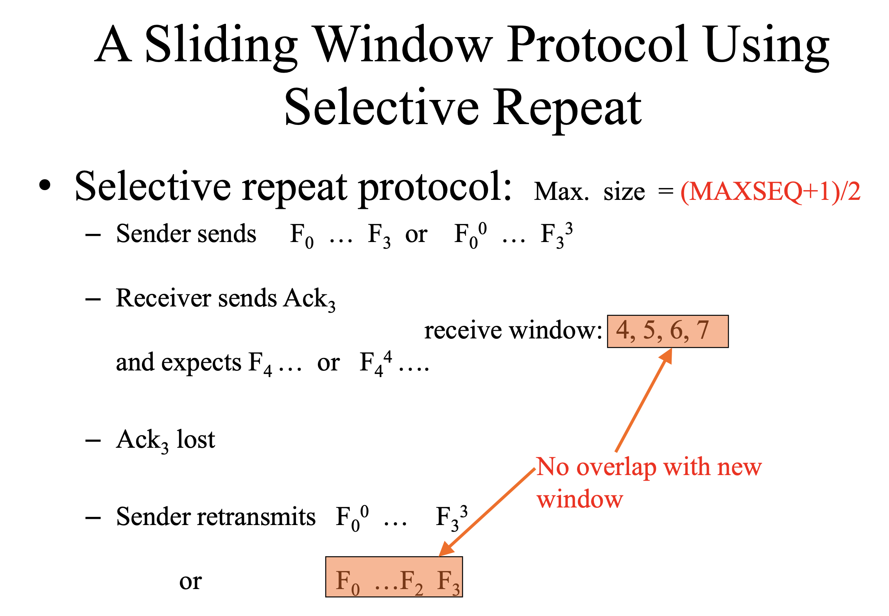

    -    选择重传协议需要保证接收方**移动窗口前后的序号没有重叠**，因此接收窗口的大小不能大于 **(MAX_SEQ + 1) / 2**。一般来说，选择重传协议的接收窗口和发送窗口的大小是一样的。

---

??? tip "例题--**重要**"
    
    - Consider an error-free **64-kbps** satellite channel used to send **512-byte** data frames in one direction, with very short acknowledgements coming back the other way. What is the maximum throughput for **window sizes of 1, 7, 15**? The earth-satellite propagation time is 270 msec. (give your answer as an integer)

    ??? note "答案"

        - 先说公式 $吞吐量 = \frac{成功发送的数据量}{所花费的总时间}$

        - 对于滑动窗口这个场景，当$W$过小时，会出现一个状况，就是**传输数据的总时间小于第一帧ACK的propogation time**，也就使得所花费的总时间里其实很多时候都**空闲**着，并没有在传输数据，而是在等待ACK的到来；

        - 于是我们定义一个**协议周期**：从发送方开始发送第 1 帧，到它收到第 1 帧的确认 (ACK) 所经过的总时间 = RTT + $t_\text{trans}$

        - 而这个邻接的窗口值也很好算，就是 $W_o = \frac{协议周期时间}{一帧所花费的时间}$

        - 当 $W < W_o$时，总时间永远是 第一帧的传输时间 + RTT

        - 当 $W \geq W_o$时，总时间就是 所有帧的传输时间，不过也没有必要了，这个时候肯定已经是**带宽上限**了 

        - 那么这个题， $RTT = 2 \times 0.270s = 0.540s$，$t_\text{trans} = 4096\text{ bits} / 64000 \text{ bps} = 0.064s$，$总周期 = 0.540s + 0.064s = 0.604s$

        - $W_o = 0.604s / 0.064s = 9.4375$

        - 所以，当W=1时，$\text{Troughput} = \frac{4096\text{bits}}{0.604s} = 6780\text{bps}$；当W=7时，$\text{Troughput} = \frac{7\times 4096\text{bits}}{0.604s} = 47470\text{bps}$；当W=15时，就是带宽上限64000

#### 总结

- Stop-and-Wait, Go-Back-N, Selective Repeat 统称为**自动重传请求 (ARQ) 协议**。

- 它们的核心目标是在**“不可靠”的物理链路上实现“可靠的”数据帧传输**。

- 在早期的网络中（例如使用同轴电缆、电话线拨号、卫星链路），物理链路（第 1 层）本身是极其不可靠的，比特错误率（BER）非常高。

    - **场景**： 想象一下您在用电话线拨号（Modem）。

    - **问题**： 电话线噪音很大，数据帧（L2）在从 A 传到 B 的过程中很容易出错（FCS 校验失败）。

    - **L2 的责任**： 如果 L2 不管，直接把坏的、丢的帧扔掉，那么上层（比如 L4 的 TCP）会发现大量数据丢失，这会触发 TCP 大规模的重传，导致整个网络性能崩溃。

    - **L2 的解决方案**： 就在 L2，在这一跳（Hop-by-Hop）上，我们必须确保数据帧可靠地从 A 传到了 B。

        - **Stop-and-Wait**：A 发 1 帧，等 B 回复 L2 的 ACK。

        - **Go-Back-N / Selective Repeat**：为了提高效率，A 一次发 N 帧（滑动窗口），B 批量确认。

- 结论： 在那些**“物理层不可靠”**的时代，L2 必须承担起**“可靠传输 + 流量控制 + 错误恢复”**的重任。像 HDLC、LLC Type 2（我们之前讨论过）这样的经典 L2 协议，就内置了 GBN 或 SR 这样的滑动窗口机制。

??? tip "现代“有线以太网” (Wired Ethernet) 发生了什么变化？"

    在**现代有线局域网**（您办公室或家里的网线）中，情况完全变了：

    1. L1 变得极其可靠： 光纤和高质量的双绞线（Cat6/7）的误码率低到可以忽略不计。

    2. L2 变得“偷懒”了 (End-to-End Principle)：

        - 网络设计者们意识到：“既然 L1 这么可靠，L2 何必再辛辛苦苦地为每一帧都做确认、重传、排序呢？这太浪费交换机和网卡的 CPU 了！”

        - 我们不如在 L2 奉行“快速失败”(Fail Fast) 原则：

        - 交换机收到一个帧，检查 FCS（MAC 层的错误校验）。

        - 如果帧是坏的，**L2 直接把它丢弃**。

        - **L2 不会发 NAK，也不会请求重传**。

    - 那谁来负责可靠性？ 我们把这个工作完全上交给了第 4 层 (L4) 的 TCP。

    - TCP 在**端到端**（比如您的浏览器和 Web 服务器之间）维护一个滑动窗口（它也使用 GBN/SR 的变种算法！），如果它发现数据包丢了，它会负责重传。

    - 虽然 L2 放弃了“可靠性”的活，但它没法放弃“流量控制”。

        - IEEE 802.3x (PAUSE 帧)：

        - 这不是 GBN 或 SR，它简单粗暴得多。

        - 当交换机（接收方）的缓冲区快满时，它会向服务器（发送方）发一个特殊的 PAUSE 帧（这是一个 MAC 层的帧）。

        - 服务器网卡（的 MAC 芯片）收到这个 PAUSE 帧，会立即在硬件层面暂停发送数据，直到 PAUSE 帧指定的时间过去。

!!! "现代WIFI更常用"

    Wi-Fi (IEEE 802.11) 是一个特例！ 它的行为更像“经典 L2”。

    **L1 (空气) 可靠吗？ 绝对不可靠！**

    原因： 信号干扰、遮挡、距离、多个设备冲突 (Collision)。

    **L2 的解决方案：**

    - Wi-Fi (的 MAC 层) 不能像有线 L2 那样“偷懒”。如果它偷懒，那 TCP 会因为 L1 的**高丢包率**而误以为网络“极度拥堵”，从而把速度降到几乎为 0。

    - 因此，Wi-Fi 在 L2 使用 **CSMA/CA（带冲突避免）**，并且强制要求：

    - “发送方每发一个数据帧，接收方必须立即回复一个 L2 的 ACK 帧。”

    - 如果发送方（比如您的笔记本）在规定时间内没收到 AP 发来的 L2 ACK，它会认为这一帧丢失了（可能因为冲突），它会立即在 L2 重传。

    - 这本质上就是一个 Stop-and-Wait (停止-等待) 协议！

### 点对点传输协议实例

#### HDLC

- **高级数据链路控制 HDLC, High-Level Data Link Control**，HDLC 是一种 bit-oriented protocol，使用全双工通信；有顺序编号和校验，传输可靠性高。其帧结构如下图

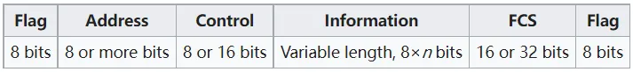

- 每个帧的**开始和结束用序列 01111110 (0x7E) 标识**。同时发送方的数据链路层在数据中每发现**连续的 5 个 1，发送时就在其后面添加一个 0**；接收方的数据链路层在发现 111110 时将最后一个 0 舍弃。这样整个帧中只会有头和尾的 FLAG 有 01111110 这样的序列了。当链路上没有需要传输的内容时，HDLC 也会通过不断发送形式为 01111110 的帧以保持双方的同步。（实际上，HDLC 最开始是作为 SDLC, Synchronous Data Link Control 被提出的。）

#### PPP（Point-to-Point Protocol）

- PPP是一个标准的数据链路层协议，用于在点对点链路上封装和传输网络层数据包。它被设计得非常灵活，可以在多种物理层上传输多种网络层协议的数据包。

- PPP 是一种 byte-oriented protocol。HDLC 提供了可靠的数据传输；而 PPP 通常不编号、提供一种**无连接无确认**的服务。 

- PPP 协议有 3 个组成部分：

1. 一种成帧方法。

2. **链路控制协议 LCP, Link Control Protocol**，用于启动、测试、配置（协商参数）、关闭链路。

3. **网络控制协议 NCP, Network Control Protocol**。PPP 是由 SLIP 发展而来的；SLIP 的问题在于它只能用于传送 IP Packet；PPP 则支持对于网络层运行其他协议以及两端网络层运行的协议不同的情况下仍使用 PPP 进行传输。对于每一个支持的网路层协议，都有一个相应的 NCP 进行配置。其帧结构如下：

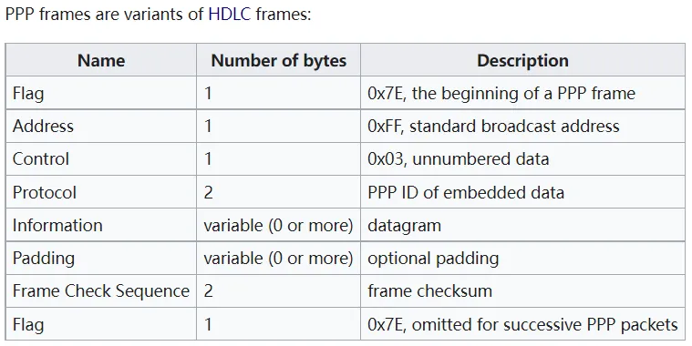

- 前后的 FLAG 都沿用 HDLC 的 `0x7E`，但填充方式有所不同。PPP 是 byte-oriented 的，因此使用 **byte stuffing**。在数据中**发现的 0x7E 将被替换为 0x7D 0x5E** 两个字节；而 0x7D 将被替换为 0x7D 0x5D。这样可以保证唯一出现 0x7E 的地方就是帧的开始和结束。

- Address 段始终为 0xFF，表示广播，即所有计算机都接收；Control 的值为 0x03，表示这是一个无编号帧；由于这两个字段的值始终为定值，因此可以通过 LCP 协商省略这两个字段。

- Protocol 包含关于 LCP 和 NCP 的信息，默认 2 byte，但是可以通过 LCP 协商为 1 byte；Information 的默认长度是 1500 byte，但是也可以通过 LCP 协商，可能利用 Padding 进行填充以满足长度要求；Frame Check Sequence 默认 2 byte，但是也可以协商使用 4 byte，也是 CRC。

- **Internet使用PPP作为点到点线路上的主要数据链路协议。PPP协议提供了无连接的无确认服务，使用标志字节区分帧的边界，至于错误检测采用CRC。该协议通常被用在运载数据包的一系列链路上，包括广域网中的SONET链路和家庭ADSL链路**