# MAC | 介质访问控制子层

- 前面讨论的协议都是针对**点对点连接**的，但是在如LAN这样的场景下，我们通常需要使用到**广播信道（broadcast channels）**，广播信道也称为**多路访问信道（multiaccess channels）**或者**随机访问信道（random access channels）**

- 对于广播信道，最关键的问题就在于当多方争用这个信道时，决定到底谁可以使用信道，从而让他们都成功发送信息。用来确定下一个使用者的协议，属于Link Layer的一个子层，**介质控制访问子层（MAC, Medium Access Control Sublayer）**

- OSI七层模型将Data Link Layer分成了上下两个子层：LLC(logical link control)和MAC

|Service|Sublayer|
|------|--------|
|**流量控制 Flow Control**| LLC or DLC|
|**成帧 Framing**|MAC|
|**物理寻址 Physical Addressing**| MAC|
|**错误检测 Error Control**|MAC|
|**介质访问控制 Access Control**|MAC|

## 广播信道传输协议

### static FDM/TDM

- 静态的FDM/TDM，是不好的，因为有很多浪费，而且灵活性差

### ALOHA

#### Pure ALOHA

- 基本思想很简单：每个用户有数据需要发送的时候就直接传输。问题在于，当两个用户的发送的信号重叠时（**冲突 collision**），就会导致冲突帧损坏。

- ALOHA就要求发送方可以知道自己所发送的信号是否冲突，而这种采用了**可能引起冲突**的**共享信道**方法的系统称为**竞争系统（contention system）**

- 当发送方侦测到冲突、收到一个 NAK 或者一段时间没有收到回复时，它在等待一段 **随机** 时间后再次发送该帧。如果等待时间不是随机的，那么发生冲突的帧会一次又一次发生冲突。

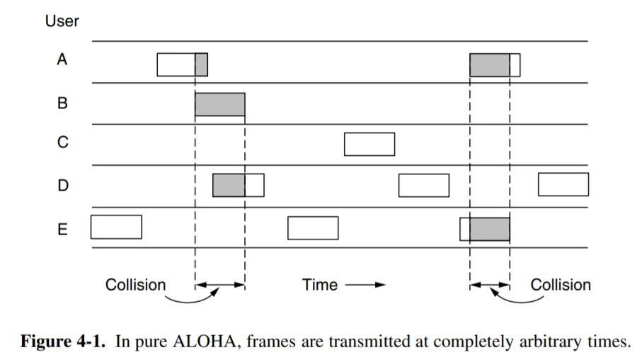

- 最好情况下，Pure ALOHA 的信道利用率期望约为 1/2e ≈ 18%，这是很低的。

#### Slotted ALOHA

- 在这种优化了的协议中，时间被分成了**离散的 slot**，用户只能在每个 slot 的开始时刻才能发送帧。每次传输帧的用时**必须小于或等于一个 slot 的长度**。

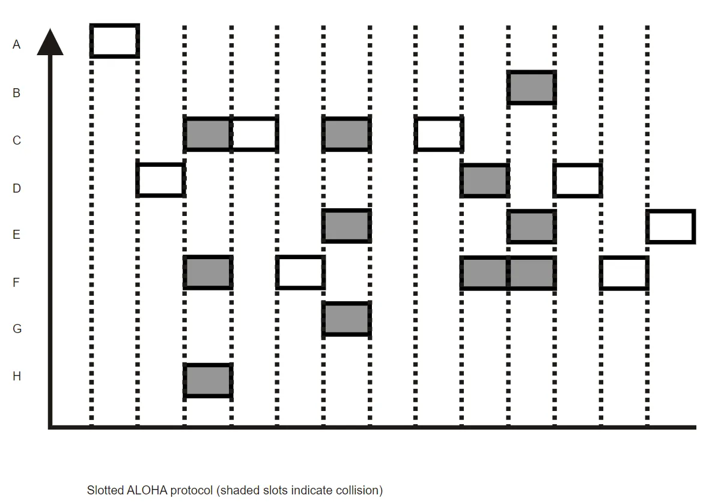

- 这种方式可以达到的最佳利用率是 1/e ≈ 36%。

### 载波侦听多路访问 CSMA

> ALOHA明显有一个可以优化的地方：我在传输帧之前，完全可以先听一下有没有其他人再发，这就是CSMA（Carrier Sense Multiple Access）的思想

#### 1-persistent CSMA

- 每个站点需要发送数据时，首先侦听信道：如果信道**空闲则立即发送数据**；如果信道忙，则**不断侦听**直至信道空闲时发送数据。如果冲突（比如一段时间内没收到 ACK 或者收到了 NAK），则随机等待一段时间后重复上述策略。

- 这个方式的问题在于：

1. 如果信道忙时两个站点**同时侦听**，信道空闲的时候两个信道就会同时试图发送，从而出现冲突

2. 我们还需要考虑信道上的**传播延时**：如果 A 已经开始发送数据，但是数据暂时没有传播到 B，此时 B 侦听到的信道是空闲并开始发送数据，也会引起冲突。

#### nonpersistent CSMA

- 这种方式的关键区别是：如果侦听到信道忙，则放弃侦听，**等待一段随机时长**后再进行侦听，直到侦听到信道空闲并成功发送。

#### p-persistent CSMA

- 这种方式用于 slotted channels。当站点需要发送数据时侦听信道：如果信道忙，**到下一个 slot 再侦听**；如果信道空闲，则**以 p 的概率发送数据，以 1-p 的概率到下一个 slot 再侦听**。

#### CSMA/CD

- **CSMA with Collision Detection**，前述几种 CSMA 对**冲突**的发现都是**通过确认帧**进行的，对于链路过长的情况，等待的时间可能较长。

- 所以，我们**不断侦听信道以检测冲突**，这要求**返回的信号不能比发出的信号弱太多**（如无线传输就不行），而且冲突必须在发送过程中就可以被检查到。如果一个站检测到冲突，它会立即停止传输，并等待一个随机时间后再尝试发送。

!!! tip "考察冲突检查花费的最长可能时间"

    - 在 CDMA 中，冲突的可能性是某个站开始发送前进行侦听时，另一个站虽然已经开始发送，但是信号尚未传播到这个站。
    
    - 因此如果最远的两个站之间传播用时是 t，那么一个站发送后 0~t 秒内冲突才有可能会发生；而这个冲突会花费同样多的时间传播回去。也就是说，如果一个站发送信息后 **2t** 时间仍然没有侦测到冲突，那么它发送的这一帧就不再可能出现冲突了。

    - 那么为了很好地运用这个特性，那么我们在0~2t时间内**只能发一个帧**，这样就可以精确知道谁出错了，**不然这个时间段有多个帧的话不知道重发谁**

    - 那么我们的传输时间$t_{\text{trans}} = \frac{F}{BW} \geq RTT$就可以实现这个要求

### 无冲突协议

- **无冲突协议（collision-free protocols）**顾名思义，按照这种协议规定的多路传输可以直接避免冲突的产生

#### 基本位图协议 Basic Bit-map

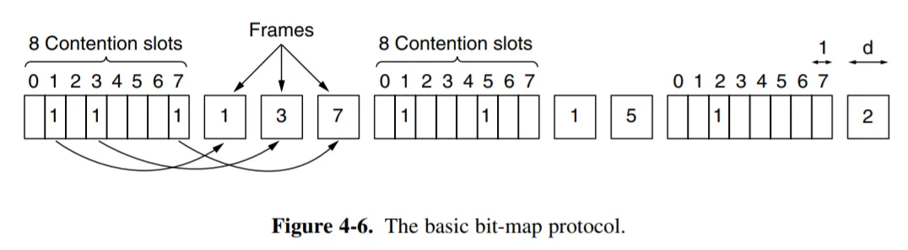

- 上图中，假设有8个站点，那么一开始先广播发送意愿（使用8个时间槽）；然后按照顺序，以此发送各个站点的帧；最后又进入下一个周期

- **基本位图协议（Basic Bit-map Protocol）**，这种在发送数据之前先**广播发送意愿**的协议叫做 **预留协议（reservation protocol）**

#### 令牌环协议 Token Ring

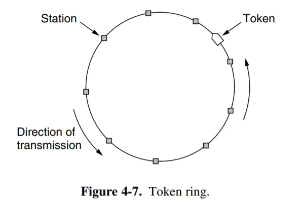

- 以循环的方式，将Token依次传输给下一个站看是否要进行传输；这样就保证了一个时间只会有一个站会传输信息

#### 二进制倒计数协议 Binary Countdown protocol

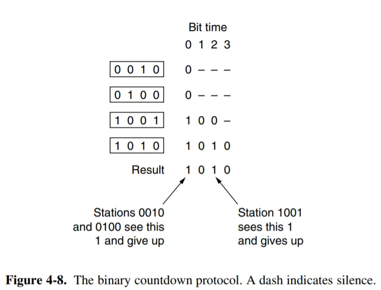

- 这里面是存在优先级的，代表的二进制数越大，优先级也就越高；

- bit time 是按有多少位bit来划分的，从各站的最高位开始，只有置1的站才能吭声；然后result里某一位置1，而某个站那一位不是1的话，说明优先级根本不够（数太小），那么直接放弃后续

### 有限竞争协议 limited-contention protocol

**自适应树遍历协议（The Adaptive Tree Walk Protocol）**，

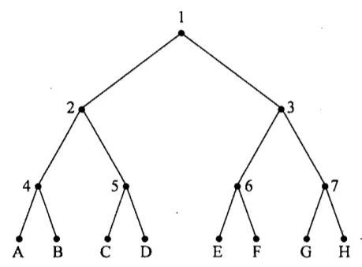

- 就是按照根节点的编号来以此允许站点传输，如果一个节点下有多个站想同时发，那就让编号++，然后再去看对应的子树，直至单个站的叶节点

## 以太网

!!! abstract

    以太网是一种具体的技术标准（由 IEEE 802.3 标准定义）。它规定了如何通过有线方式来构建一个 LAN。

    以太网定义了大量技术细节，涵盖了 OSI 模型的第 1 层和第 2 层：

    **第 1 层 (物理层)**：

    - **线缆类型**： 规定了使用什么线缆，例如我们现在最常用的双绞线（带 RJ45 水晶头）或光纤。

    - **信号标准**： 规定了如何在线缆上用电子信号（或光信号）来表示“0”和“1”。

    - **接口规格**： 比如我们电脑上的“网口”（RJ45 接口）的物理形态和引脚定义。

    **第 2 层 (数据链路层)**：

    - **MAC 地址**： 规定了每个设备都必须有一个全球唯一的“物理地址”（MAC 地址），就像设备的身份证号。

    - **数据帧 (Frame)**： 定义了数据的“信封”格式。一个以太网帧包括目标 MAC 地址、源 MAC 地址、要传输的数据（例如一个 IP 包）和错误校验码。

    - **访问控制**： 定义了设备如何访问网络介质（在“经典以太网”中是 CSMA/CD，在现代交换式网络中是全双工通信）。

### 经典以太网 Classic Ethernet

- 一个10Mbps的以太网标准在1978年被制定出来，称为DIX standard；在1983年被修订为IEEE 802.3标准

- 它的核心特征是：

1. **共享介质 (Shared Medium)**： 无论是使用**粗同轴电缆（总线型）**还是使用**集线器（星型）**，网络上的所有设备都连接到同一个共享的通信“通道”上。

2. **CSMA/CD 协议**

3. **单一冲突域 (Collision Domain)**： 因为所有设备共享介质，所以整个网络（连接到同一集线器或同一根电缆）构成一个**冲突域**。任何时候，**只能有一个设备**在发送数据。

#### 物理层

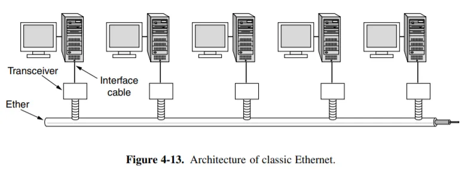

- 上图显示了经典以太网（如 10BASE5）的物理层。以太网的每个版本都有电缆长度的限制；超过这个限制的网络可以用 中继器 repeater 将多条线缆连接起来。但是收发器 transceiver 之间仍然有最大距离 2.5 km 和最大经过中继器数目 4 个的限制。在这些电缆上，信息的发送采用 Manchester 编码。

##### 集线器 Hub

- 集线器是经典以太网中用于连接多台计算机的设备。

- 它的工作方式非常简单甚至“粗暴”：

- 当一个数据帧（包）从集线器的一个**端口**进入时，集线器会简单地将这个信号**放大、再生**，然后将其**复制并广播**到所有其他端口。

    - 它不关心这个数据帧是发给谁的。

    - 它不读取数据帧中的任何地址信息（如 MAC 地址）。

    - 它只是在电子信号层面进行盲目的复制和转发。

- 在集线器出现之前，经典以太网（如 10BASE5）使用的是一根粗长的同轴电缆（总线拓扑），所有计算机都“夹”在这根电缆上。这种方式安装和维护非常困难，电缆任何一处断裂都会导致整个网络瘫痪。

- 集线器引入了**“物理星型，逻辑总线型”**的拓扑：

    - **物理星型 (Physical Star)**：所有计算机都用各自的网线（双绞线）连接到中心的集线器。这使得**添加、移除或排查**单台计算机变得非常容易，**不影响网络其他部分**。

    - **逻辑总线型 (Logical Bus)**：尽管物理上是星型，但由于集线器的**工作原理（向所有端口广播）**，它在逻辑上仍然和一根总线电缆（共享介质）完全一样。所有设备仍然在同一个冲突域中，**共享 10 Mbps 的总带宽**。

??? tip "为什么集线器被淘汰了？"

    1. **性能极差**： **所有设备共享总带宽**。如果一个 8 口集线器连接了 8 台 10 Mbps 的电脑，这 8 台电脑必须共享这 10 Mbps 带宽。

    2. **冲突问题**： 只要有两台设备同时尝试发送数据，就会发生冲突，导致网络延迟和重传，设备越多，性能下降越严重。

    3. **半双工 (Half-duplex)**： 设备在同一时间**只能发送或接收，不能同时进行**。

    4. **安全问题**： 由于所有数据都被**广播到所有端口**，网络上的任何一台计算机都可以轻易地“窃听”到（使用抓包软件）所有其他计算机的通信。

#### 传输协议

- 以太网是无连接的，也并不提供确认，使用 **1-persistent CSMA/CD** 算法进行传输；它通过侦听有没有冲突来判断是否发送成功。如果站侦听到了冲突，则发一个短的冲突加强信号 (short jam signal) 确保另一个发送站也听到了冲突；如果没有侦听到冲突则假设这个帧发送成功。传输过程中发生的错误只会通过校验和检出并由高层负责恢复。

- 根据物理层中我们规范的 2.5km、4 个中继器的最大限制，往返时间 2τ 大约是 50μs；在 10Mbps 的速率下可以发送 500bit。考虑一个安全余量，我们规定最小帧时间为 51.2μs，最小帧长为 512bit，即 64 字节。

!!! tip "避退算法——BEB"

    - 前面我们讨论的 CSMA/CD (经典以太网) 和 CSMA/CA (Wi-Fi)，都只是“访问方法”的框架。但当这个框架失败（即发生冲突）时，二进制指数倒计数 (Binary Exponential Backoff, BEB) 才是那个负责“解决问题”的具体算法。

    - 经典以太网通过 **二进制指数后退 binary exponential backoff** 算法确定每次冲突后的等待时间。

    - 设备从一个时间范围 $C$ 中随机选择一个整数 $k$。这个 $k$ 就是它需要等待的“时间槽” (time slots) 数量。
    
    **“指数”的体现 (关键)**： 

    - 第 1 次冲突 ($n=1$)：$C$ 的范围很小，例如 $C = [0, 1]$ (即 $2^1-1$)。设备随机选 $k=0$ 或 $k=1$。
    
    - 第 2 次冲突 ($n=2$)：如果它们又冲突了，$C$ 的范围会翻倍，变为 $C = [0, 1, 2, 3]$ (即 $2^2-1$)。
    
    - 第 3 次冲突 ($n=3$)：$C$ 的范围再次翻倍，变为 $C = [0, 1, ... , 7]$ (即 $2^3-1$)。
    
    - 第 $n$ 次冲突：$C$ 的范围是 $[0, 2^n-1]$（最大不超过某个上限，例如 $n=10$）。

    - 在上面的例子，我们可以将时间按照 51.2μs 分块；在第 i = **1 ~ 15** 次冲突发生后，站等待 0 ~ $\text{min}((2^i-1), 1023)$ 个时间槽后再次尝试发送；

    - 在发生 **16** 次冲突后，它**放弃发送并给上层返回一个失败报告**；高层协议负责进一步的恢复工作。

    **巧妙之处**:

    - **网络空闲时**： 冲突少 ($n$ 很小)，等待时间范围很短，设备可以快速重传，效率高。
    
    - **网络拥堵时**： 冲突多 ($n$ 很大)，等待时间范围变得非常大，这使得设备们“各自随机等待的时间”撞到一起的概率急剧降低，从而让拥堵的网络恢复稳定。

#### 帧结构

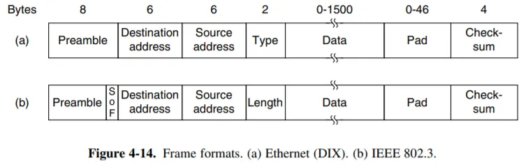

1. **Preamble（前导码）**

- **大小**：7字节(IEEE 802.3)或8字节(DIX)

- **用途**：这是纯粹的物理层 (L1) 字段。它是一串交替的 `10101010`

- **目的**：**时钟同步**；同时 Preamble **不被计算**为是帧的一部分

2. **SOF（Start of Frame Delimiter）**

- **大小**： 1 字节。

- **注意**： 这个字段只在 (b) IEEE 802.3 格式中明确标出。

- **内容**： 它的值是 `10101011`。

- **用途**： 在 7 字节的 Preamble 之后，这个特殊的 11 结尾（打破了 10 的重复）就像一声“预备，开始！”。它明确地告诉接收方的网卡：“同步结束，下一个字节就是帧的正式内容（目的地址）了。”

- 在 (a) DIX 格式中呢？ DIX 格式的 8 字节 Preamble 实际上是把 7 字节 Preamble 和 1 字节 SOF **合并在一起**计算了。它的**最后 1 字节也是 `10101011`**。所以它们在物理层的功能是完全一样的。

3. **Destination Address（目标地址）**

- **大小**： 6 字节 (48 位)。

- **用途**： 存放接收方**网卡（Network Interface Card）**的 MAC 地址。这是 L2（数据链路层）的“收件人地址”。

- **类别**：

    - **单播 (Unicast)**： **第一个bit是 0**，发给网络上某一个特定的设备。

    - **多播 (Multicast)**： **第一个bit是 1**，发给网络上某一组设备。

    - **广播 (Broadcast)**： 发给局域网内的所有设备（地址是 FF:FF:FF:FF:FF:FF）。

4. **Source Address（源地址）**

- 同上

5. **（关键区别）Type / Length 字段**

- 这是 (a) 和 (b) 两种格式的核心区别。它们共享相同的位置，**大小都是 2 字节**。

- (a) 格式：**Type** (类型)

- **标准**： Ethernet II / DIX

- **用途**： 标识上层协议。它告诉接收方的操作系统：“Data 字段里装的是什么？”

- **规则**： 当这个字段的值 > 1536 (即 0x0600) 时，它就被当作 Type 字段。

- **示例**：

    - 0x0800 = IPv4

    - 0x0806 = ARP

    - 0x86DD = IPv6

- **现状**： 现代网络（TCP/IP）的绝对主流。

---

- **(b) 格式：Length (长度)**

- **标准**： IEEE 802.3 (经典)

- **用途**： 标识 Data 字段的长度。它只说明“Data 字段里有多少字节”，但不说明是什么数据。

- **规则**： 当这个字段的值 <= 1500 (即 0x05DC) 时，它就被当作 Length 字段。

- **现状**： 已基本被 (a) 格式取代。

6. **Data (数据)**

- **大小**： 0 - 1500 字节。

- **用途**： 这就是帧的“有效载荷” (Payload)，也就是 L2 真正要传输的东西。

- **内容**： 通常是一个 **L3 的数据包**，例如一个完整的 IP 包（包含 IP 头和 TCP/UDP 头以及应用数据）。

- **1500 的限制**： 这个 1500 字节的最大值，就是我们常说的最大传输单元 (MTU)。

7. **Pad (填充)**

- **大小**： 0 - 46 字节。

- **用途**： 确保以太网帧的最小长度。

- **原因**： 在“经典以太网”（CSMA/CD）中，规定一个帧（从目的地址到 Checksum）最小必须有 64 字节。

    - 为什么？这是为了确保在最坏情况下（网络两端的设备同时发送），冲突信号也能在发送方发完最短帧之前传回，从而能被“检测”到。

- **计算**：

    - L2 头部 (14 字节) + Checksum (4 字节) = 18 字节。

    - 64 (最小帧长) - 18 = 46 字节。

    - 这意味着，如果 Data 字段的数据少于 46 字节，就必须在 Data 字段后面填充 (Pad) 一些无意义的数据（通常是 0），直到 Data + Pad 凑够 46 字节为止。

    - 如果 Data 字段本身就大于或等于 46 字节，那么 Pad 字段的大小就是 0。

8. **Checksum (校验和)**

- **大小**： 4 字节 (32 位)。

- **现代名称**： FCS (Frame Check Sequence, 帧校验序列)。

- **用途**： 错误检测。

- **如何工作**：

    1. 发送方： 对**“目的地址”到“Pad”**之间的所有数据运行一个 **CRC (循环冗余校验) 算法**，得到一个 4 字节的 FCS 值，附在帧的末尾。

    2. 接收方： 收到帧后，对相同的数据（目的地址到 Pad）运行完全相同的 CRC 算法。

    3. 对比： **比较自己算出的 FCS 和接收到的 FCS**。

    - 如果一致，说明数据在 L1 传输过程中没有出错，帧被接收。

    - 如果不一致，说明数据在网线上传输时被（如电磁干扰）破坏了。L2 会直接、静默地丢弃这个帧（它不会请求重传，重传是 L4/TCP 的工作）。

---

#### 简单分类

- 10Base2, 10Base5 用的是同轴电缆；Base 指基带传输，前面的数字表示是多少 Mbps（除了 10GBaseT 这样的表示 10Gbps）；*BaseT* 或者 *BaseC*（比如 100BaseT4, 1000BaseCX）差不多都是双绞线；其他的差不多都是光纤

### 网桥

> **网桥 (Bridge) 是一个工作在 OSI 第 2 层（数据链路层）的设备。它通过读取和学习 MAC 地址，智能地在两个或多个局域网 (LAN) 网段之间有选择地转发数据帧。**

#### 引入

- 在原来使用**集线器**的以太网中，逻辑上由于是**总线型**的，使得所有电脑构成了一个巨大的冲突域；而网桥的发明，就是为了**分割冲突域**；

#### 工作原理

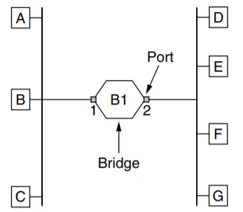

??? tip "什么是网卡的混杂模式"

    - 默认情况下，我们的网卡运行在普通模式（normal mode）下，此时网卡只关心发送给**自己MAC地址**的数据帧，如果目标地址不是自己的MAC地址，则会在硬件层面上直接被丢弃

    - **混杂模式（promiscuous mode）**，在这个模式下，网卡**会捕获网线上看到的每一个数据帧，无论它是发给谁的**；wireshark在抓包的时候，就是把网卡设置成了混杂模式

    - **它和网桥的关系**：**网桥的每一个端口都必须默认运行在混杂模式下**。 如果网桥端口只接收发给它自己的帧，它就永远无法“偷听”到其他电脑的通信，也就永远无法“学习”到 MAC 地址表。混杂模式是网桥实现“反向学习”的前提。

网桥的工作逻辑（也称为**透明网桥**）包括三个关键步骤：

1. **反向学习（backward learning）**：

- 网桥有一个哈希表，也就是**MAC地址表**；

- 例如，当它从 **端口1** 收到一个帧（来自电脑A1），它会查看**源MAC地址**，然后在MAC地址表上记录下`{MAC_A1, Port_1}`

2. **过滤/隔离（Filtering / Isolation）**：

- 这是网桥**最重要**的功能

- 例如，电脑 A1 (在端口 1) 向电脑 A2 (也在端口 1) 发送一个帧。网桥在端口 1 收到这个帧，查看“目标 MAC 地址”(A2)。网桥查表，发现 MAC_A2 也在端口 1。

- **决定**： 网桥会**丢弃**这个帧，不会将它转发到端口 2。

- **结果**： 办公室 A 的内部通信，被完全**“隔离”**在本地，根本不会占用办公室 B 的网络带宽，也不会与 B 发生冲突。

3. **转发（Forwading）**：

- 电脑 A1 (在端口 1) 向电脑 B1 (在端口 2) 发送一个帧。网桥在端口 1 收到这个帧，查看“目标 MAC 地址”(B1)。网桥查表，发现 MAC_B1 在端口 2。

- **决定**： 网桥将这个帧仅仅转发到端口 2。

- **结果**： 实现了**跨网段通信**。

- 两种转发模式：**cut-through, store-and-forward**

4. **泛洪算法（Flooding Algorithm）**：

- 这是网桥不知道转发端口时的**默认转发决策**，这使得数据帧能送达目的地，哪怕网桥还不知道目的地在哪里。

- **触发时机**：

    - **未知单播 (Unknown Unicast)**： 网桥在 MAC 地址表里查不到 MAC_B 的记录。

    - **广播 (Broadcast)**： 目标 MAC 地址是 `FF:FF:FF:FF:FF:FF`（例如 ARP 请求）。

- **Flooding 动作**：网桥将这个数据帧复制，并向除了它进来的那个端口之外的**所有其他端口**发送出去。

#### 老化机制

- 在上面的反向学习中，有一个潜在问题：**如果MAC地址表只进不出，它很快就会被过时的、无效的信息填满**

- 当电脑关机或者移动的时候，都会使得MAC地址表里的原信息无效，因此我们需要一个**老化机制（Aging Mechanism）**来确保MAC地址表始终保持**最新、准确，能够动态适应网络拓扑的变化**

**1. 启动计时器**： 当网桥学习到一条记录（如 `{MAC_A, P1}`）时，它会为该条目启动一个**“老化计时器”**（Aging Timer），例如 300 秒（5 分钟）。

**2. 刷新计时器**： 之后，每当网桥再次从 P1 收到来自 MAC_A 的帧时，它都会重置（刷新）`{MAC_A, P1}` 条目的计时器，让它重新倒数 300 秒。

**3. 清除条目**： 如果电脑 A 关机或被移走，网桥将不再收到来自 P1 的 MAC_A 帧。它的计时器不会被刷新。当 300 秒**倒计时结束**后，网桥会**自动清除（Purge）这条“过时”的记录**。

#### 两种转发模式

- 下面介绍的是两种网桥/交换机的转发模式，其中**存储转发（Store-and-Forward）**更是现代交换机的首先转发模式

##### 直通式交换 Cut-Through

- **直通式交换（Cut-Through）**，它追求的是**极致的速度和最低的延迟**。

**工作方式：**

1. 当数据帧进入交换机端口时，交换机**不等待接受完整个帧**

2. 它只读取**帧的前 6 个字节（即目标MAC地址）**

3. 立即用这个MAC地址去查表

4. 在**帧的其余部分（Data, FCS）还在进入**，

**优点：**

- **极低的延迟 (Latency)**。 因为交换机几乎没有“处理”时间，延迟只有几微秒。这对于金融交易、高性能计算等对延迟极度敏感的应用至关重要。

**缺点：**

1. **会转发“坏帧”**。 交换机因为“赶时间”，它**没有等到帧的末尾去检查 FCS (Checksum)**。如果这个帧在物理传输中已经损坏了，Cut-Through 交换机照样会把这个“坏帧”转发出去，导致错误在网络中传播。

2. **不能连接不同速度的端口**

##### 存储转发 Store-and-Forward

**工作方式：**

1. 一个数据帧开始进入交换机端口。**交换机必须将整个、完整的帧（从 MAC 头到 FCS）全部接收完毕。**

2. 它将这整个帧先存放在其内部的**“缓存” (Buffer)** 中。

3. 在缓存中，它会做两件事： a. 检查帧末尾的 **FCS (Checksum)**，如果帧是坏的，立即丢弃，不会转发。 b. 查看**“目的 MAC 地址”**并查表，决定从哪个口转发。

4. 将完好的帧从正确的出口发送出去。

**优点**：

1. **错误检测 (不转发坏帧)**

2. **速率适配 (连接不同速度端口)**

**缺点**：

- 延迟较高

---

??? tip "**拥塞（Congestion）**"

    - 当数据**进入**交换机某个出口（Egress Port）的速率，**大于**这个出口转发**出去**的速率时，拥塞就发生了。

    - 对于Store-and-Forward转发模式，拥塞时的表现就是**缓存耗尽**；例如，它会把 P1, P2, P3, P4 来的帧全部存入缓存 (Buffer)，然后尽力以 1Gbps 的速度从 P5 发出去。很快，P5 的出口缓存就会被填满。一旦填满，新来的帧就会被丢弃(Drop)。

#### 冗余链路与广播风暴

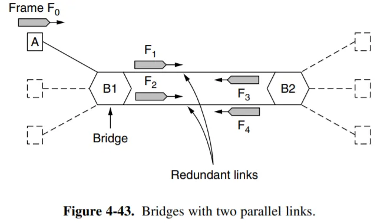

- **冗余链路 (Redundant Links)** 指的是在网络设备（最常见的就是交换机）之间，提供了多于一条的物理连接路径。它是一种为了**提高网络可靠性 (Reliability)** 而故意进行的设计。

- 但是由于反向学习和泛洪的存在，导致冗余链路可能出现一个**广播风暴**的灾难场景

**广播风暴**：(结合上图)

1. A发送一个帧(F0)（假设是广播，或者是两个交换机没有学习过的MAC地址）

2. B1收到F0，根据泛洪原则，B1将F0复制并从所有其他端口发出；于是一份F1，一份F2，都发往B2

3. 而B2处理F1和F2时也是同样的泛洪，一份变成F3，一份变成F4，发给B1；

4. B1收到F3和F4又会继续泛洪...

- 最终后果就是这些帧会在这两台交换机之间以**指数级增长并无限循环，瞬间吃掉 100% 的网络带宽和交换机 CPU**。同时**MAC地址表也会不稳定，完全错乱**

---

##### 解决方案：生成树算法

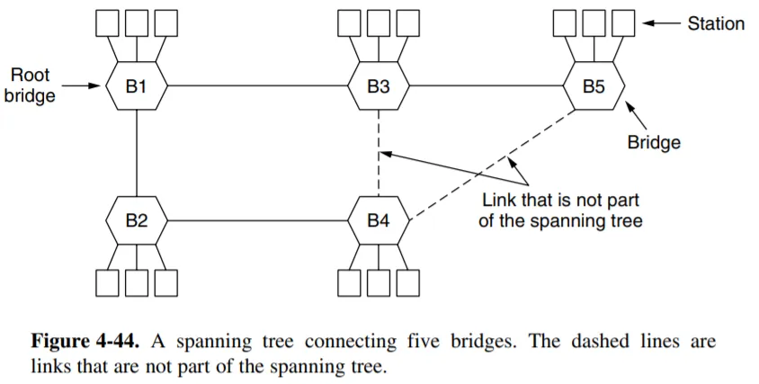

- 每个网桥周期性地从它的所有端口广播一个配置信息 configuration message，同时处理来自其他网桥的信息。这些信息不会被转发。

- 首先，全体网桥必须选择一个网桥作为生成树的根。这一选择是通过在自己的配置消息中包含一个**基于 MAC 地址的标识符**；网桥选择具有**最低标识符的网桥作为生成树的根**；通过足够的消息交换，所有网桥都将同意这个根。

- 下面，我们选择**所有与根直接连接的网桥，它们到根的最短路径都是一跳**。此后，我们每次选择上一次选出的网桥通过一跳可以到达的**未被选中的所有网桥**，直到全部网桥都被选中。

- 如果过程中**两个或多个网桥**都试图扩展到一个新的网桥，那么其中**标识符最低的那个网桥获得这个新的网桥的扩展权**。在过程中，网桥在它们的配置信息中还会包括与根的距离。每个网桥记住它找到的到根的最短路径，然后关闭不属于这条路径的端口。

- 比如在上图中，我们选择B1作为根桥，然后连接B2和B3；之后B2欲连接B4，B3欲连接B4和B5，两者竞争B4的时候选择标识符较小的B2，最后所有网桥都连接到了一起，那么B4到B5也就是冗余的链路

- **整个生成树算法会在网络正常运作期间持续进行，以自动检查拓扑结构的变化，更新生成树**

#### 交换式以太网

- 交换机是现代网桥的另一个称呼，它是交换式以太网的核心。现在的以太网交换机都是**全双工、点对点的，因此冲突不可能发生**，也不再需要**CSMA/CD**算法了。

### VLAN

- 之前我们为了将LAN连接在一起，采用了网桥；但是处于安全性以及功能划分的考虑，我们还是希望对于连接在一起的多个LAN，再进行一个逻辑上的隔离划分，实现一个物理上相连但是逻辑上隔离的效果；而实现这个功能的技术就是VLAN

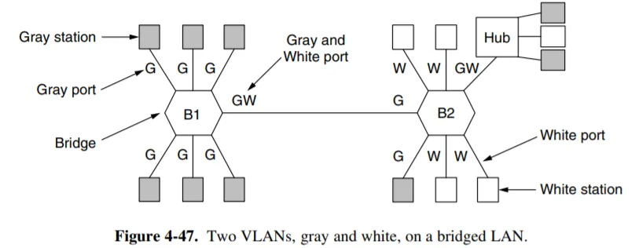

- 例如上图中，有白色W和灰色G两个VLAN。G和G通信，W和W通信，那么为了使交换机更好地进行复杂准确的转发，帧结构因而被拓展

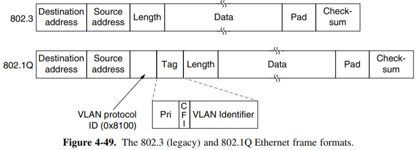

1. **VLAN protocol ID (0x8100)**： 这是一个特殊的“类型”值。它告诉接收方：“注意！这不是一个普通的帧，它是一个 802.1Q 标记帧！”

2. **Pri (Priority)**： 3 位，用于服务质量 (QoS)，标记数据包的优先级。

3. **CFI**： 1 位，已基本弃用。

4. **VLAN Identifier (VLAN ID)**： 这是最关键的 12 位。它明确地**标记了这个帧属于哪个 VLAN**（例如，10）。

#### Access vs. Trunk

- **Access** 和 **Trunk** 是现代交换机（VLAN）配置中最基本的两个端口模式。

1. **Access Mode**

    - 是**“接入”模式**。它是一个“普通房门”，专门用于连接**终端设备**（如 PC、打印机）。

    - **核心规则：只属于一个 VLAN (PVID)**

    - 当配置一个 Access 端口时，必须为它**指定一个且只有一个 VLAN ID**。例如，将端口 1-8 设置为 "Access Mode, VLAN 10"。

    **入站 (Ingress) - 从 PC 到交换机**：

    - PC 不知道什么是 VLAN，它只会发送**标准的 DIX 帧** (未标记的)。

    - 当 Access 端口（属于 VLAN 10）收到这个未标记的帧时，它会立刻为这个帧贴上一个 802.1Q 标签，上面写着 VLAN 10。

    - 然后，这个“已标记”的帧才能在交换机内部流转。

    **出站 (Egress) - 从交换机到 PC**：

    - 交换机内部有一个“已标记 (VLAN 10)”的帧要发给您的 PC。

    - 当这个帧准备从 Access 端口（属于 VLAN 10）离开时，该端口会检查标签（"哦，是VLAN 10，是我的人"）。

    - 然后，它会**剥离 (Remove) 掉标签**，将一个标准、干净的 DIX 帧发给 PC。

2. **Trunk Mode**

    - 是**“中继”模式**。它是一个“大动脉/主干道”，专门用于**连接其他网络设备（如另一台交换机、路由器）**。

    - **核心工作：传递 VLAN 标签**

    - 当数据帧Trunk 链路时，必须有VLAN 标签，以便到达另一台交换机时，接收方交换机知道该送他去哪。

    **出站 (Egress) - 从 交换机 A 到 交换机 B**：

    - 交换机 A 内部有一个来自 VLAN 10 的帧要发往 B。

    - 当这个帧准备从 Trunk 端口离开时，端口不会移除标签。

    - 它会将这个完整的、带 802.1Q 标签 (VLAN 10) 的帧原封不动地发出去。

    **入站 (Ingress) - 从 交换机 B 到 交换机 A**：

    - Trunk 端口收到一个带标签的帧。

    - 它读取标签（"哦，这是 VLAN 10 的"）。

    - 它保留这个标签，然后在交换机内部将它转发给所有属于 VLAN 10 的其他端口（Access 口或 Trunk 口）。

---

!!! tip "如果使用 Trunk Mode 的端口连接终端设备会发生什么？"

    - **答案是：终端设备（PC）将无法正常通信。**

    - 它不认识 802.1Q 标签。如果收到一个带标签的帧，它会因为不认识帧类型 (0x8100) 而直接丢弃。

!!! tip "Native VLAN"

    - 如果 Trunk 端口收到了一个**未标记的帧**（就像 Access 端口收到的那种），该怎么办？

    - Trunk 端口上会配置一个“Native VLAN”（默认为 **VLAN 1**）。

    - 它会假设这个帧属于 Native VLAN，当 Trunk 口需要发送一个属于 Native VLAN 的帧时，它会**不带标签**（Untagged）就发出去。

!!! tip "如果一个交换机和另一台交换机相连的端口，一台配置为trunk mode， 另一台配置为access mode，会发生什么？"

    - **它们之间将无法正常通信，或者会导致灾难性的“VLAN 错位”**。

    **假设一个最常见的场景**：

    - Switch A (交换机 A): 端口 1 配置为 **Trunk Mode**。

        - Native VLAN (本地VLAN) 设置为 1 (默认)。

        - Allowed VLANs (允许的VLAN) 设置为 1, 10, 20。

    - Switch B (交换机 B): 端口 1 配置为 **Access Mode**。它被分配到VLAN 10

    **失败一：从 Trunk (A) 发往 Access (B)**
    
    - 目标： Switch A 上的 VLAN 10 用户，想发数据给 Switch B 上的 VLAN 10 用户。

    - Switch A (Trunk 口) 发送：交换机 A 收到一个内部标记为 VLAN 10 的帧。

    - Trunk 端口的规则是：“这个帧 (VLAN 10) 不是我的 Native VLAN (VLAN 1)。因此，我必须带着 802.1Q 标签 (Tagged) 将它发送出去。”

    - Switch B (Access 口) 接收：交换机 B 的 Access 端口收到了这个帧。

    - Access 端口的规则是：“我只能接收未标记 (Untagged) 的标准以太网帧。这个帧居然带着我不认识的 802.1Q 标签！”

    - 结果：Switch B 认为这是一个无效帧或**“巨型帧”(Baby Giant)**，立即将其丢弃 (Drop)

    **失败二：从 Access (B) 发往 Trunk (A)**

    - 目标： Switch B 上的 VLAN 10 用户，想回数据给 Switch A 上的 VLAN 10 用户。

    - Switch B (Access 口) 发送：交换机 B 收到一个来自 VLAN 10 用户的未标记帧（因为 PC 不懂 VLAN）。

    - 它需要将这个（内部已标记为 VLAN 10）的帧从 Access 端口发往 A。

    - Access 端口的规则是：“我是一个 Access, VLAN 10 端口。我必须在发送时移除所有标签 (Strip Tag)，只发送一个未标记 (Untagged) 的标准帧。”

    - Switch A (Trunk 口) 接收：交换机 A 的 Trunk 端口收到了这个未标记的帧。

    - Trunk 端口的规则是：“我收到了一个未标记的帧。我必须假定它属于我的 Native VLAN (VLAN 1)。”

    - 结果：交换机 A 接收了这个帧，并**错误地将它“标记”为了 VLAN 1。这个本应属于 VLAN 10 的流量，被错误地“错位”或“跳跃”到了 VLAN 1**。

!!! "两台交换机 Access to Access"

    - 当两台交换机连接的端口都配置成 Access Mode 的话，假设它们都配成 VLAN 10，那么跨交换机通信的流量就只能是VLAN 10的

    - 例如，当某台属于Switch A的VLAN 1的PC想发数据帧给Switch B下的任意一台PC时，都会失败；因为Switch A会**泛洪**给所有属于VLAN1的其他端口，结果就是根本不可能转发给B

    - 两台交换机端口的另一种情况：假设它们相连的端口，A配置成VLAN10， B配置成VLAN20，然后PC1在A下属于VLAN10，PC在B下属于VLAN20

    - 当PC1和PC2通信时，A会将流量通过端口意外地转发给B，并且由于都是Access Mode，这个过程是会**移除标签**的，结果就是B收到了相连端口的流量，认为来自VLAN20，并且转发给了B；**流量会从一个 VLAN“跳”到另一个 VLAN，彻底破坏 VLAN 的隔离性和安全性**。

!!! tip "VLAN-aware Switch and unaware Swtich"

    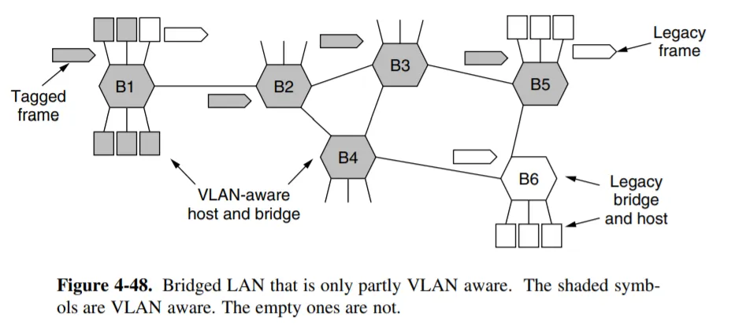

    - 当一个“VLAN 感知交换机”（智能交换机）需要连接一个“VLAN 不感知交换机”（傻瓜交换机）时，智能交换机那一侧的连接端口必须被配置为 **Access Mode**。这样它才能把802.1Q帧的**额外部分去除**

## WLAN

- WLAN是以无线介质（空气）实现的，而无线介质（空气）是不可靠、开放且半双工的，这导致了**“隐藏终端”（导致冲突）和“暴露终端”（导致低效）**两大难题。

### 冲突避免多路访问 MACA

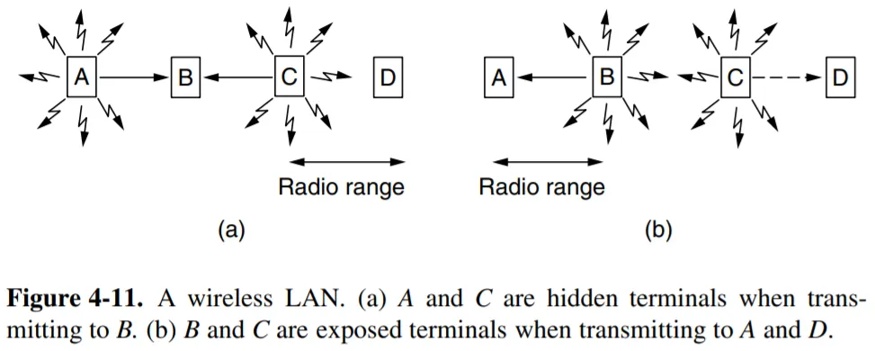

1. **隐藏终端问题 hidden terminal problem**

- 如上图 (a)，如 C 想要给 B 发送数据，实际上此时 A 正在给 B 发送数据；但由于 C 在 A 的无线传播距离之外，并没有监听到 A 发送的信号，因此它发送出数据并在 B 处与 A 的数据冲突，双方发送失败。

2. **暴露终端问题 exposed terminal problem**

- 如上图 (b)，B 正在给 A 发送消息；此时 C 试图给 D 发送消息，但是它侦听到了来自 B 的信号，认为此时应该等待。而事实上，此时 C 给 D 发送信号并不会受到干扰；因此这种等待引发了无意义的时延。

- 这两个问题的根本原因在于，发送端只能知道发送处是否有其他无线电信号；但是实际上影响信号接受结果的是接收端附近有无其他无线电信号干扰。在有线通信中，由于不存在传播范围这个限制，这两个概念是等同的；但是在无线通信中只要接收方互不干扰，多个传输可以同时发生。我们也应当利用这种并发性。

---

- **RTS/CTS 如何解决 (MACA 理论)**： 这个机制的核心**是将“侦听”的责任从“发送端”转移到了“接收端”**。

1. **A → AP (RTS)**： A 向 AP 发送一个很短的“RTS (Request To Send)”帧。同时所有在 A 信号范围内的其他设备(C)也会听到，而它们会选择保持沉默，以让A能**干净地**收听到CTS。

2. **AP → All (CTS)**： AP 收到 RTS 后，向其覆盖范围内的所有人（包括 A 和 D）广播一个“CTS (Clear To Send)”帧。

3. **D 的反应**： D 虽然听不到 A，但它能听到 AP 的 CTS 广播。这个 CTS 就像一个“全体安静！”的命令。D 收到后，会查看 CTS 中的时长信息，并设置自己的 NAV（虚拟传感），在A的传输时间内保持沉默。

4. **结果**： D 被成功“冻结”，A 可以安全地向 AP 发送数据，冲突被避免。

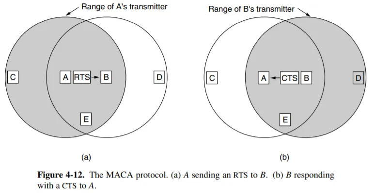

### IEEE 802.11

!!! abstract

    **CSMA/CA 是“总协议”，MACA 是它用来解决“隐藏终端”问题的“核心策略”，而 Virtual Channel Sensing (虚拟信道传感) 则是实现这一策略的“具体工具”。**

#### 物理层

- 802.11 规定了设备可以在哪些“公共频段”上运行。

1. **2.4 GHz 频段**： 早期标准（如 802.11b/g）使用。它**覆盖范围广、穿墙好，但干扰多、信道少、速度慢**。

2. **5 GHz 频段**： 较新标准（如 802.11a/n/ac/ax）使用。它**干扰少、信道多**（允许“信道捆绑”以实现高速），但**覆盖范围小、穿墙差**。

3. **6 GHz 频段**： 最新标准 (Wi-Fi 6E / Wi-Fi 7) 使用，提供更宽阔的“高速公路”。

- **速率自适应 (Rate Adaptation)** 802.11 规定了一套包含多种传输速率的机制。AP 和客户端会根据当前信号的强弱和干扰情况，自动协商使用最快的（如果信号好）或最慢但最可靠的（如果信号差）速率进行通信。

#### MAC层

##### CSMA/CA

- CSMA/CA (冲突避免) 这是 802.11 的“第一交通法则”。由于无线电**无法像有线那样“检测冲突”(CD)，所以它必须尽力“避免冲突”(CA)**

1. **先听后说 (CS)**：发送前，必须先侦听信道是否空闲，监听到信道刚刚从“忙碌”变为空闲时，它不准立即发送数据。它必须强制自己先等待一个 **DIFS** 的时间

2. **随机退避 (Backoff)**：侦听到空闲后，**不能马上发，必须再等待一个随机倒计时**。这是为了防止两个同时侦听到空闲的设备发生碰撞。

3. **确认**：当数据帧成功抵达，终点站要立刻发送一个极短的**ACK**，如果没有ACK返回就意味着错误

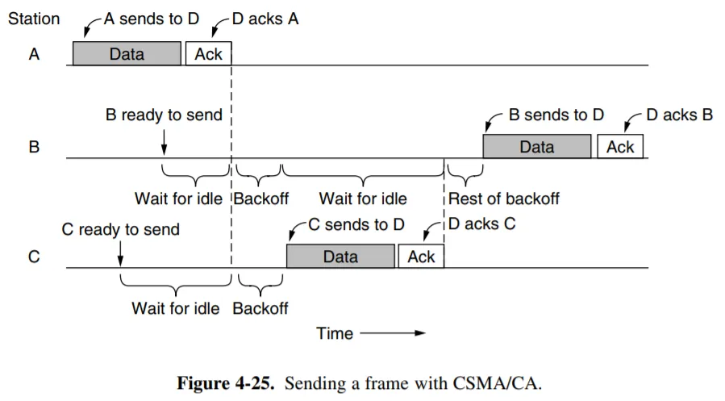

!!! tip "和CSMA/CD的区别"

    1. **从后退开始**：在CSMA/CD中，我们是检测到冲突后，进行一个随机避退；而CA中，我们无法检测到冲突，所以只能先进行随机避退，来**最大可能地降低冲突的概率**

    2. **ACK是强制的**：因为**无法检测冲突**，所以**使用ACK来推断冲突**

##### DCF

- **DCF (Distributed Coordination Function)“分布式协调功能”**，

- 意味着： 网络中没有一个“中央调度员”或“老板”，AP (接入点) 和所有的客户端（手机、笔记本电脑、智能电视）都是平等的“站”(Station)，它们各自独立地运行同一套“礼仪规则”，来“竞争”使用共享的无线信道。

#### Virtual channel sensing

- **虚拟信道传感**，就是设备（如笔记本）通过逻辑上跟踪 **NAV (Network Allocation Vector, 网络分配向量)**，来判断信道是否“繁忙”的一种机制。

- NAV 不是一个物理的东西，是笔记本网卡内部的一个**“倒计时器”**。

- “虚拟传感”通过 NAV 计时器，实现了**“隔空预告”**和**“强制安静”**的功能。

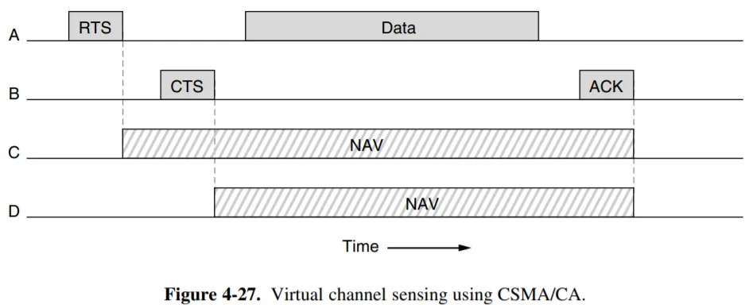

#### 一些其他机制

1. Reliability

- 降低传输速率

- 发送更短的帧

2. Saving Power

- Beacon Frames

3. Quality of Services

### 帧结构

