# 网络层

## 主要任务

- **链路层**完成的是在一个网络中如何将帧**从一个结点传输给另一个结点**；或者说是从线路的一边传递到另一边。而**网络层**则考虑如何将数据包**从发送方一路送到接收方**。在这个过程中，数据包**可能会跨越不同的网络**

- 使用一些中间设备（或称中间系统、中继系统）可以将两个计算机网络连接起来。我们之前学到的物理层的中继器 (Repeater)、集线器 (Hub)，以及链路层的网桥 (Bridge)、交换机 (Switch) 都属于中间设备。即，我们认为上述设备只是**扩大了网络，并没有连接不同的网络**。

- 因此我们引入**网络层的中间设备：路由器 (Router)**，它**负责连接不同的网络**，为到来的跨网络的数据包根据其目的地找到一条路径，并对应地将其转发。**在更高层还有网关 (Gateway) 这一中间设备**。

- 我们说，**网络层是处理端到端数据传输的最底层**。这是因为，链路层考虑的只是将数据从网络上的一个结点发给另一个结点，而我们实际上需要做的是将**一个进程的数据传递给另一个进程**。如下图所示，发送方 H1 上的进程 P1 将信息传递给 ISP（网络应用提供商）提供的设备 A，ISP 的路由器为数据包找到一条通路并转发给接收方的路由器 F，最终由接收方 H2 的进程 P2 接受。网络层首先完成了从主机到主机的数据传输。 

## 提供给传输层的服务

- 网络层（L3）的唯一工作，是将一个数据包（Packet）从“源主机”发送到“目的主机”。

- 为了实现这个目标，L3 必须为上层的 L4（传输层）提供一个“投递服务”。但在网络设计的“大辩论”中，这个“投递服务”分成了两种截然不同的理念：

理念 A（“智能网络”）： 网络层应该提供一个**可靠的、有连接**的服务。

- 就像电话系统一样，网络层（L3）自己就负责建立连接、保证顺序、重传丢失的包。

- L4（传输层）会非常“省心”，因为它天生就得到了一个可靠的通道。

理念 B（“傻瓜网络”）： 网络层应该只提供一个**不可靠的、无连接**的服务。

- 就像邮政系统一样，网络层（L3）只提供“尽力而为”(Best-Effort) 的投递。

- 它不保证包会送达，不保证按顺序，也不会重传。

- 所有的“可靠性”工作，都应该**交给上层的的 L4（传输层，即 TCP）在“端到端”上去解决**。

- **互联网 (Internet) 的选择： 互联网（基于 IP 协议）决定性地选择了不可靠的、无连接的服务**。

- 因此，在我们的现代网络中，网络层 (IP) 提供给传输层 (TCP/UDP) 的服务只有一种：一个**无连接 (Connectionless)、不可靠 (Unreliable)**、“尽力而为”的主机到主机 (Host-to-Host) 数据包投递服务。

### 数据报网络

- **数据报网络(Datagram Network)**就是**无连接**的网络的具体实现

**工作机制：**

1. **没有“建立连接”**的步骤。发送方（您的电脑）直接把数据包（Packet）扔给网络。

2. 每一个数据包（称为一个 **Datagram**）都是完全独立的，并且**必须携带完整的目标地址（目标 IP）**。

3. 网络中的每一个**路由器**都会对每一个数据包独立地做出**“存储-转发”**和**“路由”**决策。

**带来的后果：**

1. **包可能走不同路径**： 路由器可以根据当前的拥堵情况，把您的两封信（包）发往两条不同的路径。

2. **包可能乱序 (Out-of-Order)**： 因为路径不同，第 2 个包可能比第 1 个包先到。

3. **包可能丢失 (Packet Loss)**： 如果一个路由器的缓存满了，它会合法地将您的包丢弃。

4. **路由器“无状态” (Stateless)**： 路由器**不需要记忆“您正在进行一个会话”**。它只看眼前的这一个包，转发，然后就忘了。这使得网络极其健壮（一个路由器坏了，包会自动绕路）和高效。

### 虚电路网络

- 虚电路网络是**有连接的**包交换的一种实现方式。虚电路不希望给每个数据包选择一条路径，而希望建立一个连接，选择一条固定的路径；所有需要从这个连接上通过的流量都使用这条路径。虚电路之所以是“虚”的，是因为这条**电路不是专用的，只是逻辑上的**。一条链路上可能有多个虚电路通过，一对 host 之间也可能存在多条不同的虚电路。

- 如下图所示，每个连接有一个**连接标识符（connection identifier）**；路由器 A 的表中的第一行表示：如果有一个来自 H1 的、标识符为 1 的包，那么 A 将其转发给 C，且标识符为 1。这种方式中，每个数据报不需要保存目的地址，而是保存 connection identifier。

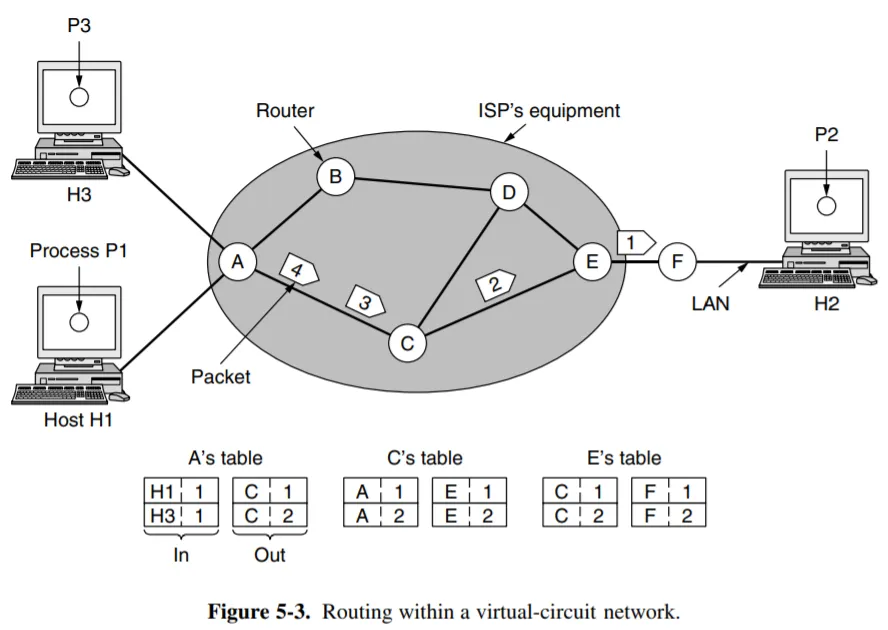

---

### 数据报网络 vs 虚电路网络

| 方面 | 数据报网络 (Datagram network) | 虚电路网络 (Virtual-circuit network) |
| :--- | :--- | :--- |
| **电路建立** | 不需要 | 需要 |
| **寻址** | 每个数据包包含完整的源地址和目标地址 | 每个数据包包含一个简短的 VC 号 (虚电路号) |
| **状态信息** | 路由器不保存有关连接的状态信息 | 每个 VC (虚电路) 都需要为连接在路由器中占用表空间 |
| **路由** | 每个数据包都被独立路由 | 路径在 VC (虚电路) 建立时被选定；所有数据包都遵循该路径 |
| **路由器故障的影响** | 没有影响，除了在崩溃期间丢失的数据包 | 所有经过该故障路由器的 VC (虚电路) 都会被终止 |
| **服务质量 (QoS)** | 困难 | 容易，前提是能为每个 VC 提前分配足够的资源 |
| **拥塞控制** | 困难 | 容易，前提是能为每个 VC 提前分配足够的资源 |

1. 由于datagram network的数据包始终带着较长的目的地址，如果需要packet较短的话，那么采用虚电路网络更好

2. 虚电路网络对于QoS和拥塞控制更加容易实现

3. 虚电路网络具有 **vulnerable** 的特点，如果路径上的路由器崩溃了，那么经过它的所有虚电路都会被aborted；但如果是datagram network，只有位于崩溃路由器buffer里的packet数据才会丢失

4. 流量模式是“突发的 (Burst)”或“短连接”时，由于datagram network不需要setup time，此时更优

5. datagram network路由器可以“balance the traffic”，实现**动态负载均衡**

## 路由算法

- 路由器的功能是 路由 routing 和 转发 forwarding。路由是指根据特定的路由算法构造出路由表，同时不断进行更新维护；而转发是指根据到来的数据包的内容查询路由表并从合适的端口转发出去。

1. **静态路由 static routing / 非适应性算法 nonadaptive algorithm**：简便，开销较小，在拓扑变化不大、路由选择非常清楚的场合很有用；但无法响应故障。

2. **动态路由 dynamic routing / 适应性算法 adaptive algorithm**：能够改善网络性能，有助于流量控制，收到故障的影响较小。但是算法较为复杂，会增加网络负担。另外如果变化太快容易引起震荡，变化过慢会影响路由的一致性。

- **路由算法的目标，就是为网络中的每一个“目的地”路由器，都计算出一张“最优路径图”（即汇集树），以便所有其他路由器都知道该如何最高效地将数据包发给它。**

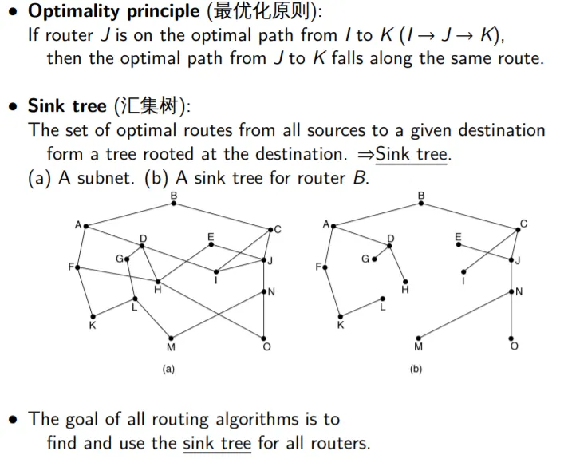

### Shortest Path

- 衡量path length的指标有很多：Hops（结点数量），physical distance（物理距离），bandwidth（带宽），traffic（流量），cost（费用），measured delay（测量延迟），mean queue length（平均队列长度）

- 构建最短路径的方法就是 **Dijkstra's Algorithm**

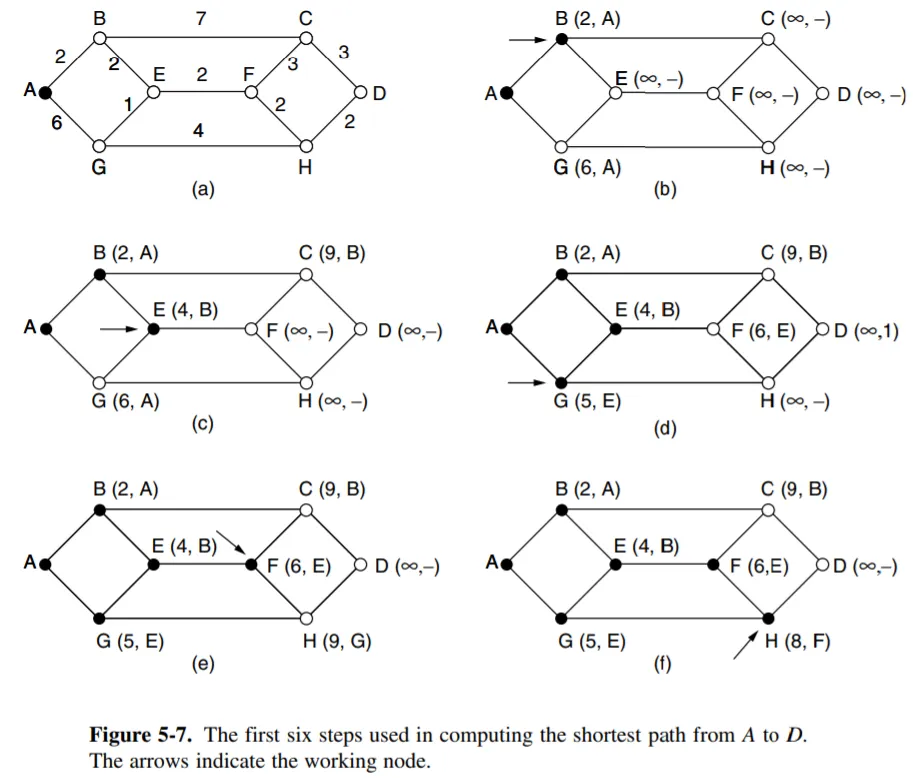

### Flooding

- 泛洪算法，将packet从所有除了进来以外的端口发出去；但是问题在于代价太高，带宽占用太厉害；至于环路问题，我们可以考虑用 time to live 来解决；总归不是一个实用的算法

### Distance Vector / Bellman-Ford

**距离矢量 (Distance Vector) 算法**

- **核心思想：** “通过邻居传闻来路由” (Routing by Rumor)。

- **依赖的算法：** Bellman-Ford 算法。

**工作机制：**

1. **信息共享：** 路由器**只**与它的**直接邻居**通信。

2. **共享内容：** 每个路由器会**定期**地（例如每 30 秒）将其**整个**路由表（即它所知的“距离矢量”：“我到网络 X 的距离是 3 跳”）发送给其所有邻居。

3. **路径计算：** 路由器 B 收到来自邻居 C 的路由表。如果 C 说“我到 X 只有 2 跳”，而 B 到 C 的距离是 1 跳，那么 B 就知道“我可以通过 C 到达 X，总距离是 2 + 1 = 3 跳”。

4. B 会比较所有邻居（C, D, E...）提供的“传闻”，并选择一个总距离最短的作为自己的最优路径。

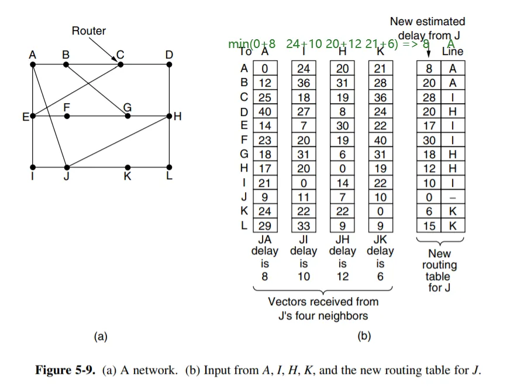

- **优缺点：**

  - **优点：** 简单，配置容易，对路由器 CPU 占用极低。

  - **缺点：**

    - **收敛缓慢 (Slow Convergence)：** 当网络拓扑发生变化（如链路断开）时，**好消息传得快，坏消息传得慢**（**“计数到无穷”**问题, Count-to-Infinity）。

    - **高带宽占用：** 无论网络是否变化，都会定期发送完整的路由表。

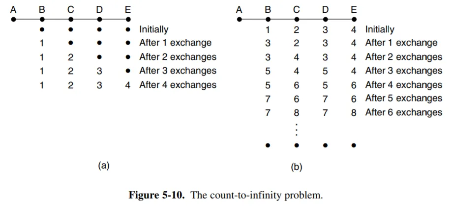

- 上图中表示了它们到A点的最短路径，(a)是AB之间好的，(b)是AB之间断开了；这就导致B以为走C到A最短，然后C又返回来看到B的路径变化了，因而又在它的基础上加一；然后它们之间就**总是递增一个彼此的距离值**，然后这条虚空路径越来越大

**经典协议**：

- RIP (Routing Information Protocol, 路由信息协议)： 最经典的 DV 协议。它使用“跳数 (Hop Count)”作为唯一的“距离”度量（最多 15 跳）。

### Link State

**链路状态 (Link State) 算法**

- **核心思想：** “每人拿到完整的地图，自己算路” (Everyone has the full map)。

- **依赖的算法：** **Dijkstra 算法**（用于计算单源最短路径）。

**工作机制：**

1. **发现邻居：** 路由器启动后，首先向其**直连链路发送 "Hello" 包**，以发现它的直接邻居。

2. **创建 LSA (Link-State Advertisement)：**
   
    - 每个路由器都会创建自己的“链路状态通告”。LSA 不是一个“路由”，它是一个**纯粹的数据库条目**，是一个**地图的“碎片”**。
    
    - 例如，Router A 会创建这样一个 LSA（称为 Type-1 LSA）：
    
    - **"我是 Router A (Router ID: 1.1.1.1)"**
    
    - **"我连接着 Router B (ID: 2.2.2.2)，链路成本 (Cost) 是 10。"**
    
    - **"我连接着 Router C (ID: 3.3.3.3)，链路成本是 5。"**
    
    - **"我连接着一个子网 192.168.1.0/24，成本是 1。"**

3. **LSA 泛洪：** 每个路由器会创建一组“**链路状态通告 (LSA)**”——这就像一张“名片”，上面写着：“我是 Router A，我连接着 B (成本 10) 和 C (成本 5)”。
   
    - 当路由器 A 创建或更新了它的 LSA 时，它会立即将这个 LSA 发送给它所有的“邻居”（B 和 C）。
    
    - 当 B 收到 A 的 LSA 时，B 会**立即**将这个 LSA**转发（泛洪）**给它自己的**所有其他**邻居（除了 A）。
    
    - 这个过程会像“病毒”一样扩散，直到网络中的**每一台**路由器都收到了 A 的这份 LSA。
    
    - 同样，A 也会收到 B、C、D... 等所有其他路由器的 LSA。

    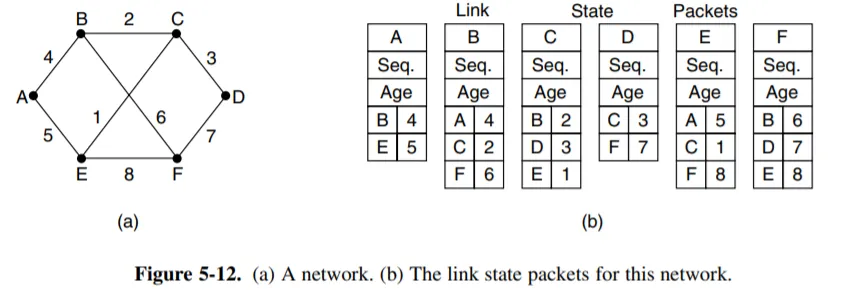

    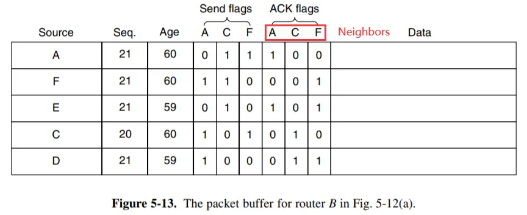

    !!! tip "**Seq** 和 **Age**"

        **LSA Sequence Number (序列号)**：
        
        - 每个 LSA 都有一个 32 位的序列号。
        
        - 当 Router A 第一次创建 LSA 时，序列号为 `0x80000001`。
        
        - 当 A 的链路状态发生变化（例如 A-B 链路断开），A 会创建一个新的 LSA，并将序列号递增（`0x80000002`）。
        
        - 当其他路由器收到这个新 LSA 时，它们会**比较序列号**。因为“...002”比“...001”更新，它们会**用新 LSA 覆盖旧的**。
        
        **LSA Age**：
        
        - 这是一个**“保质期”计时器**，单位是秒。
        
        - 它会在路由器中逐渐递增，如果超过了`MaxAge`，就会认为这个LSA**过期了而被清除**
        
        - **不过书上说Age是一个递减的字段，减到0的时候就要从buffer丢弃**

4. **构建拓扑图：** **每一个**路由器都会收集**所有**的 LSA，并在自己的内存中构建出一个**完全一致**的、**完整的**网络“拓扑地图”。

    - 如果LSA是**新的**，就会被继续转发下去

    - 如果LSA是**重复**的或者**旧的**，就会被舍弃

4. **路径计算：** **每一个**路由器**独立**地以“自己”为树根，对这个“地图”运行 Dijkstra 算法，计算出到所有其他目的地的“最短路径”。

5. **这正是“汇集树 (Sink Tree)”的创建过程！** Link State 算法就是用来计算汇集树的。

- **经典协议：**
  
    - **OSPF (Open Shortest Path First, 开放最短路径优先)：** 现代网络中**最重要、最常用**的 IGP 协议。
    
    - **IS-IS** (Intermediate System to Intermediate System)：另一个被 ISP 骨干网广泛使用的链路状态协议。

- **优缺点：**
  
    - **优点：** **收敛极快**（拓扑变化时才发送增量更新），路由准确，支持大型网络。
    
    - **缺点：** 配置相对复杂，对路由器 CPU 和内存的要求更高。

### Hierarchical Routing

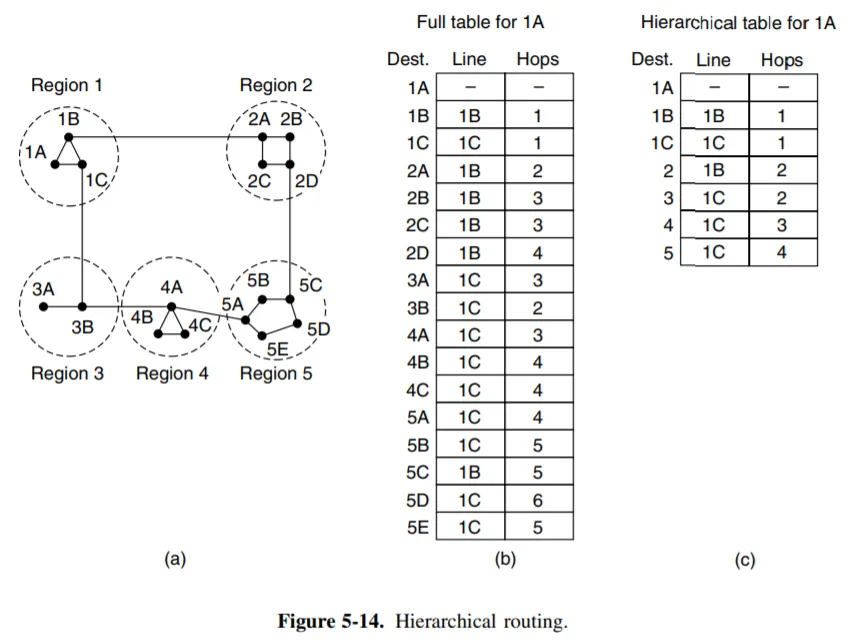

## 网络互联

### 不同协议的路由策略

**异构网络之间如何进行转发**：

- 在不同**链路层**协议网络转发时，就用**不同的帧结构包装**：

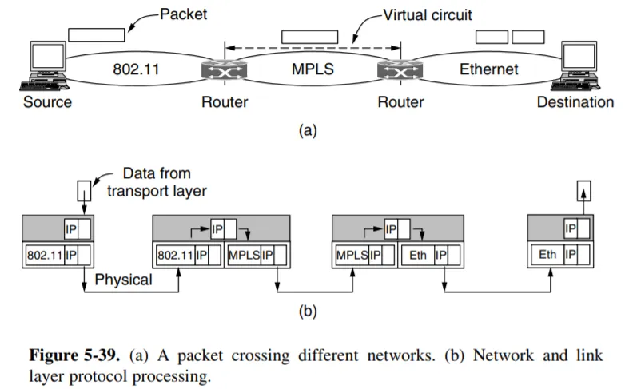

- 在不同**网络层**协议网络转发时，使用**“隧道技术” (Tunneling)**：

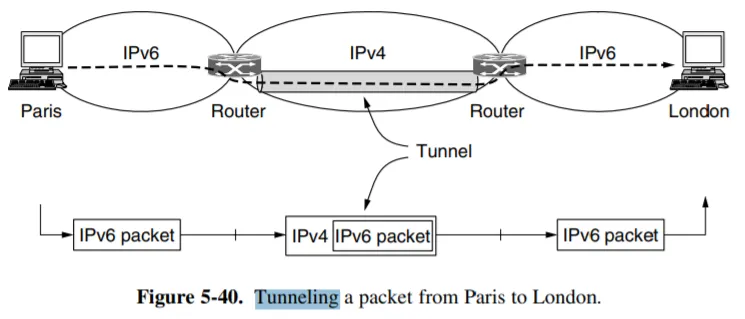

- 包装两层，相当于把里面的ipv6 packet当作是一个payload

### Packet Fragmentation

- **数据包分片 (Packet Fragmentation)** 是网络层（L3）的一种机制，指的是将一个过大的 **IP 数据报 (IP Datagram)** 分割成若干个较小、独立的数据片段的过程。

- 数据包分片的**主要目的**是：**允许 IP 数据报穿越由不同物理链路技术组成的异构网络**。

- **限制因素**：**MTU (最大传输单元)**： 每一条网络链路（例如一根网线、一段 Wi-Fi、一条光纤）都有一个限制它在 **L2（数据链路层）能够承载的最大数据量**，这个限制被称为 **MTU (Maximum Transmission Unit)**。**如果数据报的大小超过了中途遇到的最小 MTU，那么它必须被分割，否则无法通过该链路**。

---

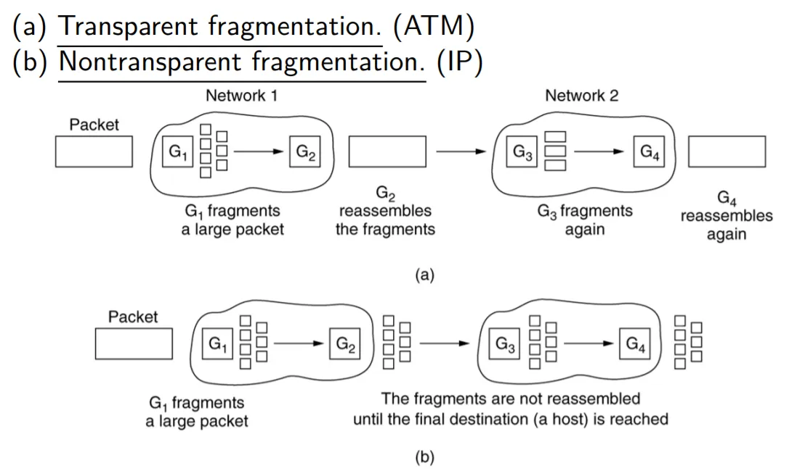

- 问题：(a) 拆分重组和**重复工作、不能分别路由**，以及 (b) **判断结尾、额外开销、错误率提升**。

!!! tip "Example--Non-Transparent Fragmentation"

    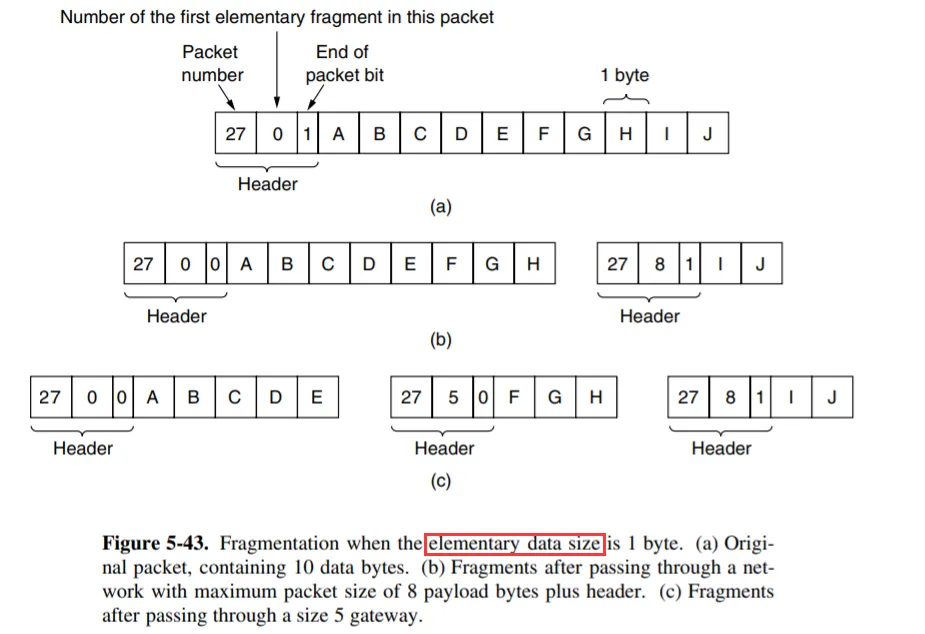

---

#### Path MTU Discovery

- **Path MTU Discovery（路径 MTU 发现，简称 PMTUD）**是网络层（L3）的一个关键机制，用于解决数据包分片问题，并在 IPv6 中是强制性的。

- PMTUD 的**主要目的**，是让**源主机 (Source)** 能够**动态地、准确地**找到一条完整通信路径上**最小的 MTU (Maximum Transmission Unit)**。

- IPv6禁止包分片，所以为了提高效率，提前得知最小的MUT是必要的

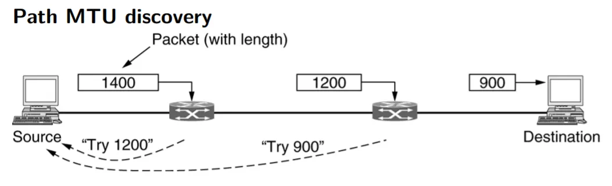

**步骤一：初始探测与设置 DF 标志**

1. **源主机 (Source) 发送：** 源主机首先会尝试发送一个基于其自身 MTU（例如 1500 字节，或者图中所示的 1400 字节）的**大尺寸数据包**。

2. **设置 DF 位：** 重要的是，源主机必须在这个 IP 数据包的头部设置 **“禁止分片” (Don't Fragment, DF)** 标志位（仅在 IPv4 中）。在 IPv6 中，这是默认行为。

**步骤二：中间路由器的反馈 (The Drop & Notify)**

1. **遇到瓶颈：** 当这个大尺寸数据包到达路径上一个 MTU 较小的“瓶颈”路由器时（例如，图中从 1400 字节进入，但下一跳 MTU 只有 1200 字节）。

2. **路由器动作：**
   
    - 路由器看到 DF 标志位被设置（或在 IPv6 中看到包过大）。
   
    - 路由器**丢弃 (Drop) 这个数据包**，因为它不允许分片。
   
    - 路由器向**原始的源主机**发送一个特殊的 **ICMP/ICMPv6 错误消息**（如图中虚线所示）。

**步骤三：源主机的调整 (The Adjustment)**

1. **ICMP 消息内容：** 路由器在 ICMP 消息中会包含一个信息：“**数据包太大 (Packet Too Big)**”，并附带它下一跳链路的 **实际 MTU 值**（例如，“Try 1200”或“Try 900”）。

2. **源主机接收反馈：** 源主机接收到这个 ICMP 错误后，它**不会重传**刚才那个失败的包。相反，它会**学习**到这个新的 MTU 限制，并在后续的 TCP/UDP 会话中，**自动将发送的数据包大小调整**到这个更小的 MTU 值。

3. **重复探测：** 整个过程会重复，直到源主机找到整条路径上遇到的**最小 MTU 值**（图中最终是 900 字节）。

**总结与意义**

- PMTUD 是一种**端到端**的机制，它依赖于网络层的 ICMP 错误消息反馈。

- 它解决了网络中的 **MTU 不匹配**问题，是确保 IPv6 高效传输的关键。

- 一旦 PMTUD 找到正确的路径 MTU，源主机就能发送尺寸**最大**且**无需分片**的数据包，从而最大化链路利用率并最小化处理开销。

## Internet Protocol

### IPv4

#### Header

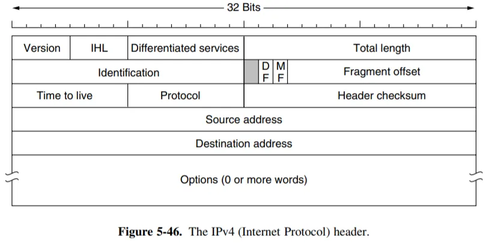

- **传输顺序**：由于历史原因，**网络字节序是大端序**，即MSB在低地址

- **Version**：4bit (0100) for IPv4

- **IHL (Internet Header Length)**：4 bits, [5, 15]范围的数, in 32-bit words. E.g. IHL = 5 表示头部有 5*32 bits = 20 Bytes，即 Option 字段长度为 0。因此 Option 字段最多 40 Bytes

- **Differentiated Services (区分服务)**：8 bits；用于 **QoS (服务质量) 控制**。前6位标明服务类型，最后2位用于**ECN (显式拥塞通知)**，允许路由器在不丢包的情况下通知发送方“网络堵了，请减速”。

- **Total length**：16 bits, in Byte, **Head + Body**, <=65536

- **Identification**：16 bits, 一个包的fragments有相同的identification值

- Unused：没用到

- **DF (Don't Fragment)**：要不要分段的选项

- **MF (More Fragments)**：如果设为 1，意思是后面还有碎片。如果设为 **0**，意思是**最后一块**。

- **Fragment Offset (片偏移)**：13 bits；告诉接收方，当前这个切片，在原始大包中**排在什么位置**；因为网络是里的数据是乱序的，所以通过offset来拼回去

- **Time to Live (TTL, 生存时间)**：8 bits；含义是这个包还能在网络中存活多久。虽然叫“Time”，但实际上指的是 **跳数 (Hop Count)**。每经过一个路由器，TTL 值 减 1。

    - **作用**：**防止环路 (Loop Prevention)**。如果路由配置错误导致包在网络里转圈，**TTL 最终会减到 0，路由器就会丢弃它**（并**发送 ICMP Time Exceeded 给源**），防止这个幽灵包永远占用带宽。

- **Protocol (协议)**：8 bits；指出IP包的数据部分用的是什么协议，常见的比如：**6 = TCP, 17 = UDP, 1 = ICMP**；接收方的主机收到包后，根据这个数字，决定把数据交给操作系统的哪个模块（TCP 栈还是 UDP 栈）去处理。

- **Header Checksum (首部校验和)**：16 bits；用于检测 **IP 头部**（**注意：只检查头部，不检查数据部分**）是否在传输中发生了比特翻转错误。因为 TTL 字段在每一跳都会变化，所以**每个路由器都必须重新计算这个校验和**。如果校验失败，路由器会直接丢弃该包。

- **Options (选项)**：**可变长度 (0 - 40 字节)**，用于一些特殊功能，但在现代互联网中极少使用（因为处理 Option 会让路由器变慢）。

    - **Padding (填充)**： 如果 Options 的长度不是 32 位的倍数，必须用 0 填充，以确保 Header 整体长度**是 32 位的倍数（ 4byte / 1word 的倍数）**（为了配合 IHL 字段）。

#### IPv4 地址

- Internet 上的每个 host 和 router 都有 IP 地址。需要注意的是，每个 IP 地址指向的不是一台机器，而是一个 **network interface**；例如 router 有多个接口，因此**每个接口都有一个 IP 地址**。

- IPv4地址分为两部分：网络地址和主机地址；两者的划分由子网掩码来决定，然后进而决定了整个子网的大小（可分配的ip地址）

#### Classful Addressing

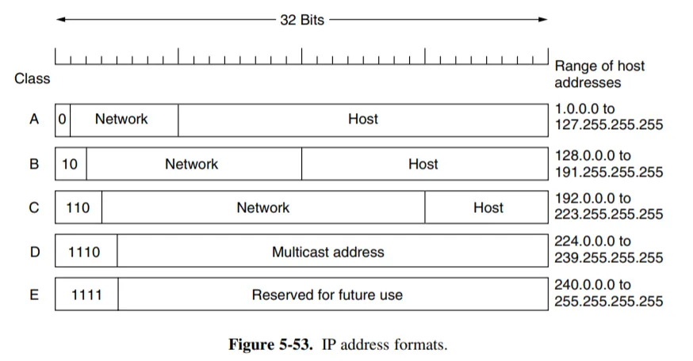

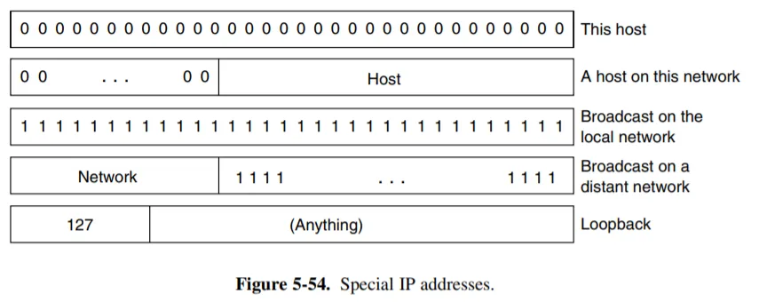

- **Classful Addressing（分类寻址）** 展示的是**“死板”的旧时代**。

- 通过检查 IP 地址**开头的几位数字（前导位）**，路由器就能立即判断出这个地址属于**哪一类（ABCDE）**，以及哪部分是网络号，哪部分是主机号。

- **问题**：这种分法造成了**严重的 IP 地址浪费**。比如一个公司有 300 台电脑，申请 C 类（254个）不够用，申请 B 类（6万个）又浪费了 65000 多个地址。

- **现状**：今天我们已经不再严格使用这种“分类”了（除了 D 类组播）。我们使用的是 **CIDR (无类域间路由) 和 VLSM (可变长子网掩码)**，也就是通过斜杠（如 /24, /18）来灵活划分网络，打破了 A/B/C 类的硬性边界。

#### CIDR

- **CIDR (Classless Inter-Domain Routing，无类域间路由)** 的诞生是为了打破旧的 IP 地址分类（A/B/C 类）限制，解决路由表爆炸和 IP 地址浪费的问题。 

- CIDR有两个核心机制：**路由聚合 (Route Aggregation) 和 最长前缀匹配 (Longest Prefix Match)**。

1. **路由聚合 (Route Aggregation)**：

- CIDR 允许我们将多个小的网络“打包”成一个大的网络广播出去，这就像是把几个小包裹装进一个大箱子里运输，大大减少了路由器的负担。

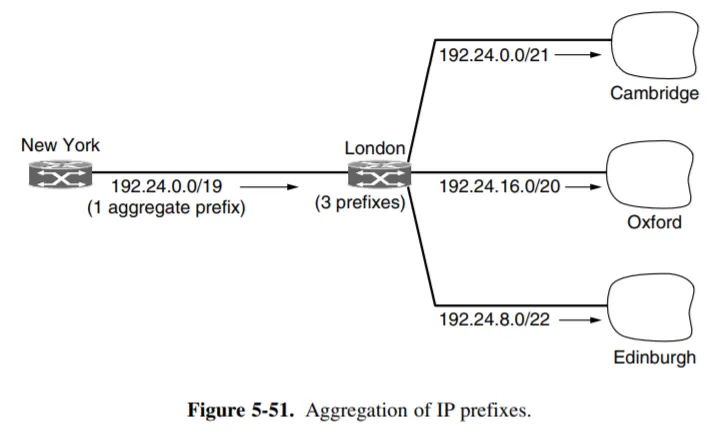

- 如果没有 CIDR，伦敦路由器必须向纽约路由器发送3 条独立的路由记录。如果全球路由器都这么干，核心路由表会爆炸。

- 有了 CIDR：伦敦路由器发现这三个地址段在二进制上是可以合并的。

- 它计算出一个能覆盖这三个区域的“总前缀”：`192.24.0.0/19`。

- `/19` 的范围覆盖了从 `192.24.0.0` 到 `192.24.31.255` 的所有地址。

2. **最长前缀匹配 (Longest Prefix Match)**

- 路由器会选择**子网掩码最长（前缀越长 = /后面的数字越大 = 范围越具体）**的那条路由。

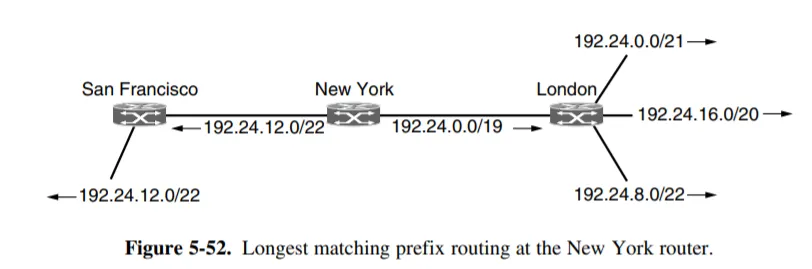

#### NAT

- **IPv4 地址枯竭**：全球只有约 43 亿个 IPv4 地址，根本不够地球上每个人、每台手机、每台电脑分配一个“永久地址”。

**解决方案：**

- 私有 IP 地址 (Private IP)：规定了几个特定的网段（如 `10.0.0.0/8`, `192.168.0.0/16`），这些地址**可以在每个家庭或公司内部重复使用，但在公网上是无效的**。

- **NAT (Network Address Translation，网络地址转换)** 技术：在公司/家庭的边缘（路由器）上部署 NAT，**负责在“私有 IP”和“公网 IP”之间进行转换**。NAT 让成千上万台内网设备可以“躲”在少数几个公网 IP 后面上网，极大地节省了 IPv4 地址资源。

---

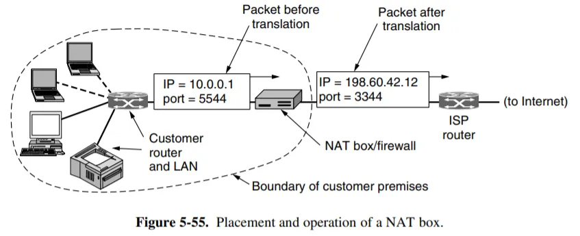

