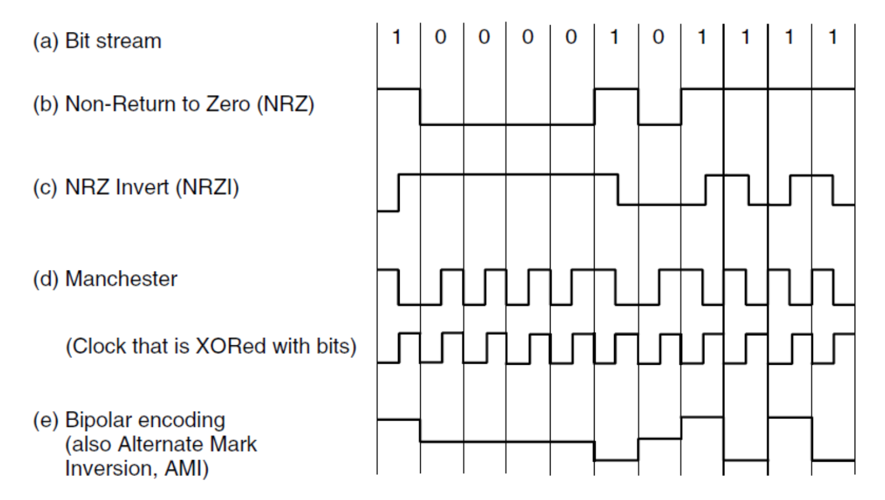
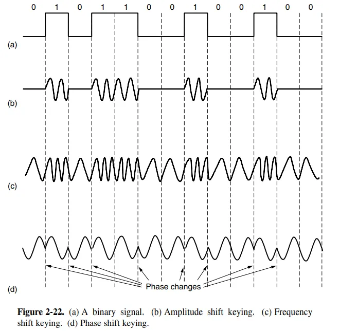
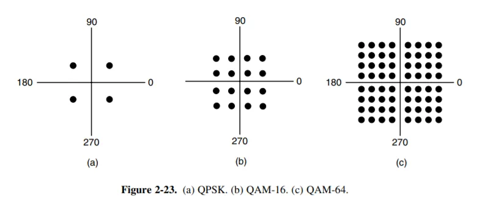
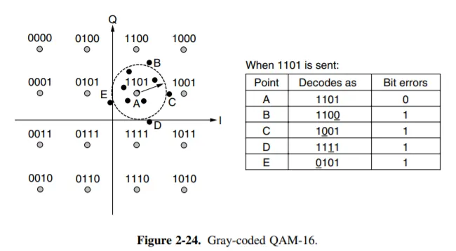
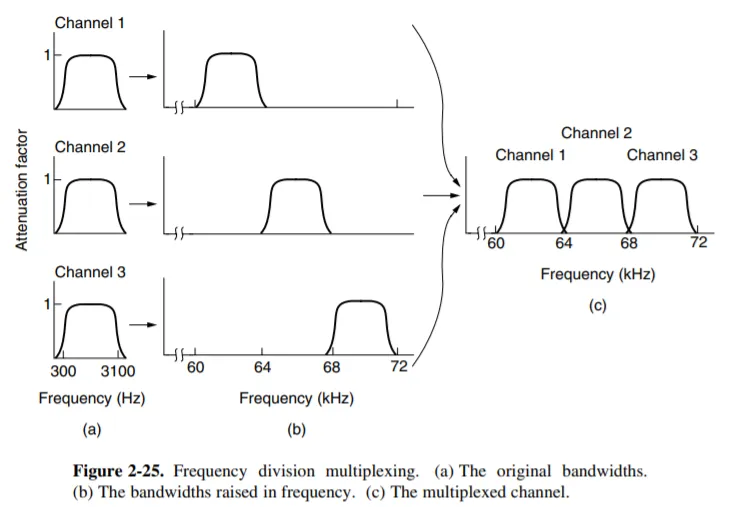
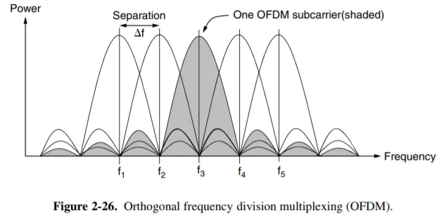
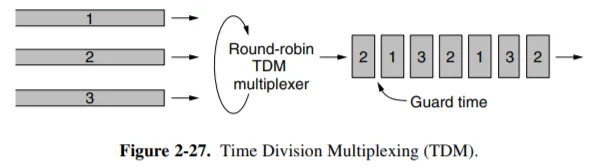
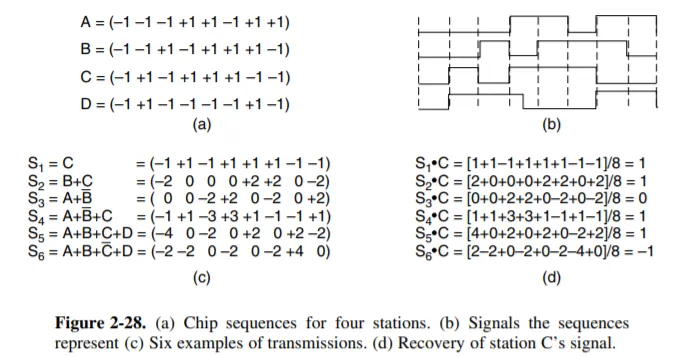
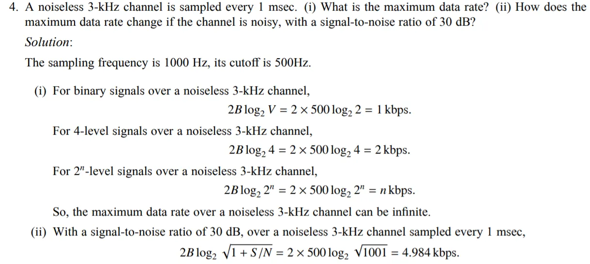

# 物理层

## 主要任务

- 网络中**硬件设备**和**传输介质**的种类繁多，通信方式也各不相同。物理层应尽可能**屏蔽这些差异**，让数据链路层感觉不到这些差异。

- 发送方的数据链路层将需要发送的帧交给物理层，传输后接收方的物理层将这些帧传递给接收方的数据链路层。**上层不需要关心是怎么发送的，只需要交给物理层**

- 具体地说，物理层确定与传输媒体接口有关的一些特性：
    - 机械特性：指明接口所用接线器的形状和尺寸、引线数目和排列、固定和锁定装置等
    - 电气特性：指明在接口电缆的各条线上出现的**电压的范围**
    - 功能特性：规定物理接口上各条信号线的功能分配和确切定义（各条线上出现**各种电压表示何意义**）
    - 规程特性 / 过程特性：定义了各信号线的**工作顺序和时序**，使得比特流传输得以完成。

## 基本概念

### 链路

- **链路(link)**有两种，物理链路和逻辑链路；**物理链路**就是承载信号的physical path；**逻辑链路**也叫**信道 channel**，是逻辑概念上的

### 码元/符号

- **码元/符号（symbol）**：用一个数字脉冲表示的一个$k$进制数字

### data rate / bit rate

- 单位时间内传输信息里bit的数量，即**数据量/时间**；这里可能有误解，实际上指的是**真实有效的数据量**，不是说我用冗杂的编码方式就会使data rate上升

- 单位可以是 **b/s, kb/s, Mb/s, Gb/s**，也可以写作**bps kbps Mbps Gbps**

- 注意这里是**bit/s**而不是日常见到的**byte/s**

### 带宽

!!! tip "数字信号传输时会遇到的问题"
    
    - 当我们在发送一个形如0100010的方波信号时，那么我们实际是通过傅里叶展开，将它拆分成一个基波和无数个更高频率的谐波叠加。

    - 也就是说我的谐波越多，频率跨度越大，对于方波信号的拟合效果就越好

    - 但是计算机网络中的传输介质（如铜缆、光纤、无线电波）都有一个**“带宽”限制**。**带宽指的是这个介质能够有效传输的频率范围**。一个理想的方波包含了无限多的高频谐波，但**任何物理信道都无法传输无限高的频率**

- 对于导线而言，从 0 Hz 到某个频率 $f_c$（我们称之为 **截止频率**）的谐波在传输过程中不会有明显减弱，我们称 0 ~ $f_c$ 的这段频率宽度为 **带宽 (bandwidth)**。

- 带宽会对 data rate 产生一定的限制。举例来说，如果 data rate 为 $r$ bps，传输 $b$ bit 的信号，就需要 $\cfrac br$ 秒，因此信号的基频就是 $\cfrac rb$ Hz；因此我们可以接受的谐波个数 $N$ 就需要满足 $N\cdot \cfrac rb\leq f_c$，即 $N \leq \cfrac{b\cdot f_c}r$。我们很容易理解，$N$ 与信号的质量成**正相关**，因此 $r$ 过大时，信号的质量就会受到影响。

- 对于一份数据，$b$是固定，所以在保证一定质量$N$的前提下，$f_c$和$r$就是**正相关**的；所以对于计算机科学家来说，带宽也可以指 $\text{Max(data rate)}$

- **模拟带宽(analog bandwidth) = $f_c - 0$，数字带宽(digital bandwidth) = $\text{Max(data rate)}$**

- 总之，带宽是传输介质的一种物理特性；

- 同时我们称 $0\sim B Hz$的信号为**基带信号（baseband signal）**，而将其搬移到$S\sim S+B Hz$的信号为**通带信号（passband signal）**

### symbol rate/ baud rate

- 单位时间内传输的symbol数量，即单位时间内可能发生的信号变化次数

- 例如，一个4进制码元可以携带2bit的信息，那么如果data rate = 64kb/s，那么symbol rate = 32k Baud

### Nyquist's theorem

- 物理上发现，在理想（无噪声）低通（带宽有限）信道中，码元的极限**symbol(Baud) rate** = $2W$ Baud，其中$W$是理想低通信道的模拟带宽。用$V$表示每个码元离散电平的数目（也就是进制数），则**极限data rate = $2W\text{log}_2V$** (b/s)

- 例如：一条无噪声的8kHz信道，每个信号包含8级，则最大传输速率为：2 * 8kHz * log(8) = 48kbps

### Shannon's theorem

- 在受高斯白噪声干扰的低通信道中，用 $W$ 表示信道的（模拟）带宽，$S$ 表示信号平均功率，$N$ 表示高斯噪声功率，则**极限数据率**是 $W \text{log}_2(1 + S/N)$ (b/s)

- **信噪比 （Signal-to-Noise Ratio）**, SNR公式中的 **S/N 就是信噪比**，没有单位；但为了方便表示更大的范围，也用 $10\text{lg}(S/N)$ 表示信噪比，单位为分贝 dB（事实上 dB 本来就是一个比例单位）。**如果看到 dB 为单位的信噪比，应换算为 S/N 再代入公式**。

!!! tip "**对于给出 V 的情况，无论是否说明无噪声都应使用 Nyquist's theorem 确定 data rate 的一个上界；对于给出 SNR 的情况，也应根据 Shannon's theorem 确定另一个上界。**"

    - **二进制**信号在信噪比为 127:1 的 4kHz 信道上传输，求最大数据传输速率。
    
    - 根据 Nyquist's theroem，最大数据率为 2 * 4k * log_2(2) b/s = 8kb/s；
    
    - 根据 Shannon's theroem，最大数据率为 4k * log_2(1+127) b/s = 28kb/s。
    
    - **二者均为上界，取较小的一个，因此最大数据传输速率为 8kb/s。**

## 信息交互方式

- **单工链路 （simplex link） - 1 条信道，固定单向通信**

- **半双工链路 （half-duplex link） - 2 条信道，双向可通但不能同时**

- **全双工链路 （full-duplex link） - 2 条信道，两边可以同时收发**

- **注意：2 条 channel 不一定需要 2 条物理链路，一条通过一些复用方式或者双向传输也可以实现**

## 传输媒介

- **导向传输介质（Guided trans media）**：

    - **磁介质（Persistent Storage）**

    - **双绞线（twisted pair）**

    - **同轴电缆（coaxial cable）**

    - **光纤（fiber optics）**

- **非导向传输介质 / 无线传输**
    
    - **无线电波（Radio）**，有较强的穿透能力，无需对准某个方向；无线手机通信，WLAN等
    
    - **微波、红外线、激光**有很强的方向性，直线传播

## 数字调制

> 数据与代表它们的信号之间的转换过程称为 **数字调制（digital modulation）**

### 基带传输（Baseband Tranmission）

- 这里我们讨论的其实是**对比特流进行编码**（在课本中这部分也称为调制）；在通带传输中我们讨论真正的调制，即将数据转换为连续的模拟信号。

- **Non-Return to Zero (NRZ)**：正电压代表1，负电压代表0

- **NRZ Invert (NRZI)**：信号**翻转**代表 1，**不翻转**代表 0

- **曼彻斯特编码 Manchester**: 用**一个高和一个低**表示 1，**一个低一个高**表示 0（实际上就是与一个时钟信号做了 XOR）

- **双极编码 bipolar encoding / AMI, Alternate Mark Inversion**：这种编码方式**用 +1 或者 -1 表示 1**，每次的 1 与前一次的 1 表示法相反，保证最多只差 1 个；**用 0 表示 0**。

### 通带传输（Passband Transmission）

- 通过调节载波信号的**幅值、相位或频率**来运载数据，占据以载波信号频率为中心的一段频带，用于无线和光纤信道。

**幅移键控 ASK（Amplitude Shift Keying）**

- 通过两个不同的振幅分别表示0和1；可以用更多的幅值等级来表示信息

**频移键控 FSK（Frequency Shift Keying）**

- 通过不同频率表示不同的码元

**相移键控 PSK（Phase Shift Keying）**

- 将载波波形偏移一定的相位

- **二进制相移键控 BPSK, Binary PSK 将波形偏移 0° 和 180°**；

- **正交相移键控 QPSK, Quadrature PSK 将波形偏移 45°, 135°, 225° 和 315°**。

---

- 为了让每个码元传输更多bit的信息，也可以将上述方法综合起来使用。下面的**星座图（constellation diagram）**中用黑点表示一个合法的振幅和相位的组合；其中每个黑点到原点的距离表示振幅，和x轴正方向所成角度表示相位偏移。

- 该图中 (a) 即为前述 **QPSK**，而后面两个图是 **正交调幅 QAM, Quadrature Amplitude Modulation** 的两个实例，它们的每个 symbol 分别携带 **4 bit** 和 **6 bit** 的信息。

- 为星座图分配每个黑点代表的 bit 时，需要考虑少量的突发噪音不会导致很多 bit 出错。可以使用 **Gray code** 解决这一问题。

---

## 多路复用

### 频分复用 FDM

- 经过调制后，要传输的信号所占频带宽度是有限的；而线路可使用的带宽远大于这一宽度。我们可以**对多路信号采用不同频率进行调制**，使得调制后各路信号频率不同，**不会互相干扰**；即将信道带宽**分割为多种不同频带的子信道**，实现多路复用。

- 每个频带之间保留足够宽的距离，保证相邻的频带不会相互重叠。这一部分保护间隔称为 **保护频带（guard band）**。

---

**正交频分复用 OFDM**

- 基本思想是：每个子载波相互正交；即每个子载波在其他子载波的中心频率处能量为 0。这样在每个子载波中心频率处取样，就不会被其他子载波干扰了。这样的方式不需要 guard band，且频带利用率很高。

### 时分复用 TDM

- 每个用户周期性地轮流工作，每次在一个非常短的时间内获得整个带宽。类似于频分复用，时分复用也可能会需要增加 保护时间 guard time。

- TDM 的调度方式是机械的。一种**动态**按需分配时间片的方式是 **统计时分复用 STDM, Statistical TDM**。这种方式效率高，但需要**额外信息**确认数据流向，因此技术上较为复杂。

### 码分复用 CDM

- **码分多址 CDMA（Code Division Multiple Access）**是重要的码分复用技术

- 考虑这样的问题：我们有若干由 1 或 -1 组成的序列。对于每个序列 $S$，我们用 $\overline S$ 表示其反码（序列中的每个数取其相反数）。对于任意两个序列 $S$ 和 $T$，我们定义其 **归一化内积 (normalized inner product)** $S\cdot T \equiv \frac 1m\sum_{i=1}^m S_iT_i$，其中 $m$ 是序列的长度，此处为 8。容易理解，有 $S\cdot S = 1$，$S\cdot \overline S = -1$。若 $S\cdot T = 0$，我们称这两个序列是 **正交 (orthogonal)** 的；显然此时 $\overline S \cdot T = S\cdot\overline T = \overline S\cdot\overline T=0$。根据这一定义，图中 (a) 的 4 个序列是两两正交的。

- 现在我们尝试利用这些序列发送信号。**每个发送端被分配了一个序列**；每一个周期中，发送端可以选择**发送 1（通过发送这个序列）**，或者**发送 0（通过发送这个序列的反码）**，或者**什么都不发送**。

- 当多个站同时发送时，它们发送的信号会叠加起来；但是由于序列的正交性，我们可以将每个站发送的信息**单独解码出来**。假设在某一个周期中，A 和 D 发送了 0，B 发送了 1，C 什么都没有发送，那么叠加出的信号就形如 $S = \overline A + B + \overline D = (1,-1,3,-1,1,3,-1,-1)$。我们将这个信号与 $B$ 作归一化内积：$S\cdot B = \frac {-1+1+3+1+1+3-1+1}8=1$，即 B 发送的是 1。如果与 $C$ 作归一化内积，则结果为 0，表示 C 什么都没有发送。如果与 $A$ 或 $D$ 做归一化内积，则结果为 -1，表示发送的是反码（即 0）。这是因为，归一化内积满足分配律，$S\cdot D = \overline A\cdot D + B\cdot D + \overline D\cdot D$，而前两项由于正交性为 0，第三项为 -1，因此最终结果为 -1；其他的情况也是类似的。

- 下面回顾我们做了什么。我们在原本需要发送 1 个 bit 的时间发送了 $m$ 个 bit 组成的序列，这样的序列可以有 $m$ 个且两两正交（考虑正交矩阵），从而满足 $m$ 个发送方同时互不干扰地传输的需要。同时由于我们在单位时间内传输的 bit 数是原来的 $m$ 倍，因此所**需要的带宽也是原来的 $m$ 倍**（回顾 1 带宽 的思考题）；如此我们将一个窄带信号扩展到一个很宽的频带上，这样更能容忍干扰，同时允许多个用户共享同一个频带。

## 物理层计算中的“采样频率”

- Sampling frequency 实际上就是 Baud rate 的理论上限之一，和带宽共同约束 Baud rate 的上限。 

- **一条无噪声的 8kHz 信道，每个信号包含 8 级，每秒采样 24k 次，那么可以获得的最大传输速率是**

  - 无噪声 -> Nyquist，data rate = 2 * 8kHz * log_2(8) bit/symbol = 48kbps 

  - “题目中给出的**每秒采样 24k 次**是无意义的，因为超过了**波特率的上限 2W = 16 kBuad**，所以 72kbps 是错误答案”

- 一个信道每 1/8s 采样一次，传输信号共有 16 种变化状态，最大数据传输速率是
  
  - 8Baud * log_2(16) bit/symbol = 32bps

  

!!! warning "公式里的$2W$实际要取两倍带宽或者实际采样频率 两者中的**最大值**"

## 公共电话交换网络

### PSTN

- **The Public Switched Telephone Network, PSTN**

- **电路交换 Circuit Switching**  图 1 (a)先建立连接，然后直接发，最后释放连接；过程中路径被独占。途径的结点收到就立刻发给下一个结点，不储存。

- **报文交换 Message Switching**  图 2不需要建立连接。报文携带目的地址和源地址，途中每个结点在收到整个 message 以后再找下一条路进行传输。这样可以动态选择合适空闲的线路，增加线路的可靠性和利用率。但是会引起转发时延，并需要缓存空间。

- **分组交换 / 包交换 Packet Switching**  图 1 (b)将报文合理分块，增加携带分组编号等信息。在报文交换的基础上，缩短了时延，减少了期望的出错重发数据量，同时由于 packet 的长度有所限制，存储管理也方便了很多；动态寻找线路时各个 packet 也可以选择不同路径（因此，packet 的数据不一定按序到达）。问题是额外信息量进一步增加，且发送前和接收后的工作量也会增加。