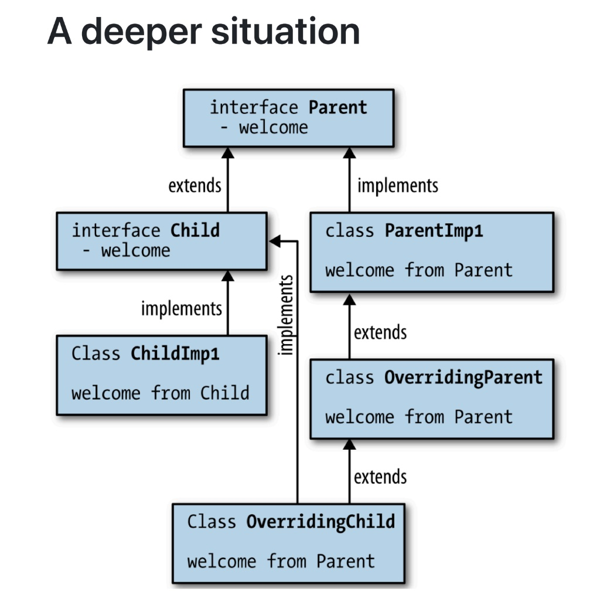

# Java

## 基本数据类型与包装类

### Primitive types

| Type   | Storage | Min Value                                          | Max Value                                         |
| ------ | ------- | -------------------------------------------------- | ------------------------------------------------- |
| byte   | 1-byte  | -128                                               | 127                                               |
| short  | 2-byte  | -32768                                             | 32767                                             |
| int    | 4-byte  | -2,147,483,648                                     | 2,147,483,647                                     |
| long   | 8-byte  | -9,223,372,036,854,775,808                         | 9,223,372,036,854,775,807                         |
| float  | 4-byte  | Approximately -3.4E+38 with 7 significant digits   | Approximately 3.4E+38 with 7 significant digits   |
| double | 8-byte  | Approximately -1.7E+308 with 15 significant digits | Approximately 1.7E+308 with 15 significant digits |

!!! note "基本数据类型和对象的最关键区别"

    - 基本数据类型作为局部变量时，存储在**栈**上，不能通过`new`来创建；而对象永远存储在**堆**上，栈上只是存储指向堆上对象的**引用地址**
    
    - 基本数据类型**按值传递（pass by value）**，方法得到的是原始值的一个副本，修改副本不会影响原始值
    
    - 对象**按引用地址的值传递**，方法得到的是**引用的一个副本**，两个引用都指向**同一个**堆中对象，修改对象的内部状态会影响原始对象

??? note "为什么Java中没有`unsigned`类型"

    - C++中 signed 和 unsigned 整数混合运算时的类型提升规则相当复杂，是许多错误的根源。例如，一个负的 signed int 和一个 unsigned int 比较大小，负数会被转换成一个巨大的正数，导致与直觉相反的结果。
    
    - Java的设计者James Gosling等人认为，为了语言的简洁和易用性，移除 unsigned 类型带来的好处（减少混淆、简化规则）远大于它带来的坏处。

??? tip "特殊数字格式和其他基本数据类型"
    
    - `145_345.23`，java在数字间可以使用下划线；`0b11001011`，前面加上`0b`可以表示二进制
    
    - `boolean`: `true`, `false`
    
    - `char`: 16bit，**Unicode-16**

### Wrapper classes

- Java为了弥补“基本类型不是对象”的鸿沟，为每一种基本类型都提供了一个对应的包装类（如 `int` -> `Integer`, `double` -> `Double`）。这使得我们可以把基本类型的数据当作对象来使用，例如放进 `ArrayList<Integer>` 这样的集合中。从Java 5开始，**自动装箱/拆箱**（Autoboxing/Unboxing）的特性使得两者之间的转换在代码层面变得非常方便。

- 所有包裹类型的`public`构造器已经在JDK16正式移除，所以`new Integer(123)`是会编译失败的；为什么？

    1. 构造器每次生成新对象，浪费内存

    2. `valueOf`工厂方法利用内部缓存（-128~127默认缓存在IntegerCache）

    3. 与字符串驻留、`Boolean`的`true/false`单例保持一致语意

    4. 为未来值类型（Valhalla）铺路，彻底消灭包装对象

---

#### 创建方法

1. 工厂方法（推荐）

`Integer a = Integer.valueOf(123);`

2. 自动装箱（语法糖，底层仍调用`valueOf`）

`Integer b = 123;`

3. 字符串解析

`Integer c = Integer.valueOf("123");`

---

```java title="自动装箱/拆箱"

class Geeks{
    public static void main(String[] args) {
        int b; // Primitive data type
        Integer a; // Integer wrapper class
        b = 357; // assigning value to primitive
        a = b; // auto-boxing or auto wrapping converting primitive int to Integer object
    }
}
```

#### Pre-created objects

- 我们有许多预先创建好的数据对象来很好地实现单例，这使得落在这个范围内的包装类始终不会创建新的对象，而是返回堆上同一个对象

- 对于整数类型：-128~127

- 对于字符类型：0~127

- 对于布尔：true和false

- 对于浮点数：没有预生成对象

```java
Integer a = 12;
Integer b = 12;
System.out.println(a == b); // true, because of integer caching


Integer a = 1200;
Integer b = 1200;
System.out.println(a == b); // false, because Integer objects are not cached beyond 127
```

## String

- 要想理解java中的string，就要去理解字符串池

- **字符串池 (String Pool)**，也常被称为**字符串常量池 (String Constant Pool)**，是Java虚拟机（JVM）内存中一个非常重要的特殊存储区域。它的核心目的只有一个：为了节约内存和提高性能，确保**内容相同的字符串字面量在内存中只存在一份拷贝**。

### 字符串的创建方式

=== "**通过字面量创建字符串 (Literal Creation)**"

    ```java
    String s1 = "你好";
    String s2 = "你好";
    ```
    
    1. **`String s1 = "你好";`**：
    
        - JVM首先会去字符串池里查找是否存在内容为 `"你好"` 的字符串对象。
    
        - 因为是第一次，池中没有，所以JVM会在池中创建一个新的 `"你好"` 对象。
    
        - 然后，JVM将池中这个新对象的**引用（内存地址）**返回，赋值给变量 `s1`。


    2. **`String s2 = "你好";`**：
    
        - JVM再次去字符串池里查找是否存在内容为 `"你好"` 的字符串对象。
    
        - 这一次，它**找到了**！池中已经有了上一步创建的 `"你好"` 对象。
    
        - 于是，JVM**不会创建新对象**，而是直接将池中**已存在的那个对象**的引用返回，赋值给变量 `s2`。


=== "**通过 new 关键字创建字符串 (Object Creation)**"

    ```java
    String s3 = new String("你好");
    String s4 = new String("你好");
    ```
    
    - `new String("你好")`：`new`关键字强制JVM**绕过字符串池的检查**，直接在堆（Heap）内存中**创建一个全新的String对象**，即使堆中（或池中）已经存在内容相同的字符串。
    
    - 因此，s3 和 s4 分别指向堆内存中两个内容相同但地址不同的独立对象。

---

### Immutable

- 在Java中，`String`类型是不可修改的对象；也就是说，当一个String的实例被创建后，它的内容就是不可修改的，它的任何方法也都不可以修改String内容（相当于全是`const`）

- 正是因为`String`的不可变特性，整个 Java 生态可以放心地把它当基础设施：**随手缓存、随处共享、当 key、当锁、当常量，而无需拷贝或同步**

- **并发/线程安全**

    - 无状态：对象只读，天然支持多线程共享，无需同步。

    - Race-free：写并发代码时不用担心“读到一半被修改”

- **哈希与索引**

    - hashCode 缓存：计算一次后缓存到字段 hash ，后续 HashMap/get 直接复用，复杂度从 O(n)→O(1)。

    - Key 可信：作为 HashMap / HashSet 的 key 时，中途内容变化导致哈希漂移的灾难不可能发生（对比 char[] 或 StringBuilder ）。

- **字符串常量池（StringTable）**

    - intern() 复用：字面量自动入池，相同内容全局一份，节省堆内存。

    - 地址比较： "foo" == "foo" 直接返回 true ，JVM 级别优化。

- **安全性与完整性**
  
    - 类加载器隔离：类名、文件路径、权限字符串一旦传入就无法被篡改，防止“在check 之后、use 之前”被恶意代码改掉。

    - 网络/文件句柄： new URL("http://xxx") 的协议、主机名不可变，避免校验后地址被替换。

- **编译器 & JVM 优化**

    - 字符串折叠：编译期常量表达式 "a" + "b" 直接变成 "ab"，减少运行时拼接。

    - 栈上优化：逃逸分析后不可变对象可拆成标量替换，消灭堆分配。

    - 共享子串：JDK 7 以前 substring 共享底层 char[] （offset + count），避免复制；JDK 7 之后虽然改为复制，但仍保留不可变语义，让 JIT 放心做循环不变量外提等优化。

---

!!! tip "**不可变带来的麻烦**"

    - 如果需要不断运算逐渐形成大的字符串
    
    ```java
    String s = "";
    for ( int i=0; i<100; i++ )
    s += i;
    ```
    
    - 这个过程会制造201个对象，并扔掉200个。
    
    - 应该使用 `StringBuffer` :
    
    ```java
    StringBuffer sb = new StringBuffer();
    for ( int i=0; i<100; i++ )
    sb.append(i);
    String s = sb.toString();
    ```
    
    - `StringBuffer.append(int)` 不会制造额外的 `String` 对象

!!! tip "`StringBuffer` and `StringBuilder`"

    - 在Java中，除了不可变的 String 类外，还有两个常用的可修改字符串类：
    
    - `StringBuffer` ：线程安全，同步，性能稍慢
    
    - `StringBuilder` ：非线程安全，不同步，性能更快

### 转换成`String`类型

- 对于简单类型来说，我们可以使用`valueOf`来转换成`String`类型

- 而对于类来说，我们可以使用`toString()`，并且这个函数可以被重载，因为它是`Object`定义的成员函数

## Package & Import

### Package

- `package` 关键字的主要作用是为Java类提供一个命名空间（Namespace），它有三大核心目的：

1. **组织管理 (Organization)**

    - 将功能相关的类和接口组织在一起，就像用文件夹管理文件一样，让项目结构清晰明了。例如，`java.util` 包存放了各种工具类，`java.io` 包存放了所有与输入输出相关的类。

2. **避免命名冲突 (Avoiding Name Collisions)**

    - 这是最关键的作用，与C++的`namespace`目的一致。不同开发者可以创建同名的类，只要它们位于不同的包下即可。例如，`java.util.Date` 和 `java.sql.Date` 就是两个不同的 `Date` 类。一个类的**完全限定名（Fully Qualified Name, FQN） 就是它的 包名.类名**，这是它在JVM中**唯一的身份标识**。

3. **控制访问权限 (Controlling Access)**

    - `package` 还定义了一个访问级别，即 **default（默认/包私有）**。如果您不为类成员（字段、方法）指定任何访问修-饰符（public, private, protected），那么它就**只能被同一个包内的其他类**访问。

```java
// 文件路径: .../com/mycompany/app/Main.java
package com.mycompany.app; // 必须是第一行

public class Main {
    // ...
}
```

### Import

```java title="不使用**import**的情况"
public class MyApp {
    public static void main(String[] args) {
        // 必须使用完全限定名
        java.util.ArrayList<java.lang.String> list = new java.util.ArrayList<>();
        java.util.HashMap<java.lang.String, java.lang.Integer> map = new java.util.HashMap<>();
    }
}

```

**两种导入方式：**

1. **单类型导入**

```java
import java.util.ArrayList;
import java.util.HashMap;

public class MyApp {
    public static void main(String[] args) {
        // 现在可以直接使用短名称
        ArrayList<String> list = new ArrayList<>();
        HashMap<String, Integer> map = new HashMap<>();
    }
}
```

2. **通配符导入 (Wildcard Import)**

- 使用星号 `*` 可以导入一个包下的所有 `public` 类和接口。

```java
import java.util.*; // 导入 java.util 包下的所有公共类

public class MyApp {
    public static void main(String[] args) {
        ArrayList<String> list = new ArrayList<>();
        HashMap<String, Integer> map = new HashMap<>();
        Random random = new Random();
    }
}
```

---

3. 特殊的 `import`: **static** 静态导入

- 从Java 5开始，import 还可以用来导入一个类的静态成员（静态变量和静态方法），从而在代码中可以直接使用这些成员，无需加上类名前缀。

```java
// 不使用静态导入
double r = 10.0;
double area = Math.PI * Math.pow(r, 2);

// 使用静态导入
import static java.lang.Math.PI;
import static java.lang.Math.pow;

double r = 10.0;
double area = PI * pow(r, 2); // 代码更简洁
```

## Class

### 访问修饰符

|修饰符	|同一个类中|	同一个包中	|不同包的子类中	|不同包的非子类中|
|------|---------|-------------|---------|---------|
|public|	✅|	✅|	✅|	✅|
|protected|	✅|	✅|	✅|	❌|
|default|	✅|	✅|	❌|	❌|
|private|	✅|	❌|	❌|	❌|

### Switch语句

```java
int day = 3;
String result = switch(day) {
    case 1 -> "Monday";
    case 2 -> "Tuesday";
    case 6, 7 -> "Weekend";
    default -> "Invalid day";
}
System.out.println(result);
```

- 使用`->`箭头语法，避免了传统break的繁琐

- `switch`表达式**返回一个值**，可以直接赋值

- 支持多个`case`合并

---

**`yeild`**

- 如果想在`switch`分支里写更复杂的逻辑，需要用`yield`返回值

```java
int day = 3;
String result = switch(day) {
    case 1, 2, 3 -> {
        String prefix = "Early week";
        yield prefix + day;
    }
    case 4, 5 -> "Mid week";
    case 6, 7 -> "Weekend";
    default -> throw new IllegalArgumentException("Invalid day: " + day);
}
System.out.println(result);
```

### 初始化顺序

- **父类优先于子类**：在子类被初始化之前，必须保证其所有父类都已经被初始化。

- **静态优先于实例**：类的静态部分（属于类本身）总是在类的任何实例（对象）被创建之前被初始化。

- 先做**定义初始化**，再走**构造函数**

- 第一阶段：类加载与静态初始化 (只在类首次被使用时执行一次)

1. **父类的静态变量初始化 和 静态代码块（按代码中出现的先后顺序执行）。**

2. **子类的静态变量初始化 和 静态代码块（按代码中出现的先后顺序执行）。**

- 第二阶段：对象创建与实例初始化 (每次new一个对象都会执行)

3. **父类的实例变量初始化 和 实例代码块（按代码中出现的先后顺序执行）。**

4. **父类的构造函数。**

5. **子类的实例变量初始化 和 实例代码块（按代码中出现的先后顺序执行）。**

6. **子类的构造函数。**

### 静态变量

- 不同于c++中将static变量视作全局变量储存在.bss/.data段

- java中的静态基本类型，它只有一份数据，就在**方法区/元空间**中

- 而对于静态对象，我们要观察两个东西，一个是它**本身（存储在堆中）**，一个是它的**引用（存储在方法区/元空间）**

### Class类

- Java中的 `java.lang.Class` 类是一个非常特殊和核心的存在。它不是我们平常用来创建业务对象（如Car, Person）的普通类，而是JVM用来**描述“类”和“接口”本身这个概念的类**。

- 对于加载到JVM中的任何一个类（比如String），JVM都会**有且仅有地创建一个**与之对应的 **Class 对象**（即String.class），这张“索引卡片”就代表了String这个类的全部结构信息。

### final 关键字

- `final`和`private`都是实现的静态绑定

1. **`final` 修饰变量**

    - 当 final 修饰一个变量时，表示这个变量是一个常量，它的值在初始化之后就不能再被改变。

    - 修饰基本数据类型 (Primitive Type)：

    ```Java

    final double PI = 3.14159;
    // PI = 3.14; // 编译错误！不能再次赋值
    ```

    - **修饰引用数据类型 (Reference Type)：**

    - 这是一个非常重要的知识点。`final` 修饰引用变量时，表示这个**引用变量不能再指向其他对象**，但它所指向的**对象本身的内容是可以改变**的。

2. **`final` 修饰方法**

    - 当 final 修饰一个方法时，表示这个方法不能被任何子类重写 (override)。

    ```java
    class Parent {
        public final void coreLogic() {
            System.out.println("这是不能被改变的核心逻辑。");
        }
    }

    class Child extends Parent {
        // ❌ 编译错误！不能重写父类中被 final 修饰的方法
        // public void coreLogic() { 
        //     System.out.println("试图修改核心逻辑...");
        // }
    }
    ```

3. **`final` 修饰类**

    - 当 final 修饰一个类时，表示这个类是**“最终类”，不能被任何其他类继承**。

    ```java
    public final class MyFinalClass {
        // ...
    }
    
    // ❌ 编译错误！不能从最终类 MyFinalClass 继承
    // class MySubClass extends MyFinalClass {
    // }
    ```

### 函数的可变参数

- `T... a`是Java的可变参数（varargs）

- 它等价于`T[] a`，只是调用者可以零个或者多个地传入元素，而不用手动创建数组

```java
asList(String... a);
asList("A", "B", "C"); // 编译器帮你 new T[]{...}
```

---

## Inheritance and Polymorphism

### super

- `super` 是Java中一个非常重要的关键字，它专门用于**继承（Inheritance）**的上下文中。

- 简单来说，`super` 关键字提供了让**子类（Subclass）访问其直接父类（Superclass）**成员的能力。

- 如果说 `this` 关键字指的是“我自己”这个对象实例，那么 `super` 指的就是“我的父辈”那一部分的引用。

- super 有两种主要的、截然不同的用法：

1. **调用父类的构造函数: `super(...)`**

2. **访问父类的成员: `super.成员`**

---

=== "`super(...)`：调用父类的构造函数"

    - 这是 `super` 最重要也是最常见的用法。它解决了对象创建过程中的一个根本问题：在创建一个子类对象时，**必须先保证其父类的部分被正确地初始化**。
    
    - **必须是第一行**：在子类的构造函数中，调用 `super(...)` 的语句必须是第一行代码。
    
    - **隐式调用**：如果您在子类的构造函数中没有显式地写 `super(...)`，Java编译器会自动在第一行插入一个对**父类无参数构造函数的调用**，即 `super()`;。
    
    - **重要陷阱**：如果父类**没有提供无参数的构造函数**（例如，只提供了一个有参的构造函数），而您在子类构造函数中又没有显式地调用 super(...) 来匹配父类的某个构造函数，那么程序**将无法通过编译**。
    
    ```java
    public class Vehicle {
        protected int wheels; // 轮子数量
    
        // Vehicle类只有一个有参的构造函数
        public Vehicle(int wheels) {
            this.wheels = wheels;
            System.out.println("Vehicle 的构造函数被调用，创建了 " + wheels + " 个轮子的交通工具。");
        }
    }
    
    public class Car extends Vehicle {
        private String brand;
    
        public Car(String brand) {
            // 错误！因为父类没有无参构造函数，编译器无法自动插入 super();
            // this.brand = brand; // 这行会报错
    
            // 正确写法：必须在第一行显式调用父类的有参构造函数
            super(4); // 汽车有4个轮子，我们在这里初始化父类的部分
            
            this.brand = brand;
            System.out.println("Car 的构造函数被调用，品牌是: " + brand);
        }
        
        public static void main(String[] args) {
            Car myCar = new Car("Toyota");
        }
    }
    ```

=== "`super.`：访问父类的成员"

    - 当子类定义了与父类同名的方法（方法覆盖/Override）或字段（字段隐藏/Hiding）时，如果您在子类中仍然希望访问父类中的那个“被覆盖”或“被隐藏”的成员，就需要使用 `super.`。
    
    ```java title="调用被子类覆盖的父类方法"
    class Parent {
        public void printInfo() {
            System.out.println("这是来自 Parent 类的信息。");
        }
    }
    
    class Child extends Parent {
        @Override
        public void printInfo() {
            // 1. 先执行子类自己的逻辑
            System.out.println("这是来自 Child 类的附加信息。");
            
            // 2. 然后通过 super 调用父类被覆盖的原始方法
            super.printInfo(); 
        }
    }
    
    // 调用
    // Child child = new Child();
    // child.printInfo();
    ```
    
    ```java title="访问被子类隐藏的父类字段"
    class Parent {
        String name = "Parent";
    }
    
    class Child extends Parent {
        String name = "Child";
    
        public void printNames() {
            System.out.println("this.name: " + this.name); // 输出 "Child"
            System.out.println("super.name: " + super.name); // 输出 "Parent"
        }
    }
    ```

---

### overload与override

- 在java中，函数都是动态绑定的，所以父类的函数都是可以被子类overload和override的

!!! warning "不同于C++"

    - 首先看**overload**：
    
        - c++中有**name hiding**的特性，子类如果定义了和父类同名的函数，即使参数列表不同，也无法直接访问到父类的函数，而是要通过`::`才可以
    
        - java则是会直接overload，子类能直接访问到父类的同名函数
    
    - 再说**override**：
    
        - c++要先加`virtual`关键字声明为虚函数，然后通过vtable，我们动态地确定要执行的函数；这就使得在不同的类里面，vtable是不同的，那么我们能访问到的函数也就是不同的
    
        - 而在java中，我们知道在进行子类的构造时要先进行父类的构造，如果父类的构造函数中调用了被子类**override**的函数，那么实际上它会直接去调用**被子类override过的版本**！！
    
        - 在父类的构造函数中调用可被重写的方法，是强烈不推荐的，因为它会带来非常隐蔽的Bug。父类构造函数执行时，子类的构造函数还完全没有开始执行。这意味着子类自己的成员变量此时还处于未初始化的状态（值为null, 0, false）。
    
    ```java
    class A {         
        private int i=baz();
        public int baz() { 
            System.out.print("A"); 
            return 0; 
        }     
    }     
    class B extends A {         
        private int i=baz();
        public int baz() { 
            System.out.print("B"); 
            return 10; 
        } 
        public static void main(String[] args) {
            A a = new B();     
        }
    }
    // 最后输出BB
    ```

## Interface

- 跟C++类似，一个方法如果被声明为抽象方法，那么这个类就被叫做抽象类

- 而Interface就是纯抽象类，所有的方法都是`public abstract`，所有的成员变量都是`public static final`

```java title="定义与继承"
public interface InterfaceName extends BaseInterfaces

class ClassName implements interfaces
```

- **Interface**是一种完全抽象的类型，它只定义一个类（或一组类）“应该能做什么”，而不关心它**具体怎么做**。

### `default`

- `default` 方法：带默认实现，实现类可复用也可覆盖

```java
public interface Greeting {
    // 普通抽象方法
    void sayHello(String name);

    // default方法：默认实现，实现类可复用也可覆盖
    default void sayHi(String name) {
        System.out.println("Hi, " + name + ( from default method));
    }
}

class EnglishGreeting implements Greeting {
    @Override
    public void sayHello(String name) {
        System.out.println("Hello, " + name);
    }
}
```

!!! tip "**当一个类继承的具体方法和它实现的接口所要求的方法发生“重叠”时**"

    
    
    ```java
    interface Parent {
        public default void welcome () {
            System.out.println("Welcome from Parent");
        }
    }
    
    interface Child extends Parent {
        @Override
        public default void welcome () {
            System.out.println("Welcome from Child");
        }
    }
    
    class ParentImp1 implements Parent {
        @Override
        public void welcome() {
            System.out.println("Welcome from ParentImp1");
        }
    }
    
    class OverridingParent extends ParentImp1{
    }
    
    public class OverridingChild extends OverridingParent implements Child {
        public static void main(String[] args) {
            OverridingChild obj = new OverridingChild();
            obj.welcome(); // This will call the welcome method from Child interface
        }
    }
    ```
    
    - **类（Class）的实现永远优先于接口（Interface）的默认实现**。

!!! tip "**当一个类试图implements多个接口，而这些接口中包含了签名完全相同的 `default` 方法时**"

    - 当一个类试图实现（implements）多个接口，而这些接口中包含了签名完全相同的 default 方法时，Java编译器会无法确定应该使用哪一个。
    
    - 这种冲突会导致编译错误，Java不会自动选择一个胜利者，需要我们自己明确地解决冲突，而唯一的方法就是：**在实现类中重写**

### static methods in interface

- **只属于接口本身**，不被实现类继承，只能通过接口名调用，必须带方法体

- 默认`public`，不允许写`abstract`, `default`, `synchronized`

- 不能被实现类覆盖（因为静态方法根本**不属于实现类**）

```java
public interface MathUtils {
    int add(int a, int b);

    static int max(int a, int b) {
        return a >= b ? a : b;
    }
}

class Demo implements MathUtils {
    @Override
    public int add(int a, int b) {
        return a + b;
    }
    public static void main(String[] args) {
        // 1. 抽象方法必须通过实例调用
        Demo d = new Demo();
        System.out.println(d.add(3, 4));
        // 2. 静态方法只能通过接口名调用
        System.out.println(MathUtils.max(3, 4));
        // 3. 以下写法均编译错误
        // d.max(3, 4);         // 错误：静态方法不属于实现类
        // Demo.max(5, 2);
    }
}
```

## record

!!! note "引入——POJO"

    - **POJO, Plain Old Java Object**，一种设计约定 / 编程风格：“除了业务字段和普通的 getter/setter，不依赖任何特定框架的接口、注解或继承”
    
    - POJO = 只有私有字段 + 无参构造 + getter/setter + 不继承/实现框架类 的纯净对象
    
    ```java
    public final class Point {
        private final int x;
        private final int y;
        public Point(int x, int y) { this.x = x; this.y = y; }
        public int x() { return x; }
        public int y() { return y; }
        @Override public boolean equals(Object o) { ... }
        @Override public int hashCode() { ... }
        @Override public String toString() { ... }
    }
    ```

---

```java
record Point(int x, int y) {}
```

编译器会自动生成：

- 两个`private final`字段`x`, `y`

- 两个全参构造器`Point(int x, int y)`

- 只读访问器（不叫`getX()`，就叫`x`）

- `equals`, `hashCode`, `toString`

- 类本身被`final`修饰，不能再被继承

---

### 追加自定义

```java
record Point(int x, int y) {
    // 1. 自定义构造器（必须最终调用自动生成的全参构造）
    public Point {
        if (x < 0 || y < 0) throw new IllegalArgumentException();
    }
    // 2. 额外方法
    public double distance(Point p) {
        return Math.sqrt(Math.pow(this.x - p.x, 2) + Math.pow(this.y - p.y, 2));
    }
    // 3. 实现接口
    public static final Comparator<Point> BY_X = Comparator.comparingInt(Point::x);
}
```

- 不能显式再声明字段（只能追加 `static` 字段）

- 不能继承别的类（且已经隐式 final ）

### 适用场景

- DTO / VO（接口返回体、MapStruct 映射）

- 复合主键、坐标、经纬度、RGB 值等“小对象”

- 函数式代码里需要快速组合/解构的数据块

- 语义清晰，线程安全，自动 equals / hashCode / toString ，是 Java 走向简洁现代语法的重要一步

## enum

```java
public enum Season {
    SPRING,
    SUMMER,
    AUTUMN,
    WINTER
}
// 编译器在幕后所做的事情（简化版）：
public final class Season extends java.lang.Enum<Season> {
    
    // 您定义的每个枚举值，都是这个类的一个 public static final 实例
    public static final Season SPRING = new Season();
    public static final Season SUMMER = new Season();
    public static final Season AUTUMN = new Season();
    public static final Season WINTER = new Season();

    // 构造函数是私有的，防止外界 new 它
    private Season() { }
    
    // ... 还会自动生成 values(), valueOf() 等方法 ...
}
```

- `enum` 不仅仅是一组数字或字符串，它是一种**特殊的类**，而定义的每个枚举值（SPRING, SUMMER...）都是这个类的**唯一、静态、final**的实例（对象）。

- `enum` 既然是一个类，它就可以拥有构造函数、成员变量和方法。这使得 `enum` 可以携带额外的信息和行为。

```java
public enum Planet {
    MERCURY (3.303e+23, 2.4397e6),
    VENUS   (4.869e+24, 6.0518e6),
    EARTH   (5.976e+24, 6.37814e6),
    MARS    (6.421e+23, 3.3972e6),
    JUPITER (1.9e+27,   7.1492e7),
    SATURN  (5.688e+26, 6.0268e7),
    URANUS  (8.686e+25, 2.5559e7),
    NEPTUNE (1.024e+26, 2.4746e7),
    PLUTO   (1.27e+22,  1.137e6);

    private final double mass;   // in kilograms
    private final double radius; // in meters
    Planet(double mass, double radius) {
        this.mass = mass;
        this.radius = radius;
    }
    public double mass()   { return mass; }
    public double radius() { return radius; }

    // universal gravitational constant  (m3 kg-1 s-2)
    public static final double G = 6.67300E-11;

    public double surfaceGravity() {
        return G * mass / (radius * radius);
    }
    public double surfaceWeight(double otherMass) {
        return otherMass * surfaceGravity();
    }
    public static void main(String[] args) {
        double earthWeight = Double.parseDouble(args[0]);
        double mass = earthWeight/EARTH.surfaceGravity();
        for (Planet p : Planet.values())
           System.out.printf("Your weight on %s is %f%n",
                             p, p.surfaceWeight(mass));
    }
}
```

## Inner Class

- **内部类 (Inner Class)** 是Java中一个非常重要的特性，它指的是在**一个类的内部定义的另一个类**。

!!! tip "与C++的区别"

    - C++中也有嵌套类（Nested Class），但Java的（非静态）内部类与它有一个根本性的区别：
    
    - C++ 嵌套类：仅仅是定义在**另一个类的作用域（scope）内**，它与外部类对象**没有实例上的关联**。它不能直接访问外部类的非static成员。
    
    - Java 内部类 (非static)：内部类的每一个实例都**隐式地“绑定”到了外部类的一个特定实例上**。它持有一个指向外部类对象的引用（可以想象成一个OuterClass.this），因此可以访问该实例的所有成员。

## Lambda expression

- “旧”方式 (Java 7及以前): 假设我们想对一个字符串列表按长度排序，我们需要一个 Comparator：

```java title="old"
List<String> names = Arrays.asList("Bob", "Alice", "Charlie");

// 必须写一个完整的匿名内部类来实现 Comparator 接口
Collections.sort(names, new Comparator<String>() {
    @Override
    public int compare(String s1, String s2) {
        return s1.length() - s2.length();
    }
});
```

```java title="new"
List<String> names = Arrays.asList("Bob", "Alice", "Charlie");

// 编译器知道 sort 方法需要一个 Comparator，
// 并且知道 Comparator 只有一个抽象方法 compare(s1, s2)
// 所以我们只需要提供参数和方法体
Collections.sort(names, (s1, s2) -> s1.length() - s2.length());
```

---

!!! tip "**函数式接口**"

- 这是 Java Lambda 与 C++ Lambda 的核心区别

- 在Java中，Lambda表达式不是独立存在的。它必须被用在一个**“类型上下文”中，这个上下文必须是一个函数式接口 (Functional Interface)**。

- 什么是函数式接口？ **一个有且仅有一个抽象方法的接口（Single Abstract Method, SAM）**。

- 例如：`Runnable` (只有 `run()` 方法), `Callable` (只有 `call()` 方法), `Comparator` (只有 `compare()` 方法)。

- Java 8 在 `java.util.function` 包中引入了大量新的函数式接口，如：

    - `Predicate<T>：(T t) -> boolean` （用于 stream.filter）

    - `Consumer<T>：(T t) -> void` （用于 stream.forEach）

    - `Function<T, R>：(T t) -> R` （用于 stream.map）

    - `Supplier<T>：() -> T` （用于生产数据）

### 闭包

- **闭包**是一个理论概念，指的是一个“函数”与其相关的“引用环境”（即它能访问到的、在它创建时存在的外部变量）的组合体

**Java Lambda**：

- 只能捕获 `final` 或 **effectively final** 的局部变量。这意味着一旦捕获，这个变量的值就**不能再被修改（无论是Lambda内部还是外部）**。

- 对于外部类的实例变量，Lambda通过捕获隐式的 this 引用来访问，这些实例变量可以被修改。

- Java的这种设计主要是为了简化实现和保证线程安全。

**C++ Lambda ([](){})**：

- 提供了非常灵活的捕获方式：

- 按值捕获 ([=] 或 [var])：捕获的是变量的副本。Lambda内部对副本的修改不影响外部。

- 按引用捕获 ([&] 或 [&var])：捕获的是变量的引用。Lambda内部可以修改外部的原始变量（除非Lambda被声明为const）。

- C++给予了程序员更大的自由度，但也带来了对生命周期和并发修改需要更小心处理的责任。

## 容器

### Array

- `Array`是一种特殊类型的对象，它能够存储**固定数量**的元素

- `Array`在创建时应该使用`new`或者通过聚合初始化

```java
int[] a = new int[10];
int a[] = new int[10];
int[] a = {1, 2, 3, 4};
```

- 存储在数组中的元素应当是**相同类型**的

- 每个数组都有一个内部变量，`public final int length`，表示数组的大小

- 最重要的一点：形如`int[] a`这样的数组变量，实际上都只是一个指向真实数组对象的指针，所以我们可以同时有好几个数组变量（指针）指向同一个数组

```java
int[] a = new int[10];
a[0] = 5;
int[] b = a;
b[0] = 16;
```

#### Object Array

!!! warning "NullPointerException"

    - 当我们创建一个Object Array时，数组里存储的其实只是**对象的引用**，而**不是对象本身**；因此，在使用的时候一定要给容器中的每个元素创建对应的对象
    
    ```java
    String[] fruits = new String[5];
    // 此刻，fruits 数组内容是 [null, null, null, null, null]
    // 数组本身存在，但它内部的5个“指针”全部指向空。
    // 试图调用一个 null 引用的 .length() 方法
    System.out.println(fruits[0].length()); // 砰！
    // Exception in thread "main" java.lang.NullPointerException
    ```

- 然后针对于for-each循环，我们可以用`var`关键字来进行类型推断

```java
String[] a = new String[10];
for (var x : a) {}
```

### Collection

!!! abstract "Overview"

    - `Collection` 接口是这个家族的“始祖”，它定义了所有单元素容器的通用方法，比如 `add()`, `remove()`, `size()`, `clear()`, `contains()`。
    
    这个家族主要有两个“分支”（子接口），它们定义了两种截然不同的“规矩”：
    
    1. `List<E>` 接口 (“列表”)
    
    - 规矩: 元素是有序的（按插入顺序），并且允许重复。
    
    - 特点: 就像一个排好队的队列，您可以根据索引（第0个、第1个...）来访问元素。
    
    常用实现类：
    
    - `ArrayList<E>`:
    
        - 底层结构：动态数组 (Array)。
    
        - 性能：读取和访问（get(index)）极快（O(1)）；但在中间插入或删除元素较慢（O(n)），因为它需要移动后续所有元素。
    
        - 何时使用：90%的情况下，这是您的默认首选。当您需要一个列表，并且主要是遍历和随机访问时，就用它。（它等同于C++的 `std::vector`）。
    
    - `Vector<E>`:
    
        - 底层结构：也是动态数组。
    
        - 特点：这是一个历史遗留的类，它与ArrayList唯一的区别是 Vector 的所有方法都是线程安全的（synchronized），因此性能较差。
    
        - 何时使用：几乎永不使用。在现代Java中，如果需要线程安全的`List`，有更好的替代方案。
    
    2. `Set<E>` 接口 (“集合”)
    
    - 规矩: 元素是不允许重复的。
    
    - 特点: 就像一个“袋子”，您只能把东西放进去和拿出来，它的主要目的是快速判断“某个东西在不在袋子里”。
    
    - **注意**：当放入自定义对象时，一定要**覆写`equals()`和`hashCode()`**
    
    常用实现类：
    
    - `HashSet<E>`:
    
        - 底层结构：哈希表（HashMap）。
    
        - 顺序：无序的（插入和取出的顺序不保证一致）。
    
        - 性能：添加、删除、查找都极快（O(1)）。
    
        - 何时使用：默认的 Set 首选。当您需要存储一堆唯一的元素，并且不关心它们的顺序时，就用它。（它等同于C++的 std::unordered_set）。
    
    - `TreeSet<E>`:
    
        - 底层结构：红黑树 (Red-Black Tree)。
    
        - 顺序：有序的（元素会按照自然顺序或您指定的比较器排序）。
    
        - 性能：添加、删除、查找都很快（O(log n)）。
    
        - 何时使用：当您需要存储唯一的元素，并且希望它们始终保持**排序状态**时。（它等同于C++的 `std::set`）。

=== "Add"

    ```java
    boolean add(E e)
    void    add(int index, E element)
    boolean addAll(Collection<? extends E> c)
    boolean addAll(int index, Collection<? extends E> c)
    ```

=== "Remove"

    ```java
    E       remove(int index)
    boolean remove(Object o)
    boolean removeAll(Collection<?> c)
    boolean removeIf(Predicate<? super E> filter)
    protected void removeRange(int fromIndex, int toIndex)
    void    clear()
    boolean retainAll(Collection<?> c)
    ```

=== "Modify"

    ```java
    E       set(int index, E element)
    void    replaceAll(UnaryOperator<E> o)
    ```

=== "Search"

    ```java
    E       get(int index)
    int     indexOf(Object o)
    int     lastIndexOf(Object o)
    boolean contains(Object o)
    boolean containsAll(Collection<?> c)
    ```

=== "Info"

    ```java
    boolean isEmpty()
    int     size()
    ```

=== "Capacity"

    ```java
    void ensureCapacity(int minCapacity)
    void trimToSize()
    ``` 

=== "Generate"

    ```java
    Object[]    toArray()
    <T> T[]     toArray()
    Object      clone
    void        sort(Comparator<? super E> c)
    List<E>     subList(int fromIndex, int toIndex)
    ```

=== "Iterator"

    ```java
    Iterator<E>     iterator()
    ListIterator<E> listIterator()
    ListIterator<E> listIterator(int index)
    ```

=== "Stream"

    ```java
    Stream<E>   stream()
    Stream<E>   parallelStream()
    void        forEach(Consumer<? super E> action)
    ```

#### Set

- 日常去重： `HashSet`

- 去重+插入顺序： `LinkedHashSet`

- 去重+排序/区间： `TreeSet` （单线程）或 `ConcurrentSkipListSet` （并发）

- 并发去重：首选 `ConcurrentHashMap.newKeySet()` （JDK8+ 工厂方法），或`ConcurrentSkipListSet`

- 读多写少且集合小： `CopyOnWriteArraySet`

- `enum` 专用： `EnumSet.allOf(MyEnum.class)`

!!! warning "**必须：正确覆写 `equals()`, `hashCode()`**"

- 模板（字段比较 + null 安全）

```java title="equals()"
@Override
public boolean equals(Object o) {
    // 自反
    if (this == o) return true;
    // null和类型判断
    if (!(o instanceof MyKey)) return false;
    MyKey other = (MyKey) o;
    // 具体的判断规则
    return Objects.equals(this.name, other.name) 
        && this.age == other.age;
}
```

```java title="hashCode()"
@Override
public int hashCode() {
    return Objects.hashCode(name, age);
}
```

```java title="Comparable<T>"
class MyKey implements Comparable<MyKey> {
    public int compareTo(MyKey o) {
        int c = this.name.compareTo(o.name);
        return (c != 0) ? c : Interger.compare(this.age, o.age);
    }
}
```

```java title="提供外部Comparator"
Set<MyKey> set = new TreeSet<>(
    Comparator.comparing(MyKey::getName)
              .thenComparingInt(MyKey::getAge)
);
```

### Map

!!! abstract "如何选择`Map`"

    **单线程场景**
    
    |实现类|底层结构|Key可否为null|有序性|备注|
    |----|-------|------------|------|--------|
    |`HashMap`|数组+链表+红黑树|允许一个|无顺序|O(1)|
    |`LinkedHashMap`|继承`HashMap`，再串一条双向链表|允许|插入顺序或者顺序（LRU）|适合做缓存|
    |`TreeMap`|红黑树|不可|键自然顺序或者自定义顺序|O(log n)，支持区间查询|
    
    ---
    
    **多线程场景**
    |实现类|同步方式|Key可否为null|并发性|备注|
    |----|-------|------------|------|--------|
    |`Hashtable`|全表锁|不可|低|上古类，别用|
    |`Collections.synchronizedMap(new HashMap<>())`|包装后全表锁|不可|低|简单兼容旧代码|
    |`ConcurrentHashMap`|桶级锁/无锁(JDK8+)|不可|高|读写并行，默认首选|

## 泛型

- 简单来说，Java 泛型就是**“类型的占位符”**。它让你在定义类、接口和方法时，把“类型”当作一个参数来传递。

- Java 泛型的核心目的：

    1. **编译时类型安全 (Compile-time Type Safety)**：在编译时就发现类型错误，而不是等到运行时崩溃。

    2. **消除强制类型转换 (Eliminating Casts)**：让代码更简洁、更可读。

### Java泛型 vs. C++模板

- **一句话总结：Java 泛型是“擦除法”，C++ 模板是“复印法”。**

**实现原理**：**类型擦除 (Type Erasure) vs. 代码生成 (Code Generation)**

- **Java 泛型：类型擦除 (Type Erasure)**
  
    - **原理**：Java 的泛型信息（比如 `<String>` 或 `<Integer>`）**只存在于编译时**。
    
    - 当代码被编译成字节码（.class 文件）时，所有的泛型信息都会被“**擦除**”掉。
    
    - 在字节码中，`List<String>` 和 `List<Integer>` 都会变回它们“原始”的 `List` 类型，里面实际存储的是 `Object`。
    
    - 编译器会**自动**在合适的地方插入 `(String)` 这样的强制转换，并检查类型安全。
    
    - **结果**：在**运行时**，JVM **不知道** `list` 是一个 `List<String>`。它只知道它是一个 `List`。

- **C++ 模板：代码生成 (Code Generation / Monomorphization)**
  
    - **原理**：C++ 模板（template）本质上是一个“**代码生成器**”或“**宏**”。
    
    - 当你使用 `std::vector<int>` 时，C++ 编译器会读你的模板，然后**为你生成一个全新的、专门处理 `int` 的 `vector_int` 类**。
    
    - 当你使用 `std::vector<std::string>` 时，编译器会**再生成一个全新的、专门处理 `string` 的 `vector_string` 类**。
    
    - **结果**：在**运行时**，`vector<int>` 和 `vector<string>` 是**两个完全不同**的类。

### 通配符

- 由于“类型擦除”和 Java 的继承体系，Java 引入了一个 C++ 没有的（也不需要）的复杂概念：**通配符 (Wildcards)**。

- 在 Java 中，`List<Dog>` 不是 `List<Animal>` 的子类（即使 `Dog` 是 `Animal` 的子类）。

- Java 的泛型信息（比如 `<Dog>` 和 `<Animal>`）**只存在于编译时**。

    1. **编译时**：编译器（`javac`）会严格检查你的 `List<Dog>` 是不是只放了 `Dog`，`List<Animal>` 的操作是否都合法。
    
    2. **编译后**：一旦编译器确认你的代码是类型安全的，它就会**“擦除”**掉所有的泛型信息，把它们**还原**成原始类型（Raw Type）。

- 在生成的字节码（.class 文件）中：
  
    - `List<Dog>`  ——> 变成了 `List`
    
    - `List<Animal>` ——> 变成了 `List`
    
    - `new ArrayList<Dog>()` ——> 变成了 `new ArrayList()`

- **在运行时 (JVM 中)：** JVM 根本**不知道**泛型这回事。在它眼里，**根本不存在** `List<Dog>.class` 或 `List<Animal>.class` 这种东西。**只存在一个 `java.util.ArrayList.class`！**

---

为了解决“我想要一个能装 *任意* `Animal` 子类的列表”这个问题，Java 提供了**通配符**：

- **`? extends T` (上界通配符)**（**Read-Only**）
  
    - `List<? extends Animal>`：表示“一个列表，它装的是 `Animal` 或 `Animal` 的**任意子类**（比如 `Dog` 或 `Cat`）”。
    
    - 你**只能**从这个列表**读取** (Get) 数据（取出的都是 `Animal`），**不能**往里**写入** (Add) 数据（因为编译器不知道它到底是 `List<Dog>` 还是 `List<Cat>`）。

- **`? super T` (下界通配符)**（**Write-Only**）
  
    - `List<? super Dog>`：表示“一个列表，它装的是 `Dog` 或 `Dog` 的**任意父类**（比如 `Animal` 或 `Object`）”。
    
    - 你**可以**往这个列表**写入** (Add) `Dog` 对象，但**读取** (Get) 时只能得到 `Object`。

```java title="? extends" linenums="1"
// 使用 <? extends Animal>
public void printAnimals(List<? extends Animal> animals) {
    // 1. 读取数据 (Get)
    for (Animal a : animals) {
        // 编译器知道：不管这个 "List<?>" 到底是什么，
        // 无论是 List<Dog> 还是 List<Cat>，
        // 我从里面 .get() 出来的东西 *至少* 是一个 Animal。
        // 所以这个循环是 100% 安全的。
        System.out.println(a);
        a.makeSound();
    }
}

// --- 调用 ---
printAnimals(animalList); // ✅ OK
printAnimals(dogList);    // ✅ OK
printAnimals(catList);    // ✅ OK
```

```java title="? super" linenums="1"
// 使用 <? super Dog>
// 意思是：一个列表，它的类型 *至少* 是 Dog（即 Dog 或 Animal 或 Object）
public void addDog(List<? super Dog> dogContainer) {
    // 1. 写入数据 (Add)
    // 编译器知道：这个 "List<?>" 无论是 List<Dog>, List<Animal>, 还是 List<Object>，
    // 我往里 add(new Dog()) 都是 100% 安全的。
    // (因为 Dog "is-a" Dog, Dog "is-a" Animal, Dog "is-a" Object)
    dogContainer.add(new Dog("新狗"));
}

// --- 调用 ---
addDog(dogList);    // ✅ OK
addDog(animalList); // ✅ OK

List<Object> objectList = new ArrayList<>();
addDog(objectList); // ✅ OK (Dog 也是 Object)
```

### 定义泛型 -- 类型约束

- 定义泛型类、泛型接口、泛型方法的写法和C++几乎一样

- 而Java在定义泛型的时候引入了一个关键的规则：**类型约束 (Bounded Type Parameters)**

- 默认情况下，我们的`T`会被擦除为`Object`

**问题场景**： 如果我想写的泛型方法 `T` 必须是 `Number` 的子类（比如 `Integer`, `Double`），这样我才能安全地调用 `.doubleValue()` 方法，全被擦除成`Object`是无法被保证的

**答案**： 使用 `extends` 关键字来“约束” `T` 的上界。

**语法**： `<T extends SomeClass>`

```java title="<T extends Number>" linenums="1"
public class calc {
    public static <T extends Number> double getSum(T[] numbers) {
        double sum = 0.0;
        for(T num : numbers) {
            sum += num.doubleValue();
        }
        return sum;
    }
}

Integer[] ints = {1, 2, 3};
calc.getSum(ints); // ✅ OK

Double[] doubles = {1.1, 2.2};
calc.getSum(doubles); // ✅ OK

String[] strings = {"a", "b"};
// calc.getSum(strings); // ❌ 编译错误！
// 错误信息：String is not within its bound; 
// should extend java.lang.Number
```

!!! tip "**类型约束声明的位置**"

    - 类型约束（extends SomeClass）既不声明在“返回值”里，也不声明在“函数参数”里。它声明在**“泛型参数列表”里，也就是尖括号 <...> 内部**，在**T这个名字被首次定义的地方**。
    
    ```java linenums="1"
    // "T" 在这里被首次定义
    // |---------------------|
    class Box<T extends Number & Runnable> {
        
        // "T" 在这里被“使用” (作为参数)
        public void setItem(T item) { 
            // ... 
        }
        
        // "T" 在这里被“使用” (作为返回值)
        public T getItem() { 
            // ...
            return null; 
        }
    }
    ```

## Stream

- Java 8 API添加了一个新的抽象称为流Stream，可以让你以一种声明的方式处理数据。

- Stream 使用一种类似用 SQL 语句从数据库查询数据的直观方式来提供一种对 Java 集合运算和表达的高阶抽象。

- Stream操作有两个基础的特征：

1. **Pipelining**: 中间操作都会**返回流对象本身**。这样多个操作可以串联成一个**管道**，如同流式风格（fluent style）。这样做可以对操作进行优化，比如延迟执行(laziness)和短路(short-circuiting)。

2. **内部迭代**：以前对集合遍历都是通过Iterator或者For-Each的方式, 显式的在集合外部进行迭代，这叫做外部迭代。Stream提供了内部迭代的方式，通过访问者模式(Visitor)实现。

---

### 原始数据类型的Stream

- 在 `java.util.stream` 包里，JDK提供了4套专门用于基本类型的流类型，每套都带独立的**静态工厂**和专用中间/终端操作

|流类型|元素类型|Lambda类型|专用终端例|
|-----|--------|----------|--------|
|`IntStream`|`int`|`int`|`sum()`, `average()`, `summaryStatics()`|
|`DoubleStream`|`double`|`double`|同上|
|`LongStream`|`long`|`long`|同上|

### 创建 Stream

1. **从容器创建**：

|容器类型|创建方法|流类型|
|`java.util.Arrays`任意引用数组|`Arrays.stream(T[])`|`Stream<T>`|
|`java.util.Arrays`基本类型数组|`Arrays.stream(int[])`...|`IntStream`, `LongStream`, `DoubleStream`|
|`java.util.Arrays`指定区间|`Arrays.stream(array, start, end)`|`Stream<T>`|
|`java.util.Collection`|`stream()`, `.parallelStream()`|`Stream<T>`|
|`java.util.map`|`.entrySet().stream()`, keys/values...|`Stream<Map.Entry<K, V>`|

2. **静态工厂方法**：

|方法|用途|
|-----|-----|
|`Stream.of(T...)`, `Stream.ofNullable(T)`|前者避免了List构造，直接将传入的全部参数当做stream中的元素；后者返回一个单元素的stream，如果这个元素是**null**，则是**空stream**|
|`Stream.empty()`|返回`Stream<T>`类型的空stream|
|`Stream.generate(Supplier<T>)`|创建一个**无限流**，其中supplier是一个`() -> T`的函数，一定要有`limit()`限制元素个数|
|`Stream.iterate(T, UnaryOperator<T>)`|和`generate`一样创建一个**无限流**，其中前者是一个seed，作为第一个元素；后者是一个一元运算符，表示了整个迭代操作，最后创建出一个`seed, f(seed), f(f(seed))...`这样的流|
|`Stream.iterate(T, Predicator<T>, UnaryOperator<T>)`Java9+|创建一个迭代的**有限流**，`Predicator<T>`是截止条件|
|`Instream`...|`Instream.of(int...)`, `Intstream.range(1, 10)`, `IntStream.rangeClosed(1, 10)`|

### Lazy vs. Eager

1. **惰性操作 (Lazy Operations)也称为中间操作 (Intermediate Operations)**：

- **它们是谁？** `map`, `filter`, `flatMap`, `sorted`, `distinct`, `limit`, `skip`, `peek`...

- **它们做什么？**

    1. **返回一个新的 Stream：** 它们**总是**返回一个新的 Stream 对象，这允许你像链条一样把它们串联起来（`...map(...).filter(...).sorted()...`）。

    2. **“惰性求值” (Lazy Evaluation)：** 这是最关键的一点。**调用这些方法时，它们并不会立即开始处理数据。** 它们只是在“构建一个处理流程的蓝图”。

2. **即时操作 (Eager Operations)也称为终止操作 (Terminal Operations)**：

- **它们是谁？**： `forEach`, `collect`, `count`, `reduce`, `findFirst`, `anyMatch`...

- **它们做什么？**

    1. **触发计算：** 当你调用一个终止操作时，它就像按下了“启动”按钮。**整个 Stream 管道（包括所有惰性操作）现在才开始真正执行。**
    
    2. **返回最终结果：** 它们**不会**返回一个 Stream。它们会返回一个最终的结果（比如 `void`，`List`，`long`，`Optional`）。

    3. **关闭流：** 一个流一旦被终止操作“消费”过，就不能再重用了。

| 特性 | 惰性操作 (Lazy Operations) | 即时操作 (Eager Operations) |
| :--- | :--- | :--- |
| **别名** | 中间操作 (Intermediate Operations) | 终止操作 (Terminal Operations) |
| **核心目的** | **数据转换 (Transformation)** | **最终消费 (Consumption) / 触发计算** |
| **返回值** | `Stream` (返回一个新的流对象) | 最终结果 (如 `void`, `List`, `long`, `Optional<T>`) |
| **是否触发计算?** | **否。** 只是在构建处理“蓝图”。 | **是。** 触发整个管道（Pipeline）的执行。 |
| **是否可链式调用?** | **是。** 允许你继续 `.map()`, `.filter()` 等。 | **否。** 流在此终止，不能再进行流操作。 |
| **常见例子** | `map` <br> `filter` <br> `flatMap` <br> `sorted` <br> `distinct` <br> `limit` / `skip` <br> `peek` | `forEach` <br> `collect` <br> `reduce` <br> `count` <br> `anyMatch` / `allMatch` <br> `findFirst` / `findAny` |
| **使用场景** | 当你需要对数据进行**多步处理**时。 <br> (例如: "先过滤，再转换，最后排序") | 当你**处理完毕**，需要得到**最终结果**时。<br> (例如: "执行所有步骤，然后打印" 或 "执行所有步骤，然后装进一个新列表") |

### Parallel Stream


## Optional

- 在C++中，经常也有这样的场景，返回的对象或者指针是`null`的，我们需要进行大量的判空，而这个操作如果被遗忘就会引发灾难性的后果

- `Optional<T>`则在类型上明确告诉开发者**这个值可能不存在**，从而强迫我们去处理

- 有了`Optional<T>`之后，就不要再像之前那样进行if判空了，而是首选**流式API**

??? tip "为什么首选流式处理API？"

    ```java title="噩梦例子"
    class User {
        // 一个用户 *可能* 有一个地址，也 *可能* 没有
        public Optional<Address> getAddress() {
            // ... 
        }
    }
    
    class Address {
        // 一个地址 *可能* 有街道信息，也 *可能* 没有
        public Optional<String> getStreet() {
            // ...
        }
    }
    
    public Optional<User> findUserById(String id) {
        // ...
    }
    
    // ❌ 噩梦般的“金字塔”
    String street = "默认街道";
    Optional<User> userOpt = findUserById("123");
    if (userOpt.isPresent()) {
        Optional<Address> addrOpt = userOpt.get().getAddress();
        if (addrOpt.isPresent()) {
            Optional<String> streetOpt = addrOpt.get().getStreet();
            if (streetOpt.isPresent()) {
                street = streetOpt.get();
            }
        }
    }
    System.out.println(street);
    ```

- `orElse(T other)`：提供一个默认对象

- `map(Function<T, R> mapper)`：如果 `Optional` 有值 (类型为 `T`)，它会用这个值去执行 `map` 里的函数，得到一个结果 (类型为 `R`)。`map` 会自动把这个结果 R 再用一个 `Optional` 包起来，返回 `Optional<R>`

- `filter(Predicate<T> predicate)`：过滤

- `flatMap(Function<T, Optional<R>> mapper)`：“扁平化转换器”。`map` 里的函数返回一个普通值 `R`。`flatMap` 里的函数返回一个**`Optional<R>`**。

    ```java
    // ❌ 错误的做法
    Optional<User> userOpt = findUserById("123");
    Optional<Optional<Address>> nestedOpt = userOpt.map(user -> user.getAddress());
    // 结果类型是 Optional<Optional<Address>>，我们得到了一个“套娃”的盒子！
    Optional<Address> Opt = userOpt.flatMap(user -> user.getAddress());
    ```

## 