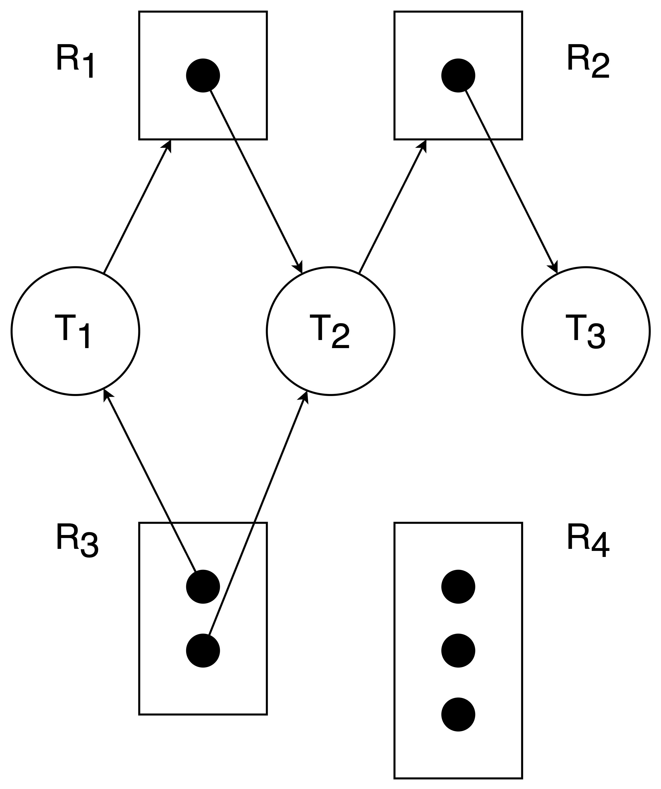
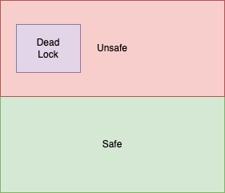

# 死锁

> A deadlock is a situation in which every process in a set of processes is waiting for an event that can be caused only by another process in the set.

> 即存在一个进程/线程的集合，它们互相等待对方持有的资源。

## 死锁建模

- 死锁产生于资源的使用过程，而且通常只在特定情况下才会发生，而正是因为这种不确定性，死锁问题才异常棘手。

**从资源使用的角度来看，我们可以将系统的行为分成三个部分**：

1. **申请资源**
2. **使用资源**
3. **释放资源**

### 资源分配图

- 根据上面的描述，我们可以知道，建模死锁可以从讨论进程/线程与资源的求取关系入手。我们可以用**资源分配图(resource-allocation graph)**来描述这件事。

- 资源分配图是一种有两类节点的**有向图**，我们用圆节点 $T_i$ 表示进程/线程，用方节点 $R_j$ 表示资源，方节点中的实心点表示一个资源类别的一个实例。

- 同时，我们称从进程/线程指向**资源类别**的有向边为**请求边(request edge)**，表示进程/线程 $T_i$ 正在**等待**这种资源；称从**资源实例**指向进程/线程的有向边为**分配边(assignment edge)**，表示资源 $R_j$ 被分配给进程/线程 $T_i$，即目前进程/线程 $T_i$ 持有一个（一条边表示一个）资源 $R_j$ 的实例，例如下图：

 {width=40%} 

- 当资源分配图中**不存在环**时，说明**不会出现死锁状态**；

- 当资源分配图中**存在环**时，系统**可能**处于死锁状态，也可能不处于死锁状态；

    - 特例：如果与环相关的节点都只有**一个实例**时候，系统处于死锁状态；

- 换句话来说，资源分配图中**存在环**，是系统处于死锁状态的**必要条件**。

### 安全状态与不安全状态

- **安全状态(safe state)**指存在**安全序列(safe sequence)**的状态，系统按照 safe sequence 的顺序执行进程/线程和分配资源，就不会出现死锁；相对应的，**不存在安全序列**的状态称为**不安全状态(unsafe state)**。具体来说，safe sequence 的定义如下：

- 对于safe sequence <$T_1, T_2, ..., T_n$>，每一个线程还需要的资源$R_j$为 $\text{need}_{i, j}$, 已经分配的资源为 $\text{allocated}_{i, j}$，这个状态下空闲的资源为 $\text{avalable}_j$

- 那么按照这个序列走下去的话，需要让空闲的资源 $\text{avalable}_j$ **加上** 先前线程释放过（即allocate）的资源 $\text{allocated}_{i, j}$，始终**大于等于**下一个线程的 $\text{need}_{i, j}$

- 所以，只要能保证系统始终运行在safe state下，就能够避免死锁的发生；三者的关系如下

 {width=40%} 

## 死锁的条件

死锁的出现，需要**同时满足四个条件**：

1. **互斥(mutual exclusion)**：死锁的资源必须是非共享的，即**一次只能被一个进程/线程使用**；这就导致了**等待释放**

2. **持有并等待(hold & wait)**：死锁中的进程/线程在等待资源的同时，也**必须至少持有一个资源**

    - 就是因为**持有**，所以才有**被等待**，于是前两个条件叠加，开始循环

3. **非抢占(non-preemtive)**：死锁中的进程/线程只能在使用完资源后主动释放资源，其**持有的资源无法被其它进程/线程抢占**；这就导致了**循环无法被打破**

4. **循环等待(circular wait)**：wait for graph有环

## 死锁的处理

1. 开发者逻辑上没有死锁

2. **死锁预防（deadlock prevention）**：使用某种规范或者协议保证死锁不会出现

3. **死锁避免（deadlock avoidance）**：禁止可能产生死锁的行为发生

    - 与 2. 的主要区别是：在 prevention 规范下所有行为都不会产生死锁；而 3. 则是不约束行为，但是**禁止可能产生死锁的行为执行**

4. **死锁检测（deadlock detection）**和**死锁解除（deadlock recovery）**：允许死锁的出现，但是检测到死锁时，需要消除死锁问题

## 死锁预防

- **死锁预防(deadlock prevention)**的核心思路是**破坏死锁产生的必要条件**。由于「要想死锁出现，四个条件必须同时满足」，所以我们如果能保证四个条件中**某一个一直不成立**，那么死锁将永远不会产生

1. 破坏**互斥（mutual exclusion）**：

    - 可以认为这个条件是无法破坏的，很多资源天生就是互斥的

2. 破坏**持有并等待（wait & hold）**：

    - 有个想法就是，我们只允许一个进程/线程只能在**“等待”和“被等待”之间二选一**，**让一个线程/进程一旦申请资源就一次性获取所有资源，如果没法一次性获取所有资源就释放已经申请到的资源，通过这种方法避免了循环等待的产生**

3. 破坏**非抢占（non-preemtive）**：

    - 通过**允许进程/线程强行抢占另外一个进程/线程持有的资源**，可以破坏被动的等待关系，从而避免死锁；

    - 但是有些非抢占是天然性的，抢占会导致任务失败；同时抢占还会**饥饿**问题，总体难以实现且效率不高

4. 破坏**循环等待（circular wait）**：

    - **通过给资源编号，规定进程/线程只能按特定的顺序申请资源，就不会出现循环等待的情况**

    - 由于需要大量设计，所以带来了资源的扩展性较差的问题；

## 死锁避免

- **死锁避免(deadlock avoidance)**通过阻止可能让系统进入死锁状态的行为，来解决死锁问题。即：**如果这么做可能导致死锁，那我就不这么做，以此来避免死锁**。

### 资源分配图算法

- 资源分配图算法较为直接，它与安全状态的概念无关，直接检测某种分配是否会导致死锁发生，如果该分配会导致死锁发生，则不进行该分配。但是需要注意，该算法**只适用于每个资源类别中都只有一个实例**的情况。（因为它以资源分配图中的那个特例为原理！）

- 我们要在资源分配图的基础上，引入一条**诉求边(claim edge)**，用虚线表示，它从进程/线程 $T_i$ 指向资源 $R_j$，表示进程/线程 $T_i$ 会在未来申请资源 $R_j$。

- 现在资源分配图的分配过程是：

1. 进程/线程 $T_i$ 被添加到资源分配图中时候，需要连好**所有相关的 claim edge**；

2. 进程/线程 $T_i$ 申请资源 $R_j$ 时候，如果这条边变为 assignment edge 不会导致成环，则将 claim edge 转化为一条 request edge $T_i$→$R_j$；（**注意，这里需要判断的是 assignment edge，而转化的是 request edge**）（其实就是先**假设把资源分配给这个线程**，看看这个时候会不会和未来的别的 request 构成循环等待啊）

3. 进程/线程 $T_i$ 获得资源 $R_j$ 时候，将 request edge 转化为一条 assignment edge $R_j$→$T_i$；

4. 进程/线程 $T_i$ 释放资源 $R_j$ 时候，将 assignment edge 删去；

---

### 银行家算法

- **银行家算法(Banker's algorithm)**弥补了资源分配图算法只适用于每个资源类别中都只有一个实例的情况的缺陷，**它支持每个资源类别不止一个**的情况，但是效率不如分配图算法。

- 银行家算法要求每个进程/线程给出执行过程中**所需要的各类资源的最大量**，同时维护一些数据以动态地计算安全状态。就是需要动态地检测某个资源申请是否会导致系统进入不安全状态，如果会导致系统进入不安全状态，则等待资源足够再分配。

!!! tip "数据结构"

    - Available[m]: 每种资源的剩余可申请量
    
    - Max[n][m]: 每个线程所需的各类资源的最大量
    
    - Allocation[n][m]: 当前每个线程各资源的分配量
    
    - Need[n][m]: 当前每个线程仍需的各资源量
    
        - Need[i][j] = Max[i][j] - Allocation[i][j]

- 银行家算法分为两个部分，分别是**安全算法(safety algorithm)**和**资源请求算法(resource request algorithm)**。前者检测当前状态**是否处于不安全状态**，后者以前者为基础，**判断是否允许当前资源请求发生**。

---

#### 安全算法

- 安全算法通过**寻找是否存在一个安全序列**来判断当前状态是否处于安全状态。我们以一种**近似贪心的策略**去模拟安全序列的资源分配过程，就可以判断是否存在安全策略。

- 因为对于所有可以作为安全状态下一项，由于执行它们后，等到进程/线程运行结束，**余下的资源只会更多不会更少**（对比运行前后，会多出来原本分配给这些进程/线程的那些资源），**因而只要符合条件，就可以作为下一项，步步可行最终也可行**。

**安全算法的模拟过程 (The "Principle" in action)：**

1. 银行家（OS）环顾一圈（所有进程）。

2. 它试图找到**至少一个**客户（进程 $P_i$），这个客户的**未来需求 (`Need`)** **小于或等于**银行家**当前手头的资金 (`Available`)**。

3. **如果找到了（比如 $P_i$）：**
   
   - 银行家**假装**把 $P_i$ 需要的钱（`Need`）都给了它。
   
   - $P_i$ 拿到了所有它需要的钱（达到了 `Max`），它保证能完成工作。
   
   - $P_i$ 完成工作后，会把它**所有的**借款（`Allocation`）都**还给**银行家。
   
   - 银行家**收回了这笔钱**，它手头的资金 (`Available`) 变多了！(`Available = Available + P_i.Allocation`)。

4. **重复：** 银行家（OS）拿着这笔**变多了的**资金，**再次**环顾一圈**剩下**的客户，寻找下一个能满足的客户。（所以整个过程就是一次**“贪心”遍历**，因为先满足了别人收了款，还是承担不起接下来的线程，那就说明没办法了）

5. **最终裁决：**

   - **安全状态 (Safe State):** 如果银行家能找到一个序列（例如 $P_1 \to P_3 \to P_2$），使得**所有**客户都能通过这个过程完成工作并还款，那么系统就是**安全**的。这个序列（$P_1 \to P_3 \to P_2$）就叫**安全序列 (Safe Sequence)**。

   - **不安全状态 (Unsafe State):** 如果银行家在某个时刻，发现自己手头的资金 (`Available`) **不足以满足任何一个**尚未完成的客户的**未来需求 (`Need`)**，那么系统就是**不安全**的。（它**不一定**会死锁，但**有可能**会）。

#### 资源请求算法

- **资源请求算法(Resource-Request Algorithm)**比较简单，就是对于一个请求资源的线程$P_i$，检查比对 `need`和`available`；然后**模拟分配**，系统在这个模拟状态上运行**安全算法**，**检查系统是否保持安全**，只有安全了才会允许这次资源分配

## 死锁检测

- **死锁检测(deadlock detection)和死锁解除(deadlock recovery)**搭配使用，其核心思路是不对资源请求做过多约束，而是在检测到系统中存在死锁时，去处理死锁。其中的第一步就是检测到死锁。

### 面向单实例资源

- **等待图(wait-for graph)**是资源分配图的化简，该算法**只能解决每个资源类别中只有一个实例**的情况。

- 在资源分配图一节中我们知道，对于每个资源类别中只有一个实例的情况，只要有环就会有死锁，而只要能检测这个环，就能检测死锁。而实际的资源分配图中资源和进程/线程的节点从是成对出现在环中，而 wait-for graph 则是抓住主要矛盾，只保留进程/线程的节点（请读者思考为什么可以这样）以减小点的数量，提高效率。

- 通过动态地维护这个 wait-for graph 和定期调用一个环检测算法，来实现死锁检测。

 {width=40%} 

## 死锁解除

- **死锁解除(deadlock recovery)**虽然是 "recovery"，但是实际上是破坏死锁而并没有恢复到一个死锁不存在的状态，所以翻译为解除。对于已经产生的死锁，至少得死一个，我们需要作出决断。书本中提到了终止和资源抢占两种方法，但本质上是一样的，所以并列地给出：

1. **都别活**，杀死所有死锁中的进程/线程；

    - 开销很大，因为所有这些工作都相当于白费了，而且并不是随随便便就能杀的；

2. 一个一个杀，杀到没有死锁；
    
    - **以特定顺序杀这些进程**，可以优化表现，例如按照优先级从低到高杀；

3. 留活命，但是需要回滚部分进程，强行抢占占有的资源；
    
    - 很难界定应该回滚到哪里，回滚也难实现，为了回滚也需要存储更多的信息，开销很大；
    
    - 又看到抢占这两个字，所以这里也会有**饥饿问题**，解决方法也和之前一样，通过**考虑优先级，并将被抢占（被迫回滚）的次数纳入优先级的考虑范畴**。

