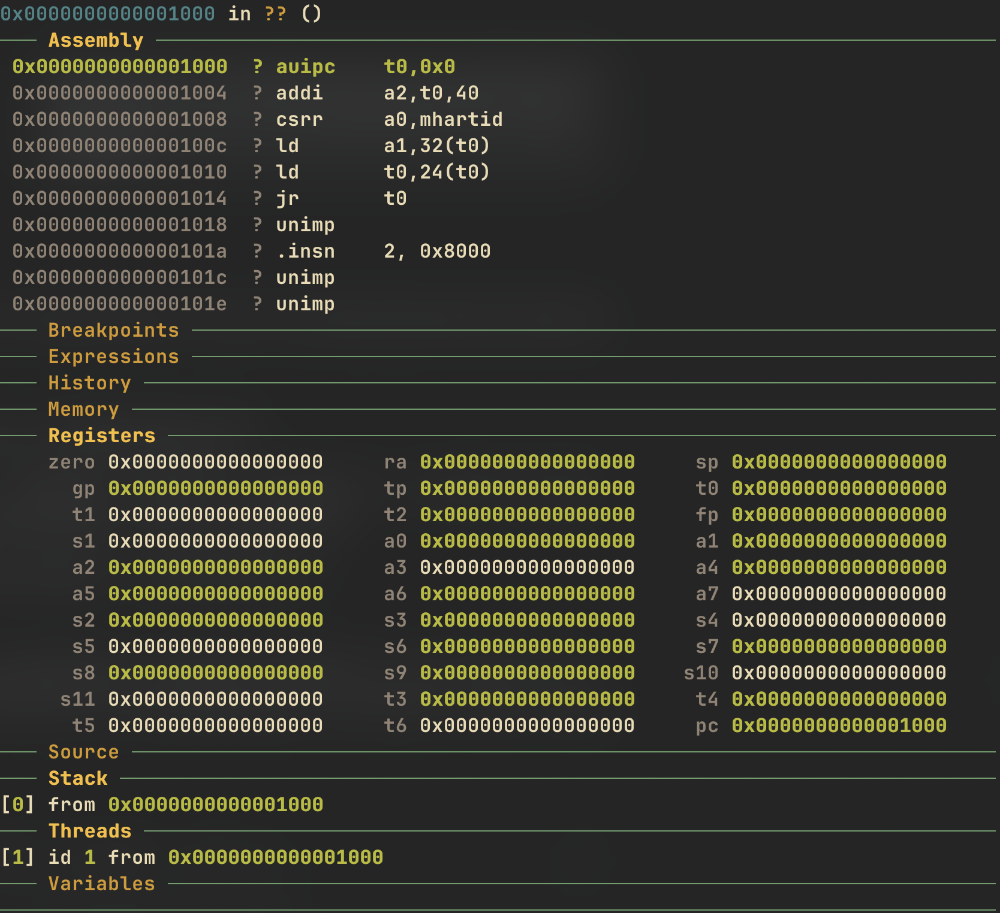
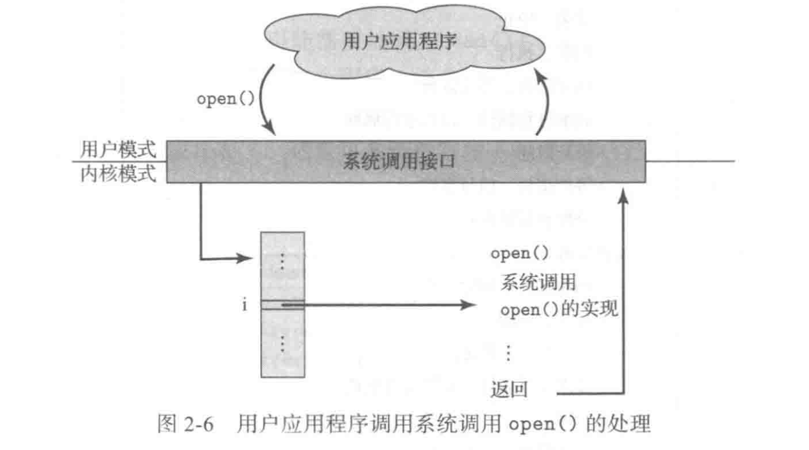

# Overview

## 什么是操作系统

> 操作系统是连接软件和硬件的桥梁。因此想要理解操作系统，我们首先需要对操作系统的服务对象 (**应用程序**) 有更精确和深刻的理解

### 应用视角的操作系统

- **要想理解 “操作系统”，就要理解什么是 “程序”**

- Everything (高级语言代码、机器代码) 都是**状态机**；而编译器实现了两种状态机之间的翻译。

!!! tip "计算机系统的状态机模型"
    1. 状态
        - 内存、寄存器的数值

    2. 初始状态
        - 由系统设计者规定（CPU Reset）

    3. 状态迁移
        - 从PC取指令执行

- 所以，**程序 = 状态机**；**但是**无论何种状态机，在没有操作系统时，它们只能做**纯粹的计算**，甚至都**不能把结果传递到程序之外**

- 于是这些涉及到“程序外的状态”的API，就是**系统调用——程序与操作系统沟通的唯一桥梁**

### 硬件视角的操作系统

- 一句话：硬件**根本不知道有没有操作系统**，它只是个无情地执行指令的状态机

- 这就涉及到计算机系统中的**抽象**，下层不需要知道上层怎么用

- 硬件只干三件事情：执行指令，响应中断，输入输出

- 那么此时操作系统其实就是一个**普通的（二进制）程序**

    - 接管了中断，I/O ...

    - 把应用程序**"放"**到CPU上运行

---

#### 固件——硬件和操作系统之间的桥梁

- **Firmware** 是**存储在硬件设备**中的一种特殊软件，直接嵌入到硬件芯片（如 ROM、EEPROM 或 Flash 存储器）中

- Firmware 是**硬件**的“灵魂”：没有固件，硬件只是一堆无法工作的硅片和电路。但这里我们主要关注计算机主板上的firmware，也就是我们常说的BIOS/UEFI

    - BIOS（Basic Input/Output System）是传统 x86 电脑主板上的固件，负责开机自检、硬件初始化，并引导操作系统启动。

    - 新一代主板已用 UEFI（Unified Extensible Firmware Interface）取代传统 BIOS，但 UEFI 本质上仍是固件。

??? tip "使用QEMU时的观察——OpenSBI"
    - OpenSBI 是 RISC-V 架构的“标准启动固件和运行时环境”，类似于 x86 架构上的 BIOS/UEFI。

    - 在使用qemu模拟RISC-V架构下的linux系统时，使用gdb调试可以看到pc初始位于`0x0000000000001000`的低地址；GDB显示 `??` 意味着它不知道当前地址`0x1000`对应的是哪个函数，因为在启动GDB时，加载的是Linux内核的符号文件（**vmlinux**）。GDB只认识Linux内核中的所有函数（比如`start_kernel`）。

    - 此刻，这台虚拟的RISC-V CPU正运行在最高权限的**M-Mode（机器模式）**下。OpenSBI作为固件，它的职责就是在M-Mode下完成底层初始化，然后加载并跳转到S-Mode（监管者模式）的Linux内核。

    

??? note "固件的主要工作"

    1. **开机阶段**：

        - **硬件初始化** (Hardware Initialization)：这是最底层、最基础的工作。firmware检测 CPU、内存、硬盘等硬件是否正常。当CPU上电时，内存、时钟、总线等都处于未初始化状态。固件负责按照硬件规格，将它们设置为一个稳定、可工作的状态。

        - **提供平台信息**：固件会探测并整理好硬件信息，比如：有多少个CPU核心？内存有多大，地址在哪里？有哪些设备（串口、磁盘控制器等）？然后通过一种标准化的方式（在RISC-V和ARM中通常是设备树 Device Tree）告诉操作系统。

        - **加载引导程序**：（如 GRUB），进而启动操作系统。

    2. **运行时**：

        - **提供运行时服务**：固件会驻留在最高权限的M-Mode，为操作系统提供一些它自己无法（或不被允许）完成的底层服务。操作系统通过 Firmware 提供的接口（如 ACPI）控制电源管理、风扇转速等。

    3. 硬件抽象层：

        - Firmware **隐藏了硬件的具体细节**（比如不同厂商的 SSD 控制器差异），操作系统只需调用统一接口。

        - 因此，Firmware是由**硬件开发商**提供的，能很好地对硬件进行管理，然后为操作系统提供服务

??? note "Firmware和Bootloader的区别"
    - Firmware是一个更宽泛的概念，它其中包含了一个基础的Bootloader；firmware贯穿了操作系统**启动到运行时**，而Bootloader生命周期集中在**启动阶段**

    - 在QEMU的**简单场景**下，OpenSBI **既是固件，同时也扮演了引导程序的角色**。因为QEMU启动环境足够简单，OpenSBI的能力也足够强，它可以直接找到（通过-kernel参数）并加载Linux内核。这个场景下，你不需要一个额外的、更复杂的引导程序。

    - 而对于大多数**复杂**的真实物理机来说，Firmware 和 Bootloader 是两个**独立的、接力工作**的程序。**Firmware** (如PC的UEFI) 先启动，它做完最底层的硬件初始化。但它本身能力有限，不认识`ext4`文件系统。于是，它就在一个约定的分区（EFI系统分区）里找到并执行**GRUB**。**Bootloader** (GRUB) 接管控制权。GRUB非常智能，它能读懂`ext4`文件系统，找到`/boot/vmlinuz-...`这个文件，把它加载到内存，然后把控制权交给Linux内核。

## 操作系统的服务

- 操作系统提供的服务有两方面，一方面提供**用户功能**，另一方面不是为了帮助用户而是为了**确保系统本身运行高效**

- 服务用户：**用户界面， 程序执行， I/O操作， 文件系统操作， 进程通信， 错误检测**

- 系统运行：**资源分配， accounting, 保护与安全**

### 系统调用

> 系统调用(system call)提供操作系统服务接口。这些调用通常以C或C++编写，当然，对某些底层任务(如需直接访问硬件的任务)，可能应以汇编语言指令编写

- 操作系统为了安全性和易用性的考量，并没有直接把内核里复杂的系统调用暴露给用户使用，而是进行了多层的封装：

    1. **应用层API（库函数）**：
    
        - 这是直接暴露给应用程序开发者的“友好”函数，通常由编程语言的标准库（如 C 库 glibc）提供。比如，`printf()`, `fopen()`, `malloc()`, `pthread_create()`

        - **简化与抽象**: 开发者不需要知道底层复杂的**系统调用号、寄存器约定**等。比如 `printf` 背后可能涉及到复杂的缓冲处理，最后才调用 `write` 系统调用。`fopen` 也会做很多文件缓冲区的管理工作。

        - **可移植性**: 同样一个 `fopen()` 函数，在 Windows、Linux、macOS 上都能用。但它们底层的系统调用是完全不同的。库函数帮助我们**抹平了这些差异**。

        - **效率**: 某些库函数（如 `printf`）会使用缓冲区技术，将多次少量的数据合并成一次大的数据，然后再一次性通过系统调用写入，**减少了用户模式和内核模式之间频繁切换的开销**。

        - **并非一一对应**: 一个库函数**可能调用多个系统调用，或者一个都不调用**！ 比如 `malloc` 在小内存分配时可能只是在用户空间管理内存池，根本不涉及系统调用；只有在需要向操作系统要一大块新内存时，才会调用 `brk` 或 `mmap` 系统调用。

    2. **系统调用接口**

        - 这是夹在**应用层和内核层之间**的、一个非常薄但至关重要的规范和机制。

        - 它不是一个函数，而是一套**协议**，包括：

            1. 一个特定的 CPU 指令（例如 x86 架构上的 syscall 或旧的 int 0x80）。

            2. 一套参数传递的约定（例如，把系统调用号放入 eax 寄存器，把参数按顺序放入 ebx, ecx 等寄存器）。

            3. 一个由内核维护的“系统调用表”，内核根据传来的调用号去这张表里查找对应的处理函数。

        - 开发者几乎从不直接使用这一层。都是第一层的库函数在幕后为我们处理了这一切。

    3. **内核中真正的系统调用实现**

        - 这是在内核空间中运行的、拥有最高权限的、真正执行具体任务的内核函数。比如，`sys_write`, `sys_open`, `sys_fork`

        - **直接操作硬件**: 这些函数可以直接访问硬件设备驱动、物理内存、进程列表等核心资源。

