# Process Management

## 进程

- 程序本质上是静态的、存储在硬盘上的指令数据，而当它附带运行程序所需要的必要信息进入内存，得到相关资源后，它成为一个动态的、与计算机资源互动的实体，这个实体就是**进程(process)**。

- 进程是是操作系统进行资源分配和调度的一个**独立单位**，它以特定形式存在于内存中，具有一定的封闭性，是多道技术的重要基础。

### 进程的形式

- 前面我们提到，进程动态地存在于内存中，因此除了命令以外，还包括其运行时的动态信息。抽象来说，主要包含这三个维度：

① **用来跑的代码**；② 跑的过程中，不断会被更新的**数据**；③ 用来维护、控制进程的**控制信息**。

- 进程在内存中存在需要一块**虚拟的地址空间**以存储上述这些内容。其包含两个部分，即虚拟地址空间中的**用户部分**和虚拟地址空间的**内核部分**。

!!! note "**用户部分**"
    <center> 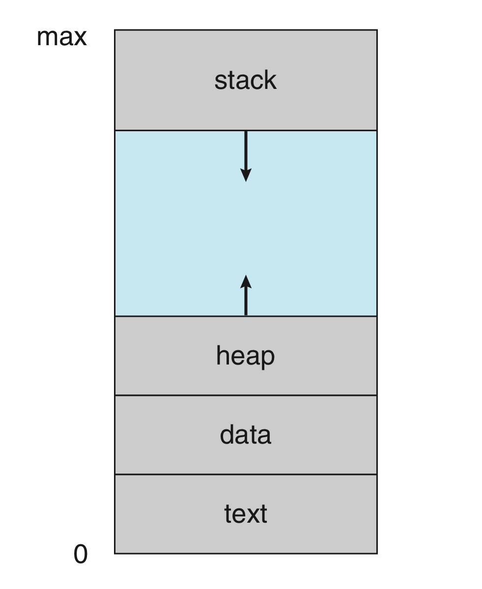{align=right width=35%} </center>

    - Text section:
        - 存储代码；
    - Data section:
        - 存储代码中的全局变量、静态变量；
    - Heap section:
        - 常说的“堆”，被动态分配的内存；
    - Stack section:
        - 常说的“栈”，存储一些暂时性的数据，如函数传参、返回值、局部变量等；

    - 可以发现，**text** 和 **data** 部分所需要的空间在**一开始就被确定**，而 **heap** 和 **stack** 都可能**动态的扩展和收缩**。观察右图，heap 和 stack 是相向扩展的，于是整一块的大小能够固定下来，而在内部进行有限制的动态分配。当然，heap 和 stack 的区域并不会交叉。


    !!! tip "C程序的内存分布"

        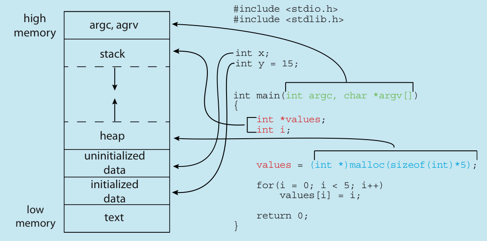

        之所以把有初始值的静态变量和没初始值的静态变量分开来，是因为我们可以在一开始只存储没初始值的静态变量的大小，而在真正第一次访问的时候才分配内存，以此来实现减少内存占用。

        通常来说，未初始化的静态变量一般都被放在 `.bss` 段，而在被初始化的时候移动到 `.data` 段。

!!! note "**内核部分**"

    - **进程控制块(process control block, PCB)**是操作系统中用来描述进程的一种数据结构，它包含了进程的所有信息，是操作系统中最重要的数据结构之一。可以说，PCB 是进程存在的唯一标志。

    <center>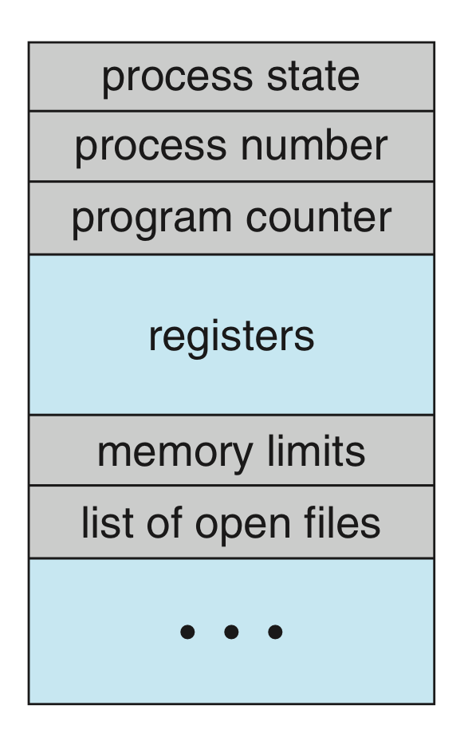{align=right width=35%}</center>

    - Process state:
        - 进程的状态
    - Program counter:
        - 标识该进程跑到了哪里，由于进程是动态的，每一被切换都需要保证下一次能无缝衔接之前的进度，所以需要存储每次的工作状态；
    - CPU registers:
        - 保存进程相关的寄存器信息；
    - CPU-scheduling information:
        - CPU 调度参考的信息，包括优先级、调度队列的指针、调度参数等；
    - Memory-management information:
        - 包括页表、段表等信息，具体与实现的内存系统有关；
    - Accounting information：
        - 一些关于进程的动态数据的统计和记录，比如总共已经跑了多久、时间限制、进程号等；
    - I/O status information:
        - 被分配给进程的 I/O 设备列表、打开的文件列表等；


### 进程的状态


- `new`:

    - 进程正在创建过程中，包括申请 PCB，分配初始资源等；

- `running`:

    - 进程正在运行，即正在使用 CPU 资源；

    - 有几个核就最多有几个进程处于 running 状态；

- `ready`:

    - 进程已经准备好了，只差 CPU 资源，一旦有 CPU 资源待分配，就会有就绪态的进程变为运行态；

    - 如果有进程处于就绪态，就一定有进程处于运行态；
    
    - CPU 调度实际上指的就是若干进程在就绪态和运行态之间的切换；

- `waiting`:

    - 进程正在等待某个事件的发生，比如等待 I/O 完成、等待某个信号量等；

    - 此时即使有空余的 CPU 资源，该进程也无法继续；
    
    - 一般进程从运行态进入阻塞态是主动的，离开阻塞态进入就绪态是被动的；

- `terminated`:
    
    - 进程因为某些原因终止，结束运行，需要释放资源；

---

- 进程在**就绪态**需要等待 CPU 资源的**派发(dispatch)**，接受调度；在**阻塞态**需要等待对应的 I/O 完成或事件完成，因而存在一种结构需要去维护这些“相对静止”的进程。通常使用**就绪队列(ready queue)**和**等待队列(wait queue)**来实现，其基本结构如下：

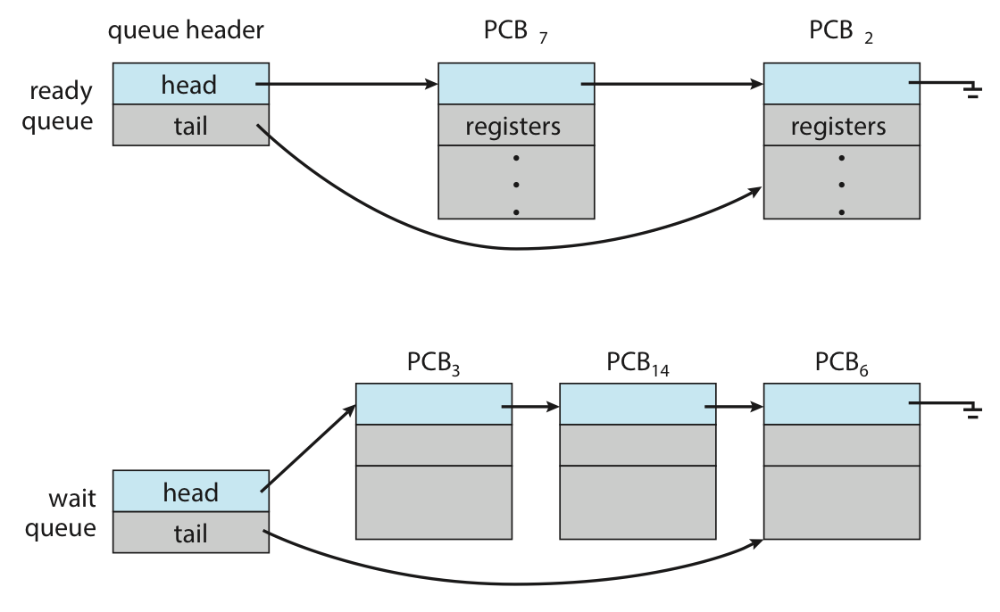

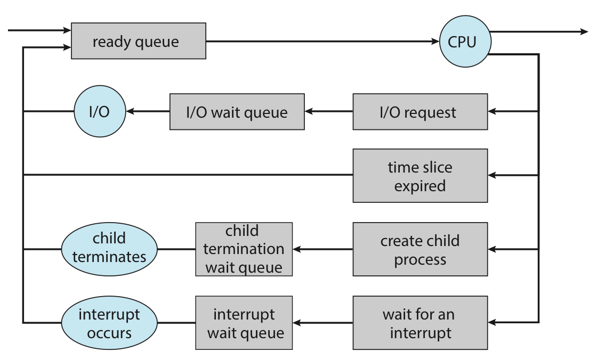

- 类似地，还有Job queue（系统中所有的进程）、Device queue（IO请求）

## 进程管理

- 用户进程在操作系统中，总体上来讲遵循一个树状的组织形式，每一个进程都有一个唯一标识符进程号（通常被称为 pid，但在特定语境下可能有不同的含义）。如下图是 Linux 的一个进程树。

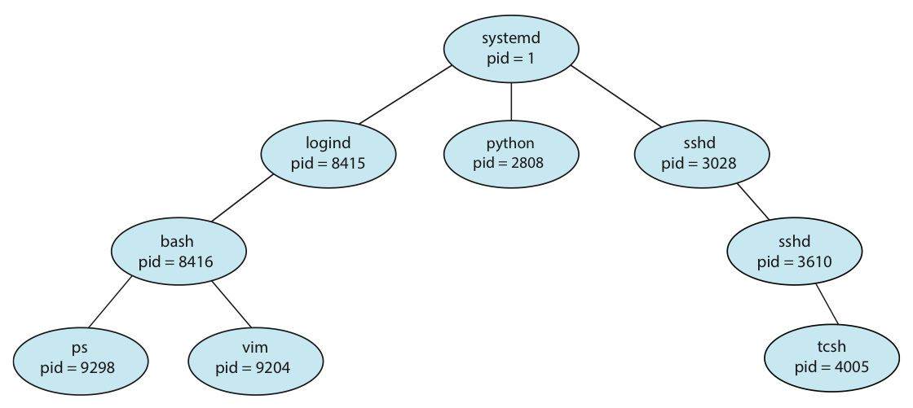

- 你也可以在 Linux 中使用 `pstree` 来查看进程树。 言下之意就是进程之间存在一种父子关系，即 child 进程是由 parent 进程创建的，因此进程除了自己的 `pid` 还有 `ppid` 来标识它的 parent 进程。

### 进程的创建

- child 进程的资源可能直接来自操作系统的分配，也可能来自 parent 进程的分配，限制使用后者的好处是能够避免因为创建太多子进程而导致资源不够用。特别的，我们观察到这棵树的根是 `systemd`，历史上也曾叫过 `init`，它是操作系统启动后运行的第一个用户进程，至少在 Linux 中，它的 `pid` 被分配为 1，而它的 `ppid` 是 0，可以理解为这个进程的 parent 是 scheduler 而非一个进程[^2]。


- 在 Linux 中，我们可以使用 `fork` 来创建一个 child 进程，在这里先引入如何实现是为了引入一个可以借来描述过程的语言，我们以下面的 C 程序为例展开之后的讨论。


```c linenums="1" hl_lines="10 18"
#include <stdio.h>
#include <unistd.h>
#include <sys/wait.h>
#include <sys/types.h>

int main() {
    printf("A process starts!\n");

    pid_t pid;
    pid = fork();

    if (pid < 0) {
        printf("Fork failed!\n");
    } else if (pid == 0) {
        // sleep(1);
        printf("pid is zero, so it's child process!\n");
    } else {
        // wait(NULL);
        // sleep(1);
        printf("pid is nonzero thus it's parent process!\n");
    }
}
```

- 第 10 行高亮的 `fork()` 语句创建了一个进程，该进程只有进程号与 parent 进程不一样，同时通过检查返回值 `pid` 来判断属于 parent 还是 child。

- 如果第 18 行仍然被注释，那么 parent 进程和 child 进程将并发执行，即完成 `fork()` 后两个进程都从 11 行开始继续向下**并发的执行**，互不阻塞；如果 18 行的注释被取消，那么 parent 进程将等待 child 进程结束后再继续。

- 逻辑上创建的新进程有两种情况：

1. **复制 parent 进程的代码数据；**

2. **载入新的程序并继续执行；**

- 而实际在 Linux 中，第一种通过 `fork()` 实现，第二种通过 `fork()` 后 `execXX()` 实现，`execXX()`会覆盖那个进程的地址空间，以实现**执行其他程序**

!!! note "**写时复制（copy on write）**"

    - 可以发现，`fork` 的复制操作可能会带来**较大的开销**。所以有一种技术称为 **copy on write**，也就是只有当需要发生内容修改的时候，才真正去复制父进程的内容，也就是一种 **“lazy copy”**。

### 进程的终止

- 当进程调用 `exit()` 这个系统调用时，这个进程将被终止，这意味着这个进程将不再执行，其**资源将被释放，同时返回状态值**，而这个状态值将被 parent 进程的 `wait()` 接收。

- 特别的，如果 parent 进程尚未调用 `wait()`，则这个 child 进程还不会完全消失，因为要返回的东西还没返回（child 并不知道 parent 会不会、什么时候来回收它）。这种逻辑上已经终止，但仍然占有一部分资源，**等待 parent 进程调用 `wait()` 的进程**，我们称之为**僵尸进程(zombie)**。

- 一个进程变成僵尸进程是很常见的。关键在于，如果 parent 进程不调用 `wait()`，那等 parent 终止后，这个僵尸进程可能仍然一直存在。此时这个僵尸进程同时是一个孤儿进程(orphan)，即没有 parent 进程的进程。这是不合理的。UNIX 的解决办法是，让所有孤儿进程都成为 `init/systemd` 的 child 进程，由 `init/systemd` 来 `wait()` 它们。

### 进程间通信

- 如果一个进程受到其它进程的影响，或会影响其它进程，那么我们称之为**协作进程(cooperation process)**，而**进程间通信(inter-process communication, IPC)**支持了进程协作，以实现进程间的数据交换。

- 信号量(semaphores)：

- 共享内存(shared memory)：

    - 相比下面几种更快，需要用到 system call 的地方只有建立共享内存的时候；

- 消息传递(message passing)：

    - 在分布式系统中更容易实现，对于**少量数据通信**很有用（因为不需要处理冲突问题）；

- 文件 / 管道(pipe)：
    
    - 管道本质上也是一种文件，但一个管道只支持单向传输，即只能 A 写 B 读，如果要**实现双向需要两个管道**；

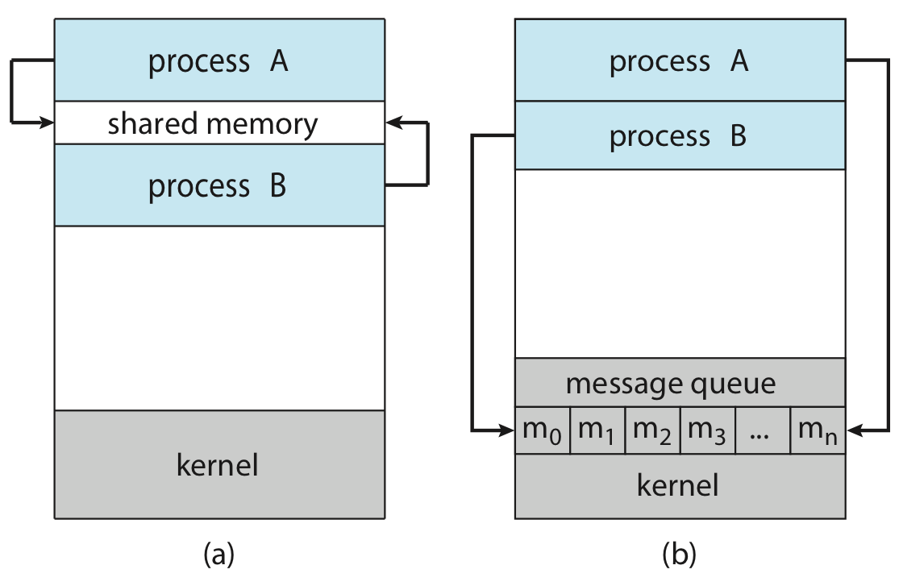


## 进程调度

- 多道技术引入后，内存中同时存在多个进程，进程的数量我们称之为多道程序度(degree of multiprogramming)。一段时间内若干进程并发执行，因此**调度问题(scheduling)**——CPU scheduler 将决定在**何时将 CPU 资源分配给哪一个就绪进程，使之进入运行态**——这个问题就很重要了。总体来讲，我们需要实现一个高效、公平的的调度，以此保证 CPU 利用率足够高，同时又保证计算机功能正常运作。

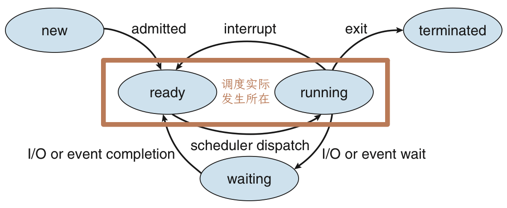

### 调度的时机

- 所有的状态都是围绕 `ready`和`running`展开的

- 我们可以发现无非只有两种情况：**抢占式（non-preemptive）**与**非抢占式（preemptive）**

1. 进程自愿放弃CPU资源：`running` -> `waiting/terminated`

2. 强制剥夺CPU资源，不占有资源的进程索取 CPU 资源成功引起的：`running` -> `ready`（比如时钟中断），`waiting` -> `ready`（更高优先级），`new` -> `ready`（也是高优先级）

- 可以简单地发现，从`running`到`waiting/terminated`为**非抢占式**，从其他态到`ready`为**抢占式**

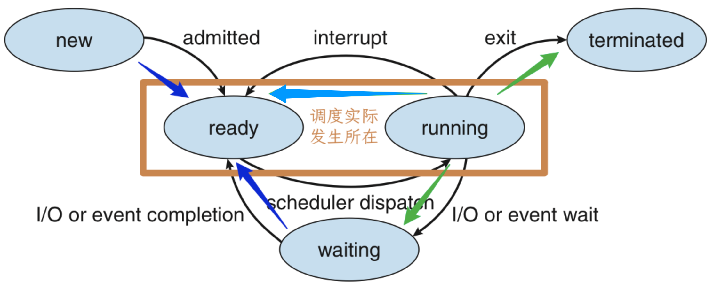

---

### 调度的过程

- 由 CPU scheduler 选择哪一个就绪态的将要被执行后，由 dispatcher 来完成具体的切换工作包括：

1. **在两个进程间进行上下文切换**；

2. **切换到用户态**；

3. **跳转到用户程序中合适的位置以继续进程执行**；

- 而从 dispatcher 停止上一个运行时的进程，完成上下文切换，并启动下一个进程的延时，称为 **dispatch latency**。

??? note "上下文切换"
    
    - 切换进程的时候需要保存“现场”，并在下一次拿出这个进程准备执行之前恢复“现场”，以此来保证进程执行的一致性。这里提到的“现场”被称为**上下文(context)**，表示一种“语境”；而保护-恢复的过程，就是上面提到的**上下文切换(context switch)**。

    - 其中，上下文可能包括 ① CPU 寄存器中的值，② 进程状态，③ 内存的管理信息等。

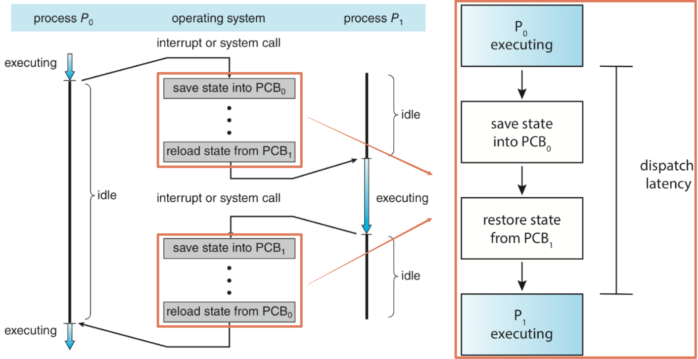

### 调度算法

- **调度算法的指标(scheduling criteria)**：

1. CPU **使用率(CPU utilization)**：

    - CPU **使用时间 / 总时间**，从 CPU 是否足够忙碌来看硬件性能是否充分发挥；

2. **吞吐量(throughput)**：

    - **单位时间内完成的进程数**，从结果来看任务完成是否足够高效；

3. **周转时间(turnaround time)**：

    - 从进程开始建立到进程完成的时间，即包括**等待进入内存、在各种 queue 中的等待时间、在 CPU 中的运行时间、I/O 时间**等，通过观察最大周转时间，能反映调度的效率和“公平性”；

4. **等待时间(waiting time)**：

    - 进程在 **ready queue 中等待的时间的总和**，由于任务所需要的 CPU 时间、I/O 时间不受调度算法影响，所以抛开这些只看在 ready queue 中的等待时间，能反映调度算法的效率；

    - 容易发现，等待时间 = 周转时间 - 运行时间；
    
5. **响应时间(response time)**：
    
    - 进程从**发出请求到第一次响应**的时间，能反应交互式系统中调度算法的“及时性”；

- **上面五个里，前两个越大越好，后三个越小越好。**

#### First-Come, First-Serve (FCFS) | NonPreemptive

- FCFS 是最基本的非抢占式调度方法就是按照进程先来后到的顺序进行调度，可以很简单地通过一个 FIFO 的队列实现。FCFS 最大的优点就是实现简单。

#### Shortest-Job-First (SJF) | NonPreemptive / Shortest-Remaining-Time-First (SRTF) | Preemptive

- SJF 的思路是，当有多个进程处于就绪态时，选择需要**运行时间最短**的进程先运行。这种算法的优点是，**能够保证平均等待时间最小**；但是缺点是，如果有一个进程需要运行时间很长，那么它可能会一直被推迟，从而导致**“饥饿”现象**，此外，我们并不知道进程运行时间有多久。

??? tip "Example：SJF vs. FCFS"

    现在有三个进程，它们将要执行的时间分别如下：

    - P1: 24

    - P2: 3

    - P3: 3
    
    现在它们按照顺序进入 ready queue，请分别计算 FCFS 下和 SJF 下的平均等待时间。

    ??? note "答案"

        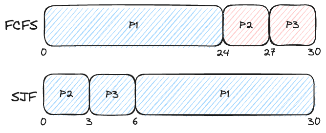

        首先看 FCFS，即按照顺序执行，平均等待时间为 $(0 + 24 + 27) / 3 = 17$。

        现在按照 SJF 来，顺序变为 P2 和 P3 先执行，再执行 P1，于是平均等待时间为 $(0 + 3 + 6) / 3 = 3$。

        ---

        可以发现，使用 SJF 以后对于这种前面放了个大任务的情况平均等待时间大大减少。

- 这种做法又被称为 **Shortest-Next-CPU-Burst**，它是一种**非抢占式**调度算法，但假设我们在执行一个进程的过程中，有一个新的进程加入了 ready queue，而且这个进程的执行时间比正在运行的进程的剩余时间还要短，我们**仍然需要继续执行完当前的进程才行**——因为它是非抢占式的。

- 而显然这个过程是可以通过**抢占式调度来优化**的，于是我们引入了 **Shortest-Remaining-Time-First, SRTF**，其表述是：**总是执行剩余运行时间最短**的进程。其优缺点与 SJF 一致。

??? tip "Example：SJF vs. SRTF"

    现在有三个进程，它们将要执行的时间分别如下：

    - P1: 8

    - P2: 4

    - P3: 9

    - P4: 5

    它们到达 ready queue 的时间分别如下：

    - P1: 0

    - P2: 1

    - P3: 2

    - P4: 3

    请分别计算 SJF 下和 SRTF 下的平均等待时间。

    ??? note "答案"

        - 对于 SJF 来说，在第 0 时刻，只有 P1 可用，所以只能执行 P1；P1 执行结束后所有其它进程都可用了，此时按照正常的 SJF 即可得到结果。

        对于 SJF 来说，在第 0 时刻，只有 P1 可用，所以只能执行 P1；P1 执行结束后所有其它进程都可用了，此时按照正常的 SJF 即可得到结果。

        ```mermaid
        gantt
            title SJF
            dateFormat ss
            axisFormat %S

            section P1
            run: a, 00, 08

            section P2
            ready: b, 01, 08
            run: e, 08, 12
            
            section P3
            ready: c, 02, 17
            run: 17, 26

            section P4
            ready: d, 03, 12
            run: f, 12, 17
        ```

        此时平均等待时间为 $(0 + 7 + 15 + 9) / 4 = 7.75$。

        ---

        对于 SRFT 来说，同样从 P1 开始执行，但是第一秒 P2 进入，发现此时 P1 还剩下 7，而 P2 只需要 4，于是 P2 需要抢占 P1 的资源；之后的过程类似

        ```mermaid
        gantt
            dateFormat ss
            axisFormat %S

            section P1
            run: a, 00, 01
            ready(rest 7): e, 01, 10
            run: g, 10, 17

            section P2
            run: b, 01, 05
            
            section P3
            ready(rest 9): c, 02, 17
            run: h, 17, 26

            section P4
            ready(rest 5): d, 03, 05
            run: f, 05, 10
        ```

        此时平均等待时间为 $((0+9) + 0 + 15 + 2) / 4 = 6.5$。

        ---

        可以发现 SRTF 能够提升 SJF 的效率。

- 但是，这个算法有个最大的问题，现实中我们**不可能提前知道一个程序的剩余运行时间**；但我们可以通过**预测**的方法估计运行的剩余时间，但是既然是预测就会有不准确，所以 SJF/SRTF 并不能实现理论上平均等待时间最优。至于如何预测，书上提供了一个叫 **exponential average** 的方法

#### Round-Robin (RR) | Preemptive

- ​定义一个 **时间片 (time slice / time quantum)** ，即一个固定的较小时间单元 (10-100ms)。除非一个 process 是 ready queue 中的唯一进程，它不会连续运行超过一个时间片的时间。

- Ready queue 是一个 FIFO 的循环队列。每次调度时取出 ready queue 中的第一个进程，设置一个计时器使得进程在一个时间片后发生中断，然后 dispatch the process。

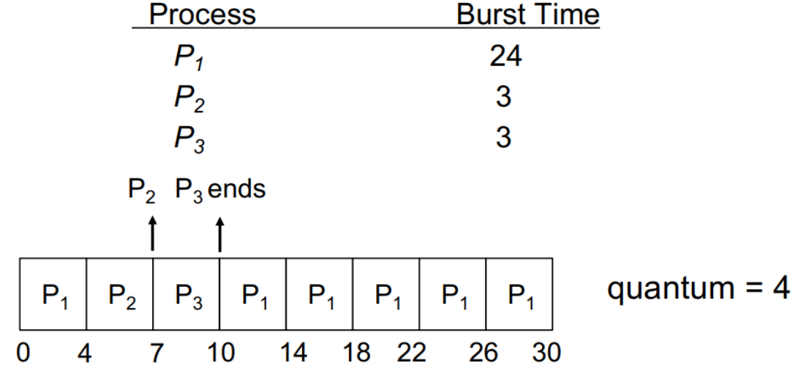

- 相比 SJF 而言，**平均等待时间更长，但响应时间更短**。

- ​RR scheduling 的性能很大程度上取决于时间片的大小。如果时间片**较小**，则 **response/interactivity** 会很好，但会有**较大的 overhead**，因为有较多的 context-switch；时间片较大则响应较差，但 overhead 会较小。如果 时间片->Inf，则RR->FCFS。

- ​在实践中，时间片大约 10~100ms，每次 contest-switch 约 10μs。即 context-switch 的时间花费是比较小的。

#### Priority Scheduling

- 优先级调度的思路是，每个进程都有一个优先级，当有多个进程处于就绪态时，**选择优先级最高的进程**先运行。

- 这种算法的优点是，能够保证优先级高的进程优先运行；

- 但是缺点是，如果有一个进程的优先级很低，那么它可能会一直被推迟，从而导致**“饥饿”**现象。

- 如果把上面这句话的“优先级最高”改成“运行时间最短”/“剩余运行时间最短”，那就和 SJF/SRTF 一模一样了，**SJF/SRTF 实际上就是优先级调度的一个特例**，因而优先级调度当然是可以实现**抢占式和非抢占式**两种的。

- 此外，优先级的分配可以根据使用需求进行设计，它可能是一些测量数据，也可能具有一些被赋予的意义，甚至可以是一些复合的值；优先级也并不一定是静态的，先前我们提到过的饥饿问题，就可以通过动态的优先级来解决：**优先级随着等待时间增加不断增长，等待过久的任务就会被赋予较高的优先级，以此避免饥饿的发生，这种策略叫 priority aging**。

#### Multilevel Queue Scheduling

- 既然调度算法多种多样，他们适配不同的需求，那能否只在特定情况下使用特定算法呢？答案是肯定的，我们可以**将 ready queue 分成多个队列**，**每个队列使用不同的调度算法**，然后再进行队列间调度，这种方法被称为**多级队列调度(multilevel queue scheduling)**。

- 比如，一个操作系统可能分**前台(foreground)程序队列和后台(background)程序队列**，而我们使用时间片来进行队列间调度，但前台占用 80% 的时间，而后台占用 20% 的时间。

- 而在队列内部，我们也可以根据需求使用不同的队列内调度算法。在这个例子中，由于前台程序往往要求更好的响应时间表现，所以我们可以使用 RR 调度；而在后台使用 FCFS 调度。

#### Multilevel Feedback Queue Scheduling

- 更进一步，Multilevel Feedback Queue Scheduling 在 Multilevel Queue Scheduling 的基础上，允许进程在队列间转移，以此实现更灵活更科学的调度。例如，一个进程如果使用了过长的 CPU 时间，它可能被移动到优先级更低的队列；相反，如果一个进程等待了太久，它可能被移动到优先级更高的队列。当然，相对应的，算法复杂度也会提高不少。

## 线程

- **线程**是一种**轻量级的进程**，它在进程的基础上进行划分，是进程内的一个可调度的执行单元，以减小进程 `fork` 和切换的开销为目的。

- 每个线程都有它自己的 thread ID, PC, register set 和 runtime stack。线程与同一进程的其他线程共享 code section, data section, heap, open files 以及 signals。

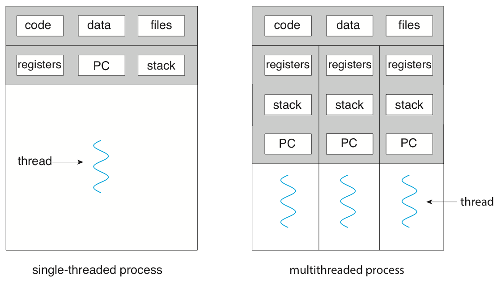

- ​对于支持线程的操作系统，实际调度的是内核级线程而非进程。也就是说，线程是运行以及 CPU 调度的基本单元。（而进程是分配资源的基本单元。）

### 多线程编程的优缺点

- 采用 **多线程编程 (Multi-Threaded Programming)** 的优点包括：

    - **Economy**: 建立线程相比进程是很经济的，因为 code, data & heap 已经在内存中了；另外在同一进程的线程间进行 context switch 时也会更快，因为我们不需要 cache flush。


    - **Resource Sharing**: 同一进程的线程之间天然共享内存，因此我们无需为它们编写 IPC；这也允许我们对同一块内存做并行的处理。但这也会引入风险。

    - **Responsiveness**: 多线程的进程会有更好的响应性，即当一个线程 blocked 或者在做一些长时间的操作时，其他线程仍然能完成工作，包括对用户的响应。
    
        - 例如，在一个 client-server 结构中，我们用一个线程来响应客户端的请求：

        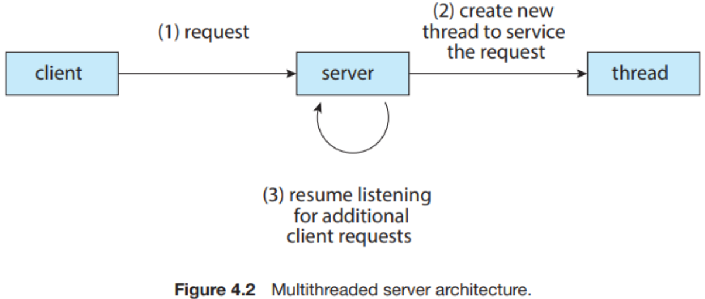

    - **Scalability**: 在多处理器的体系结构中，多线程进程可以更好地发挥作用，因为每个线程都可以在一个处理器上运行；而单线程进程只能在一个处理器上运行。

- 多线程也有一些**缺点**：

    - 如果一个进程出现错误，那么整个进程都会去世（比如浏览器的一个网页挂了，那么可能整个浏览器都会挂）。

    - 由于 OS 对每个进程地址空间的大小限制，多线程可能会使得进程的内存限制更加紧缩（这在 64 位体系结构中不再是问题）。

    - 由于多个线程共享部分内存，因此内存保护会比较困难。

---

### 多线程模型

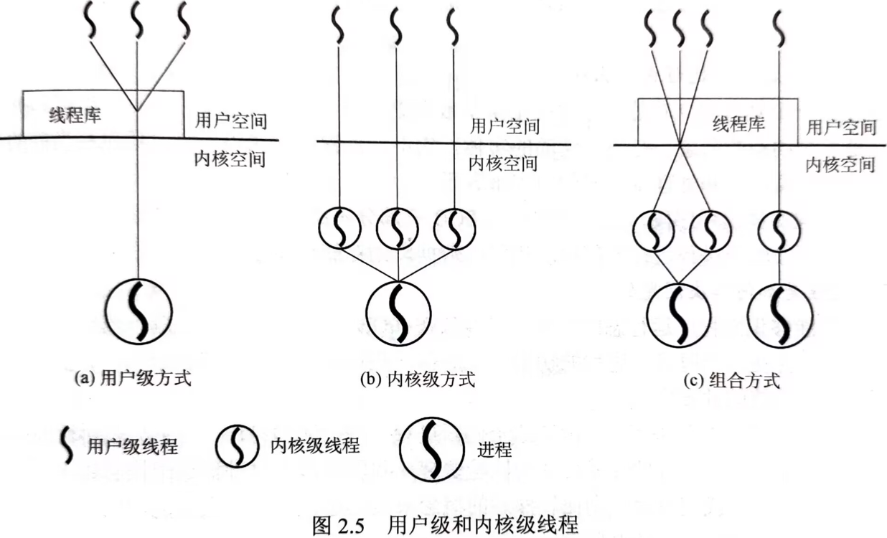

- ​线程实现的重点是共享一些资源；而具体的实现分为 **用户级线程 (User-Level Thread)** 和 **内核级线程 (Kernel-Level Thread)** 两类。

- 用户级多线程在用户空间实现多线程，即使用**线程库(thread library)**利用单个进程的资源，**在用户空间维护多个线程**；而内核级多线程则是由内核支持多线程操作。两者各有优缺点：

- 用户级多线程 **>** 内核级多线程

    - 用户级多线程不需要内核支持多线程，**不需要进入内核态**实现多线程，也不需要占用线程 ID，因此理论上可以比内核级支持更多的线程数；

    - 由于其划分是针对进程的，而**不同进程之间的线程实现没有直接关系**，而且由于是在用户空间实现算法，所以能够更容易的对单个进程内的多个线程的调度算法进行自定义；

    - **用户级线程切换开销小，速度快。可以在不支持线程的操作系统上实现。**


- 用户级多线程 **<** 内核级多线程
    
    - 由于对内核来说，**用户级多线程仍然是一个普通的进程**，所以当用户级的**线程出现阻塞时，内核会认为整个进程都被阻塞**；内核级线程由于是内核实现，所以单线程的阻塞并不会导致整个进程阻塞；

    - 在多核的情况下，**用户级多线程没法利用多核**进行线程并行；显然内核多级线程是做得到这一点的；

---

- 需要注意的是，用户级多线程和内核级多线程并不冲突，因而排列组合后得到多线程主要有如下**三种模型**：

1. Many to One：这种方式其实和只支持用户级线程没区别：

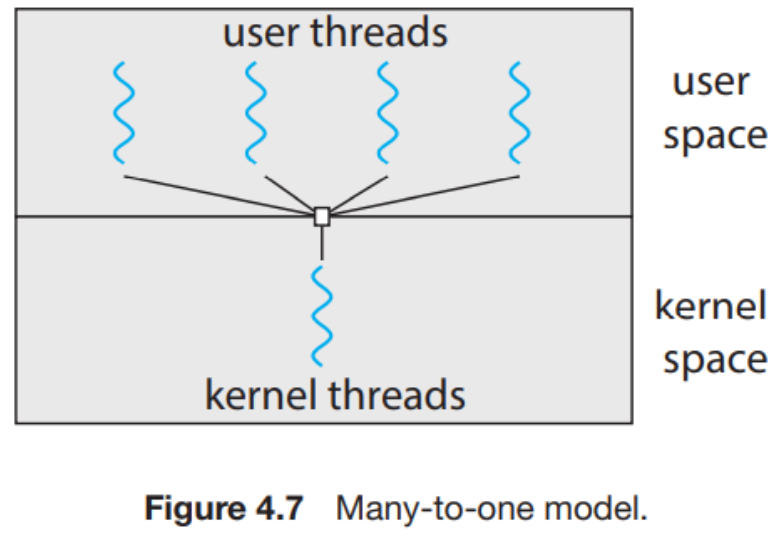

2. One to One：​这种方式和只支持内核级线程没区别：

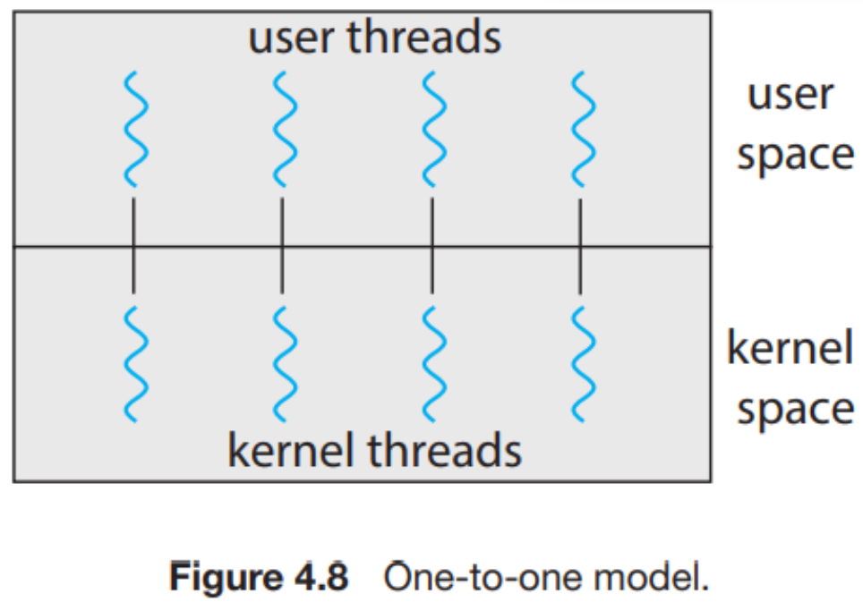

3. Many to Many：​​$n$个用户级线程可以映射到$m(\leq n)$个内核级线程上：

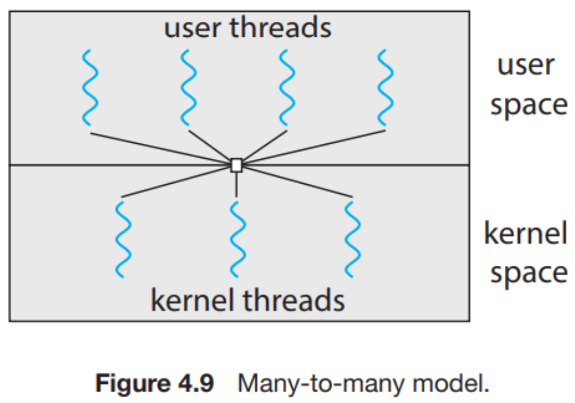

