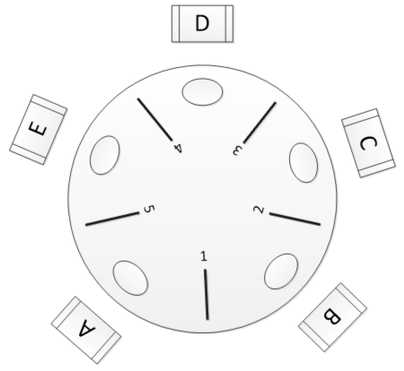

# Synchronization Prombles Examples

## The Bounded-Buffer Problem / Producer-Consumer

- **有界缓冲区 (Bounded-Buffer Problem)** 是并发编程中最经典、最重要的同步问题之一。它完美地演示了为什么我们同时需要 Mutex（用于互斥）和 Semaphore（用于计数与同步）。这个问题也被称为**“生产者-消费者”问题（Producer-Consumer Problem）**

**场景设置**：

1. **生产者（Producer）**：一个（或多个）进程/线程，负责**生产**数据（比如下载文件、处理数据）

2. **消费者（Consumer）**：一个（或多个）进程/线程，负责**消费**数据（比如把数据写入磁盘、渲染到屏幕）

3. **有界缓冲区（Bounded Buffer）**：它们之间共享一个**固定大小**（“有界”，比如大小$N$）的缓冲区（比如一个队列或者数组），这是它们唯一的通信方式

**这个场景会产生三个核心的“同步问题”**：

1. **缓冲区满了怎么办**？

    - 如果缓冲区已满，那么生产者必须**停止生产并等待**，直到消费者拿走了数据

2. **缓冲区空了怎么办**？

    - 如果缓冲区已空，那么消费者必须**停止消费并等待**，直到生产者放入了新数据

3. **如何避免冲突**？

    - 缓冲区是**共享资源**。当生产者在“放入数据”（比如修改`buffer[in]`和`in`指针），消费者**不能同时来“取走数据”**（比如修改`buffer[out]`和`out`指针）

    - 这种“放入”和“取出”的操作是**临界区（critical section），必须互斥**

### 解决方案：三个Semaphore

1. `Semaphore full`（计数器：计算**满**的槽位）

    - **目的**：告诉**消费者**还有多少个数据可以读取

    - **初始化**：`full = new Semaphore(0)`，初始没有可供**消费者**读取的数据

    - **逻辑**：**消费者**在消费前必须`wait(full)`，**生产者**生产后必须`signal(full)`

2. `Semaphore empty`（计数器：计算**空**的槽位）

    - **目的**：告诉**生产者**还有多少个槽位可以填充

    - **初始化**：`empty = new Semaphore(N)`

    - **逻辑**：**生产者**在生产前必须`wait(empty)`，**消费者**消费后必须`signal(empty)`

3. `Semaphore mutex`（**二进制锁：用于互斥**）

    - **目的**：保护缓冲区（临界区），确保同一时间只有一个进程在修改缓冲区本身

    - **初始化**：`mutex = new Semaphore(1)`（一把钥匙）

    - **逻辑**：任何线程在操作缓冲区前都必须`wait(mutex)`，操作完后`signal(mutex)`

- 之所以需要两个信号量来计数边界，是因为有两个边界，同时Semaphore也是以0为边界，而不是某个$N$

### 伪代码

```c title="生产者" linenums="1"
void Producer_loop() {
    while(true) {
        Item item = produce_item();

        wait(empty);

        wait(mutex);

        buffer.add(item);

        signal(mutex);

        signal(full);
    }
}
```

```c title="消费者" linenums="1"
void Consumer_loop() {
    while(true) {
        wait(full);

        wait(mutex);

        Item item = buffer.remove();

        signal(mutex);

        signal(empty);

        consume_item(item);
    }
}
```

!!! warning "**死锁陷阱**"

    - **一定要先`wait`资源(`empty`/`full`)，再去`wait`互斥锁**！！！
    
    **死锁场景**：如果先`wait`了锁，再去`wait`资源，就可能会发生**死锁**
    
    1. 假设生产者先`wait(mutex)`，拿到了互斥锁后`wait(empty)`
    
    2. 如果此时`empty`为0，那么生产者就要等待消费者消费，此时线程被**阻塞**
    
    3. 然后消费者线程运行，这时当它想要**获取互斥锁**时，死锁就发生了；两个线程相互阻塞

## The Readers-Writers Problem

- **Readers-Writers Problem (读写者问题)** 是另一个和“生产者-消费者”一样经典的并发同步问题。它精准地模拟了一种非常常见的**性能瓶颈**：**“读多写少”**。

**场景设置**：

- 一个共享的数据资源（比如一个数据库、一个缓存、一个系统配置）。有两种类型的进程/线程在访问它：

- Readers: 它们只读取数据，不会修改它。

- Writers: 它们会修改数据。

**同步规则**：为了保证数据一致性，我们遵循以下的规则

1. **读-读**可以并发：任意多个Reader可以同时读取数据

2. **读-写**必须互斥：当一个Writer写入时，不允许Reader读取

3. **写-写**必须互斥：当一个Writer写入时，不允许另一个Writer写入

**核心矛盾**：我们既要遵守规则 2 和 3（互斥性），又要最大化规则 1（并发性）。

- 如果我们只用一个 Mutex 来保护数据：虽然安全，但**性能极差**。100 个 Reader 也会被迫排队，**无法并发**，这违背了规则 1。

- 我们的目标是：实现一个**只在 Writer 出现时才“上锁”**的智能锁。

### 解决方案：两个锁和一个计数器

> "读者优先" (Readers-Preference)：只要至少有一个 Reader 正在读取，所有后来的 Reader 都可以“插队”并立即开始读取。

- 我们以最经典的 **"读者优先" (Readers-Preference) 方案**为例。这个方案巧妙地使用了两个 Semaphore 和一个计数器。

1. **`Semaphore rw_mutex` (读写互斥锁)**
   
    - **目的：** 保护“共享数据”本身。
    
    - **逻辑：** 它是 `Writer` 和 `Reader` 之间的大锁。`Writer` 必须 100% 独占它。**第一个** `Reader` 也必须获取它（代表“锁门，不让 `Writer` 进”）。
    
    - **初始化：** `rw_mutex = new Semaphore(1);`

2. **`int read_count` (读者计数器)**

    - **目的：** 追踪**当前有多少个 `Reader`** 正在读取数据。

    - **逻辑：** 这是实现“读者优先”的核心。

    - **初始化：** `read_count = 0;`

3. **`Semaphore mutex` (计数器锁)**

   - **目的：** 保护 `read_count` 变量。

   - **逻辑：** `read_count` 本身是一个共享变量，当多个 `Reader` 尝试同时 
   `read_count++` 时，会产生竞态条件。所以我们需要一个锁来保护它。
   - **初始化：** `mutex = new Semaphore(1);`

- `mutex`和`read_count`其实共同维护了一个**原子变量**

### 伪代码

```c title="Writer" linenums="1"
void Writer_Loop() {
    while (true) {
        // 1. 等待获取“读写锁”
        //    如果任何 Reader 或 Writer 正在使用数据，
        //    Writer 会在这里“睡眠”。
        wait(rw_mutex);
        
        // --- 临界区开始 ---
        ...
        // 执行写入操作 (Writing is performed)
        ...
        // --- 临界区结束 ---
        
        // 2. 释放“读写锁”
        signal(rw_mutex);
    }
}
```

```c title="Reader" linenums="1"
void Reader_Loop() {
    while (true) {
        
        // --- (一) 进入“前厅”：更新计数器 ---
        
        // 1. 锁住“计数器锁”，准备修改 read_count
        wait(mutex);
        
        // 2. 读者数量 +1
        read_count++;
        
        // 3. 【关键】检查：我是不是“第一个”读者？
        if (read_count == 1) {
            // 如果我是第一个，我必须负责锁上“读写锁”，
            // 以阻止任何 Writer 进入。
            wait(rw_mutex);
        }
        
        // 4. 释放“计数器锁”
        //    (注意：此时“读写锁”rw_mutex 可能仍被我们持有)
        //    其他 Reader 可以进来更新 read_count 了。
        signal(mutex);
        
        
        // --- (二) 进入“临界区”：执行读取 ---
        ...
        // 执行读取操作 (Reading is performed)
        // (此时可以有 N 个其他 Reader 也在这个区域)
        ...
        
        
        // --- (三) 离开“后厅”：更新计数器 ---
        
        // 5. 锁住“计数器锁”，准备修改 read_count
        wait(mutex);
        
        // 6. 读者数量 -1
        read_count--;
        
        // 7. 【关键】检查：我是不是“最后一个”读者？
        if (read_count == 0) {
            // 如果我是最后一个离开的 Reader，
            // 我必须负责解锁“读写锁”，
            // 以便让正在等待的 Writer 可以进入。
            signal(rw_mutex);
        }
        
        // 8. 释放“计数器锁”
        signal(mutex);
    }
}
```

## The Dining Philosophers Problem

- **哲学家就餐问题 (Dining Philosophers Problem)** 是并发编程中与“生产者-消费者”和“读写者”问题齐名的、最著名的同步问题之一。它由 Edsger Dijkstra 提出，专门用来演示 **"死锁 (Deadlock)" 产生的原因以及如何避免它**。



- 有 5 位哲学家 (P0, P1, P2, P3, P4) 围坐在一张圆桌旁。他们面前都有一盘意大利面，他们的人生只有两件事：思考 (Thinking) 和 吃饭 (Eating)。在每两位哲学家之间，放着 1 根筷子。所以，总共有 5 根筷子 (C0, C1, C2, C3, C4)。

**规则 (The Rules)：**

1. 哲学家思考时，不需要任何资源。

2. 当哲学家饿了，想吃饭时，他**必须**同时拿起他**左手边**和**右手边**的两根筷子。

3. 只有拿到了**两根**筷子，他才能开始吃饭。

4. 吃完饭后，他会**同时放下**两根筷子，然后继续思考。

**核心问题：死锁 (Deadlock)** 这个场景最大的问题是，如果 5 个哲学家**同时**饿了，并且他们都**同时**试图拿起他们**各自左手边**的筷子...


1. P0 拿起了 C0

2. P1 拿起了 C1

3. P2 拿起了 C2

4. P3 拿起了 C3

5. P4 拿起了 C4

**灾难发生了**： 现在，**所有 5 根筷子都被拿起来了**，每个哲学家都只拿着**一根**筷子（他们各自的左手筷）。 然后，他们都开始等待他们**右手边**的筷子...

- P0 等 P1 放下 C1

- P1 等 P2 放下 C2

- ...

- P4 等 P0 放下 C0

```c title="错误的方案" linenums="1"
process() {
    wait(chopstick[i]);
    wait(chopstick[ (i+1) % 5 ]); // i.e. the next chopstick

    /* eat rice */

    signal(chopstick[i]);
    signal(chopstick[ (i+1) % 5 ]);
}
```

---

### 解决方案

对于这个死锁，书中给出了三种解决方案：

1. 允许**最多 4 位**哲学家同时获取筷子；（**破坏了循环等待**的可能）

2. 哲学家必须同时获取两个筷子，而不能抓一支等一支；

   - 为了实现这一点，“抓筷子”这件事应当在一个临界段中完成；（**原子操作**）

3. 奇数哲学家先拿左手的筷子，偶数哲学家先拿右手的筷子，这样不会产生循环等待；（非对称方案，也是破坏了循环等待）
