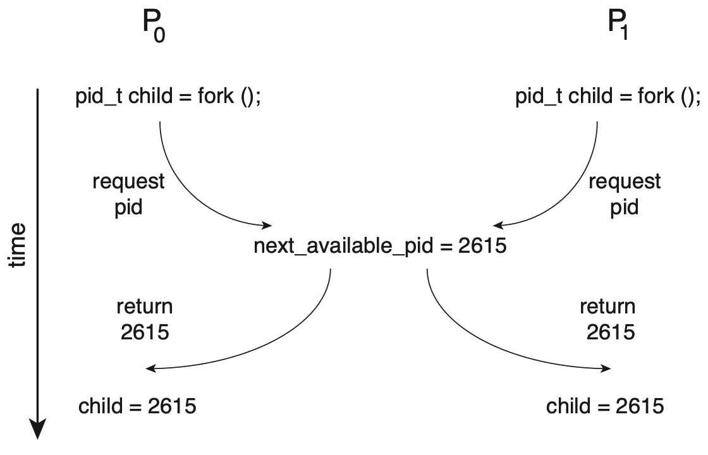
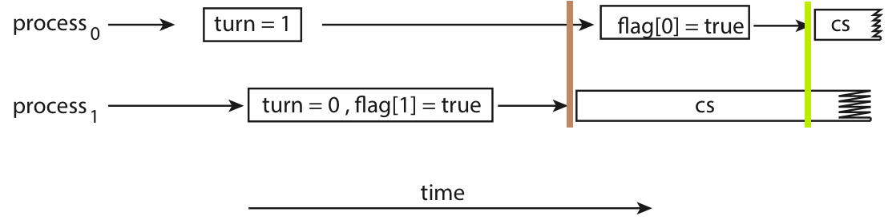

# Synchronization Tools

> 在支持并发甚至并行的系统中，虽然进程之间相对隔离，在一般情况下互不直接干扰，都是自顾自跑。即，是**异步**的。但由于各些原因（例如都需要对一共享资源的修改），进程之间的执行需要**互相制约**，**遵循特定的先后顺序**，因此进程需要通过某些手段，让协作进程能够直接或间接了解到其它相关进程的状态，以实现对当前进程执行的控制，最终在宏观上实现一种“同步”。

> 需要注意的是，同步并不是某种中心化的调控机制，而更像是一种**协议**：当各个进程发现有别的进程与自己产生竞争时，应当有某种手段允许它们达成协商，以决定谁先谁后。

!!! tip "同步(Synchronization) vs. 通信(IPC)"

    - **通信 (Communication)**: 关注 “交换什么”。目的是在进程间**传递信息 (数据)**。
    
    - **同步 (Synchronization)**: 关注 “如何协调”。目的是**控制进程间的执行顺序和时机**。
    
    | 特性 | 进程通信 (IPC - Inter-Process Communication) | 进程同步 (Process Synchronization) |
    | :--- | :--- | :--- |
    | **核心目的** | 交换信息和数据 | 协调执行顺序和时机 |
    | **解决的问题** | "进程 A 如何把 **10MB 的数据**发送给进程 B？" | "如何保证进程 A 在进程 B **执行完之前**不能执行？"<br><br>"如何保证**同一时间只有一个**进程能写入文件？" |
    | **典型机制** | 1. 管道 (Pipes)<br>2. 消息队列 (Message Queues)<br>3. 共享内存 (Shared Memory)<br>4. 套接字 (Sockets) | 1. 信号量 (Semaphores)<br>2. 互斥锁 (Mutexes)<br>3. 条件变量 (Condition Variables)<br>4. 读写锁 (Read-Write Locks) |

## The Critical-Section Problem

- 我们应当保证在一个进程在修改 `mem[x]` 的时候，其它进程不应该读取 `mem[x]`（至少不应以修改 `mem[x]` 为目的来读取），直到这个进程完成对 `mem[x]` 的修改。换句话来说，`mem[x]` 这个**共享资源应当只能被一个用户持有**，我们称这种只能被至多一个用户占有的资源为**临界资源**。而程序中**访问临界资源的代码段**，我们称之为**临界区段(critical section, CS)**

- 而CS问题，指的就是**如何保证最多只有一个用户在执行临界区段的代码**

---

- 我们队能够解决CS问题的代码做以下划分：

```bash
┌─────────────────────┐
│  Entry Section      │ <-- ask-for & wait for permission to enter CS
├─────────────────────┤
│  Critical Section   │ <-- codes manipulating critical resources
├─────────────────────┤
│  Exit Section       │ <-- release the critical resources
├─────────────────────┤
│  Remainder Section  │ <-- other codes
└─────────────────────┘
```

- 进程需要在 entry section 判断是否能够进入 critical section，即索取临界资源，如果不行则等待；而在进入 critical section 后，进程需要在 exit section 释放临界资源；然后脱离 CS 问题的语境，进入 remainder section 继续执行。

- 同时，我们要求解决方案需要满足如下性质：

!!! tip "解决CS问题的要求"

    1. **临界互斥(mutual exclusion)**：操作同一临界资源的临界区段应当互相排斥；
    
        - 如果进程$P_i$​正在执行其 critical section，那么不应当有其他进程处于（操作同一临界资源的）critical section；
    
    2. **迅速做出选择(progress)**：选择下一个进入 critical section 的操作应当只有处于 entry/critical/exit section 的进程参与，且该选择应当在有限时间内被执行；
    
    3. **等待时间有限(bounded waiting)**：进程等待被允许进入 critical section 的时间应当是有限的；

- 等待临界资源的过程，就好像进程ready态等待CPU资源的过程；类似地，在CS问题中也有三个状态：

1. **就绪态**：进程随时准备好进入 critical section，**想要有临界资源**

2. **临界态**：进程正在执行 critical section，**持有临界资源**；或者执行完 critical section，**正在释放持有的临界资源**

3. **无关态**：不处于就绪态也不处于临界态，不想要持有临界资源，或是已经释放

---

## 内核代码中的CS问题

- 在 kernel code 中也普遍存在着 race condition 的问题，例如：



- 上面$P_0$和$P_1$同时访问了 `next_available_pid` 这个临界资源，产生竞争，导致最后有两个进程使用了同一个 `pid`。

- 如果想要解决 kernel code 中的 CS 问题，我们可以只让一个进程运行在 kernel mode，这样就可以保证在 kernel code 中访问临界资源的行为没有竞争，从而解决 CS 问题。

- 对于单处理器来说，我们只需要在 kernel code 中**禁止中断**，就可以保证只有一个进程可以运行在 kernel mode；而对于多处理器来说，这种方法就不那么合适了——我们需要同时告诉多个处理器中断被禁止，而这个过程中的时延仍然会产生问题；不仅如此，这个方法也会带来**额外的开销**。在多处理器语境下，我们需要实现抢占式内核(preemptive kernels)和非抢占式内核(non-preemptive kernels)，关键是后者实现了一段时间内只有一个进程可以运行在 kernel mode2。

- 所以需要更为通用的解决方案：

### Peterson's Algorithm

- Peterson's algorithm 是对**只有两个进程参与**的同步问题的一个解法，具有一定的局限性，但其设计相对简单

### 算法描述

- 为了保证处于临界态的进程至多只有一个，我们应当在进程处于**就绪态**时，**确认没有其他进程处于临界态**后再进入。其中最重要的一件事就是，当我们处在$P_0$时，如何知道$P_1$是否处于临界态？

```c
// 这里的i和j代表pid，都是0或1
process(i) {
    j = 1 - i;

    READY[i] = true;                    // ┐
    TURN = j;                           // │
    while (READY[j] && TURN == j) {}    // ├ entry section
        // i.e. wait until:             // │
        //  (1) j exit,                 // │
        //  (2) j is slower, so it      // │
        //      should run now.         // ┘

    /* operate critical resources */    // - critical section

    READY[i] = false;                   // - exit section

    /* other things */                  // - remainder section
}
```

- `READY` 是一个共享的数组，每个进程只修改与自己一一对应的 element，所以本质上 `READY` 不会出现 race condition，因而也不是临界资源。而 `TURN`，我们在第 6 行只对 `TURN` 进行直接写的操作，但是 P1 和 P2 谁**后跑完**到这一行会决定 `TURN` 最后的值，所以实际上这里有 **race condition**。

- 但这就是 Peterson’s Algorithm 巧妙的地方，利用 race condition 这个**后覆盖前**的性质，实现了**标记了这两个进程的先来后到**的效果。我们都向这个 `TURN` 写一个独特的值（比如自己的 id，或者对方的 id），等大家都写好后我们看看这个值最终是谁写的，于是就知道谁后到。

!!! warning "不适用于现代计算机"

    - 但是，Peterson's 实际上**无法适用于现代计算机**中。上述做法有一个关键，也是我们在证明过程中一直默认成立的事情：进程总是先执行 `READY[i] = true`;，然后才会执行 `TURN = j`;，即先进入就绪态，再索取临界资源，这看起来是个非常合理的条件。但在现代计算机中，编译器可能会通过重排列部分语句来更好地利用 CPU 资源（参考计组的各种竞争）。而对编译器来说，这两个操作（就绪和请求）并没有操作相同内容，因而交换顺序是不会影响结果的，所以可能被编译器交换。而这就有可能导致出现问题，例如：
    
    
    
    - 在棕色标记时刻，process 1 进行 `while` 循环判断，发现 `READY[0]` 为 false，但此时 TURN 指向对方，所以按照我们先前的分析，此时 process 1 会认为 process 0 是已经运行完 critical section，已经释放了临界资源，所以进入临界态；然而，在绿色标记时刻，对于 process 0，此时 `TURN` 指向自己，process 1 还没运行完所以 `READY[1]` 还是 `true`，根据我们之前的分析，此时 process 0 会认为 process 1 在等待自己，所以也进入了临界态。于是，两个进程同时进入了临界态，违反了 **mutual exclusion** 的性质。

## 硬件指令

- 讨论 Peterson's Algorithm 后我们应当意识到，同步问题的出现是 ⓵ **硬件操作数据需要时间**，与 ⓶ **数据具有共享性的不协调**，所以本质上是硬件产生的问题。因而，要想更好的解决问题，我们还是应当从硬件出发。我们在这里引入**原子性(atomic)**这个概念，它的基本逻辑是让“需要时间的，对数据的操作”，变成一个“**在时间上不可分割、不可被打断的，即原子性的操作**”。不同硬件可能提供不同的原子性操作，我们这里将它们抽象为 `test_and_set()` 和 `compare_and_swap()` 两类来介绍。

### `test_and_set()`

```c
<atomic> test_and_set(bool * target) {
    bool ret = *target;
    *target = true;
    return ret;
}
```

- 该指令的功能就类似上面这段代码：将目标设为 `true`，同时返回其旧值。但除此之外，这个指令需要保证原子性，即如果有若干 `test_and_set()` 同时发生，那么无论并发还是并行，它们都**应当一个一个地执行，而不能产生时间上的交集**。

- 原子操作天然地保证了 mutual exclusion，因此可以很好地用来解决CS问题

```c
process(i) {
    while ( test_and_set(&LOCK) ) {}    // - entry section

    /* operate critical resources */    // - critical section

    LOCK = false;                       // - exit section

    /* other things */                  // - remainder section
}

```

!!! note "mutual exclusion"

    - 由于`test_and_set()`是原子性的，所以同时执行的一系列`test_and_set()`只会有一个返回`false`，即只有一个能通过锁，因而天生满足了mutual exclusion

!!! note "progress"

    - 只要没有进程处于 critical section，那么 `LOCK` 必定为 `false`，则一定有就绪的进程能够进入 critical section，而运行 critical section 的时间是有限的，因此 `LOCK` 又一定会在有限时间内变为 `false`，从而满足 progress。

!!! warning "bounded waiting"

    - 如果只有两个进程参与竞争，那么通过类似证明 progress 的过程可以得到 bounded waiting time 是可以成立的。A 离开临界态后处于就绪态等待的 B 立刻就能进入 critical section，即只有两个人排队是不会被插队的。
    
    - 但在参与竞争的进程变多以后，就很有可能出现类似于调度中“**饥饿**”的现象：
    
    ```bash
        ┌────┐      ┌────┐      ┌────┐      ┌────┐      
    P0  │ CS │   ───┤ CS │   ───┤ CS │   ───┤ CS │   ─── ···
        └────┘      └────┘      └────┘      └────┘      
            ┌────┐      ┌────┐      ┌────┐      ┌────┐
    P1  ────┤ CS │   ───┤ CS │   ───┤ CS │   ───┤ CS │ ···
            └────┘      └────┘      └────┘      └────┘
    
    P2  ──────────────────────────────────────────────── ···
    
    ```
    
    - 可以发现，由于 P0 和 P1 总是轮流获得锁，导致 P2 始终处于就绪态等待锁，因而对于 P2 来说 waiting time 就不再有限了。

- 由上面的例子，我们可以看出对于这个锁的调度，是需要进行一定设计的，不能让进程们自由竞争

```c title="WAITING and LOCK" linenums="1"
// `i` is process id in [0, n), where `n` is the count of related process. 
process(i) {
    WAITING[i] = true;                                  // ┐
    while ( WAITING[i] && test_and_set(&LOCK) ) {}      // ├ entry sec.
                                                        // │
    WAITING[i] = false;                                 // ┘

    /* operate critical resources */                    // - critical sec.

    // i.e. find next waiting process j                 // ┐
    j = (i + 1) % n;                                    // │
    while (i != j && !WAITING[j]) {                     // ├ exit sec.
        j = (j + 1) % n;                                // │
    }                                                   // │
    // release j's LOCK or release whole LOCK           // │
    if (i == j)     LOCK = false;                       // │
    else            WAITING[j] = false;                 // ┘

    /* other things */                                  // - remainder sec.
}
```

- 我们引入了`WAITING[]`数组来辅助`LOCK`细化锁的粒度，此时`LOCK`表示的是**是否存在竞争**，而`WAITING[]`则标识了正在等待的线程。区别在于，之前锁的竞争是“拼手速”，而现在则是由**准备释放锁的进程来选择下一个进入 critical section的线程**

- 在 11-14 行，我们通过一个环状的遍历来尝试找到下一个要获取锁的进程`j`，一旦找到了就设置`WAITING[j] = false`，然后让进程`j`进入critical section；如果找了一圈都没有要锁的进程（即i == j），就说明可以释放锁`LOCK = false`

### `compare_and_swap()`

```c linenums="1"
<atomic> compare_and_swap(int * target, int expected, int new_val) {
    int ret = *target;

    // *target = (*target == expected) ? new_val : *target;
    if (*target == expected) {
        *target = new_val;
    }

    return ret;
}
```
**CAS 接受三个值：**

1. `target` 待修改的数据的地址；

2. `expected` 预期中待修改的数据的旧值；

3. `new_val` 希望将数据修改为的新值；

- 而当且仅当 `*target` 符合预期，与 `expected` 相同时候，才会将它改为 `new_val`。同样，CAS 也应当`保证原子性`，即若干 CAS 同时发生时，也应当一个一个的执行，而不能存在时间上的交集。

- 我们注意到，实际上 `test_and_set(target)` 就是 `compare_and_swap(target, false, true)`，因而实际上 CAS 解决 CS 问题的方法以及问题和上一节的内容没什么差别。

- 但是我们发现，`compare_and_swap()` 相比于 `test_and_set()`，显然有更大的操作空间，也更泛用，考虑到 CAS 指令自身已经能够支持原子性的修改值，我们考虑能否跳出 CS 问题的范式来考虑问题。

## 原子变量

- **原子变量(atomic variables)**是一种用原子性操作维护的变量。我们所有对原子变量的操作可以通过 CAS 来实现，例如自增操作：

```c
increment(atomic_int * v) {
    int tmp;
    do {
        tmp = *v;
    } while( tmp != compare_and_swap(v, tmp, tmp + 1) );
}
```

- 使用 **atomic variables** 后实际上就不太符合 CS 问题的模型了，可以发现，这里并不再需要维护类似 `LOCK` 的东西，而是以 `*target` 是否符合 `expected` 的预设来判断是否有竞争出现，作为一个同步工具，我们可以直接使用这种**封装后的原子性操作来解决 race condition**，而不需要再区分 entry section 或是 critical section 等。

## Mutex Locks

- 由此我们已经得到了能在硬件层面解决 race condition 问题的根源的工具了，但是为了能让用户程序也能更好的使用，我们需要将它做一次**软件层面**的封装。于是，我们设计了**互斥锁(mutex locks)**这个东西。

- 利用互斥锁避免 race condition 的基本思路仍然是基于 CS 问题的建模，但它更具体地认为在 entry section 就该去索取互斥锁，而在 exit section 就应该去释放互斥锁，即：

```bash
┌─────────────────────┐
│  Acquire Lock       │
├─────────────────────┤
│  Critical Section   │ <-- codes manipulating critical resources
├─────────────────────┤
│  Release Lock       │
├─────────────────────┤
│  Remainder Section  │ <-- other codes
└─────────────────────┘
```

- 回顾`test_and_set()`中的代码

```c linenums="1" hl_lines="2 6"
- process(i) {
    while ( test_and_set(&LOCK) ) {}    // - entry section

    /* operate critical resources */    // - critical section

    LOCK = false;                       // - exit section

    /* other things */                  // - remainder section
}
```

- 然后将锁的获取和锁的释放，分别封装起来，实现 `acquire`和`release`

```c
// `available` means whether the `LOCK` is free, or whether the related 
// resources is available
acquire() {
    while ( !compare_and_swap(&available, true, false) ) {}
}

release() {
    available = true;
}
```

---

### 忙等待和自旋锁

- 在上述的代码中可以发现，我们一直使用`while`循环来让暂时拿不到锁的进程等待，对于等待中的进程确实要在loop中浪费CPU，我们称这种等待锁释放的行为为**忙等待(busy waiting)**；**忙**指的就是在等待过程中仍然占用CPU资源，而使用忙等待的互斥锁，被称为**自旋锁（spinlock）**

- 对于自旋锁的优化，思路很明显就是想让忙等待的进程直接**休眠**，转而让真正需要CPU的进程占用；而这种思路实现的就是 **mutex**，mutex的代价牵扯到进程上下文切换的开销；所以不同的场景，我们需要选择使用不同种类的锁

### spinlock vs. mutex

|特性 |	Spinlock (自旋锁)	| Mutex (互斥锁)|
|------|-------------------|--------------|
|等待方式	|忙等待 (Busy-Waiting)|	睡眠等待 (Sleep-Waiting)|
|CPU 占用	|等待时 100% 占用 CPU 核心|	等待时不占用 CPU (线程被挂起)|
|上下文切换|	没有 (或极少)|	有 (至少两次：一次睡眠，一次唤醒)|
|开销|	上下文切换开销低，但 CPU 周期开销高|	上下文切换开销高，但 CPU 周期开销低|
|死锁风险|	高 (尤其在单核或优先级反转时)|	较低 (但仍需小心管理)|
|适用环境|	必须是多核处理器|	单核、多核均可|
|常见应用|	操作系统内核、驱动程序|	绝大多数用户态应用程序|

**优先使用 Spinlock (自旋锁) 的场景**：

- 核心原则： 当你非常确定**锁被占用的时间极短时**。

- “极短”的标准是：锁的持有时间 < 两次上下文切换的总时间。

- **原因**：

    - Mutex 的开销是固定的：一次“睡眠”切换 + 一次“唤醒”切换。

    - Spinlock 的开销是可变的：你“自旋”所花费的 CPU 时间。

- 如果自旋的时间（比如100纳秒）远远小于两次上下文切换的时间（比如几微秒），那么用自旋锁就更划算。

- **具体场景**： 

    - **临界区极小**：临界区（被锁保护的代码）只有几行指令，比如只是修改一个指针、给一个计数器加一。

    - **内核与驱动**：在操作系统内核中，尤其是在中断处理程序（Interrupt Handler）中。在中断上下文中，你不能睡眠（会导致系统崩溃），所以你 **必须** 使用自旋锁。

    - **多核系统**：Spinlock **只有在多核 CPU 上才有意义**。如果是在单核 CPU 上，一个线程在“自旋”，那么持有锁的那个线程根本没有机会运行（因为CPU被自旋的线程占满了），锁就永远不会被释放，导致死锁。

---

**优先使用 Mutex (互斥锁) 的场景**：

- **核心原则**： 默认选择，尤其是当你不确定锁会被占用多久时。

- **具体场景**：

    - **临界区较长**：这是最常见的场景。

    - **临界区内有复杂操作**： 比如进行 I/O 操作（读写文件、网络请求）、调用其他函数、或者进行复杂的计算。

    - **锁的竞争激烈**： 如果有很多线程都在等待同一个锁，使用自旋锁会导致大量的 CPU 核心都在空转，浪费巨大。而 Mutex 会让这些线程都去“睡觉”，把 CPU 让给其他有用的工作。

    - **绝大多数用户态程序**： 在你日常编写的应用程序中（C++, Java, Python, Go...），Mutex（或其变种，如Go的 sync.Mutex、Java的 synchronized 和 ReentrantLock）都应该是你的首选和默认选项。

### Condition Variables

- **Condition Variable（条件变量）** 用来解决了一个 Mutex 无法解决的问题：**“等待特定条件满足”**。核心目的：**等待（Waiting）**

- Mutex 只能保证“同一时间只有我能操作”，但它不能保证“我操作时，条件一定是满足的”。

- Condition Variable (条件变量) 的核心，就是一个**“等待队列” (Wait Queue)**。这个队列由操作系统内核管理，里面装着所有**因为“条件不满足”而选择“睡眠”**的线程。

- CV 永远必须和 Mutex 一起使用。它们是“黄金搭档”。

    - Mutex (互斥锁) 负责**保护共享数据（防止竞态）**。

    - CV (条件变量) 负责**协调线程（当条件不满足时，让线程去“睡觉”）**。

!!! tip "对比两个队列"

    | **特性**             | **Mutex 的等待队列**                                         | **Condition Variable 的等待队列**                            |
    | -------------------- | ------------------------------------------------------------ | ------------------------------------------------------------ |
    | **队列里是谁？**     | 试图 `lock()` 但失败（锁被占用）的线程。                     | **已经** `lock()` 成功，但因条件不满足而**主动**调用 `cv.wait()` 的线程。 |
    | **他们在等什么？**   | 等待 `Mutex` **被 `unlock()`**。 （等待“门锁”被打开）        | 等待其他线程**调用 `cv.signal()`**。 （等待“新菜”的信号）    |
    | **如何进入队列？**   | **被动**进入。 （你尝试开门，但门锁着，你**被迫**在门外排队） | **主动**进入。 （你**已经**进门了，你**选择**去休息区睡觉）  |
    | **如何离开队列？**   | 当 `Mutex` 被 `unlock()` 时，内核会从这个队列里**唤醒一个**（或多个）线程让它去抢锁。 | 当其他线程调用 `cv.signal()` 时，内核会从这个队列里**唤醒一个**（或多个）线程。 |
    | **离开后的下一步？** | 成功获取 `Mutex` 锁，**进入**临界区。                        | **重新去“`Mutex` 的等待队列”排队**，等待重新获取 `Mutex` 锁。 |

### Read-Write Lock

- **Read-Write Lock** (也叫 shared_mutex) 是 Mutex 的一种**性能优化**。

- Mutex 是“一刀切”的：不管你是读还是写，都必须排队，一次只能进一个。这在“读多写少”的场景下性能极差。

- RWLock 是 Mutex 的一个**特殊变种**。它不再提供一个单一的 `lock()`，而是提供了两种锁：

1. **读锁 (Read Lock / 共享锁)：**
   
    - 可以被**多个**线程**同时**持有。
     
    - 只要没有“写锁”存在，任何线程都可以获取“读锁”。
    
2. **写锁 (Write Lock / 排他锁)：**
   
    - **只能被一个**线程持有。
     
    - 当它被持有时，**其他所有**线程（包括读和写）都必须等待。

- RWLock 专门用于**“读多写少”**的场景，目的是**最大化“读”操作的并发性**。

**典型场景：**

- **系统配置：** 服务器的配置被上万个线程频繁读取，但几小时才被管理线程写入一次。

- **数据缓存 (Cache)：** 缓存数据被高并发地读取，只在数据过期时才被写入一次。

- **用户权限表：** 每次请求都要读取权限，但权限的变更（写入）非常少。


## Semaphores

- **Semaphore (信号量)**，是一个比 Mutex 更广义，也更强大的**同步**工具。

!!! tip "Mutex vs. Semaphores"

    - Mutex **只能处理一种**同步场景：**确保一个临界区（代码）或一个共享资源，在同一时间只被一个进程/线程访问**。
    
        - **限制**：它是一个“锁”，有**所有权**（谁加锁，谁解锁）。它**无法用于协调多个进程的执行顺序（信号），也无法管理多个资源 (N>1)**。
    
    - Semaphore 的能力更广，它能处理两种截然不同的同步场景：
    
    **场景一：资源计数 (Resource Counting)**
    
    **允许多达 N 个进程/线程同时访问一个资源池。**
    
    - **核心场景**： 限制并发数量。
    
    - **解决的问题**： “这里最多只允许 N 个人同时进入。”
    
    - **Mutex 无法替代性**： Mutex 只能处理 N=1 的情况。
    
    **场景二：执行顺序同步 (Synchronization)**
    
    一个进程等待 (wait)，直到另一个进程向它发出**“完成”信号** (signal)。
    
    - **核心场景**： 跨进程/线程的“信号与等待”。
    
    - **解决的问题**： “进程 A 必须等到进程 B 完成某事后才能继续。”
    
    - **Mutex 无法替代性**： Mutex 的“所有权”特性（谁加锁谁解锁）使其无法实现这种跨进程的“A 等 B 发信号”的协调。
    
    ---
    
    |特性|Mutex|Semophore|
    |---|------|--------|
    |核心目的|互斥(Mutual Exclusion)|同步(Synchronization)/资源计数|
    |资源数量|总是 **1** 个| 可以是$N$个(couting)或者1个(Binary)|
    |工作模式|锁定(locking) | 信号(signal)/计数|    
    |所有权|**有所有权!**|**无所有权!**|

**一个信号量主要包含两部分**：

1. **一个整数计数器**

2. 两个原子操作：

    - `wait()`（也叫`P()`, `acquire()`, `down()`）：等待操作

    - `signal()`（也叫`V()`, `release()`, `up()`）：信号操作

```c linenums="1"
void wait(S) {
    while (S <= 0) {} // busy waiting
    S--;
}

void signal(S) {
    S++;
}
```

---

### 使用场景

- 下面会介绍两种Semophore的重要使用场景，而且是mutex无法做到的：


**场景一 (最重要)：跨线程的“信号”与“等待” (Synchronization)**

- 这是 Semaphore **无法被替代**的核心价值。

- **问题描述：** 假设你有两个线程，**线程 A (主线程)** 和 **线程 B (工作线程)**。 线程 A 启动了线程 B 去执行一个**耗时的初始化任务**（比如加载一个大文件）。 线程 A 必须**暂停**，**直到**线程 B **明确完成**了该任务后，线程 A 才能继续执行。

**❌ 为什么 Mutex 做不到？**

**你会怎么用 Mutex 尝试？**

- **错误尝试1：** 线程 A `lock()`，然后线程 B 在任务完成后 `unlock()`？

    - **失败！** Mutex 的规则是“谁上锁，谁解锁”。线程 B 无法解锁一个被线程 A 锁住的 Mutex。

- **错误尝试2：** 线程 B 先 `lock()`，完成任务后 `unlock()`。线程 A 在启动 B 之后，也去 `lock()`。

    - **失败！(有竞态条件 Race Condition)**

    - 如果 B 跑得快，在 A 调用 `lock()` 之前就完成了任务并 `unlock()` 了。

    - 然后 A 再去 `lock()`，它会立刻成功，但此时任务可能还没开始！

    - 或者，A 跑得快，在 B 启动前就 `lock()` 了。然后 B 启动后尝试 `lock()` 就会卡住，A 也在等 B，**死锁**。

- **结论：** Mutex 无法解决这个“A 等 B 完成”的问题，因为它是一个**“锁”**，不是一个**“信号”**。

**✅ Semaphore 如何完美解决？**

- 使用一个 `Count` **初始化为 0** 的 Semaphore。 这个 `Count=0` 非常关键，它代表“**目前还没有信号**”。

1. **初始化：** `Semaphore sem = new Semaphore(0);` (计数器为0)

2. **线程 A (等待者)：**

    - 启动线程 B...

    - 调用 `sem.wait();`

    - **发生什么？** `wait()` 检查计数器。发现 `Count` 是 0，于是**线程 A 立即被阻塞（睡眠）**。它就在这里“等待信号”。

3. **线程 B (工作者/信号发送者)：**
    - ...努力执行耗时的初始化任务...

    - (任务完成！)

    - 调用 `sem.signal();`

    - **发生什么？** `signal()` 使计数器 `Count` 从 0 变为 1。系统发现线程 A 正在等待这个信号，于是**立即唤醒线程 A**。

4. **结果：** 线程 A 被唤醒后，`wait()` 操作完成 (它会消耗掉那个信号，`Count` 变回 0)，A 继续执行。完美实现了“A 等 B 完成”的同步。

**总结 1：** 在这种**“一个线程需要等待另一个线程完成某事”**的场景下，**必须使用 Semaphore**。Mutex 由于其“所有权”限制，根本无法安全地实现这一功能。

---

**场景二：$N$ 个资源的访问控制 (Resource Pool)**

- 这是另一个经典场景，Mutex 也无法替代。

**问题描述**：

- 你有一个资源池，里面有 5 个相同的资源（比如 5 个数据库连接，或者 5 个渲染线程）。你希望最多只允许 5 个线程同时使用这些资源。第 6 个尝试访问的线程必须等待，直到有人释放了一个资源。

**❌ 为什么 Mutex 做不到？**

- Mutex 只有一把钥匙 (Count 永远是 1)。

- 它只能保护一个资源，实现“要么 1 个线程访问，要么 0 个”。

- 它无法实现“允许最多 5 个线程访问”这种复杂的计数逻辑。

**✅ Semaphore 如何完美解决？**

- 使用一个 Count 初始化为 5 的 Semaphore。

- Count=5 代表“有 5 个可用的资源许可”。

1. **初始化：** `Semaphore poolSem = new Semaphore(5);` (计数器为5)

2. **线程 1, 2, 3, 4, 5 (访问者)：**

    - 调用 `poolSem.wait();`
    
    - **发生什么？** 它们都会成功。`wait()` 发现 `Count > 0`，于是 `Count` 依次递减。
    
    - `Count` 变为 4... 3... 2... 1... 0。
    
    - 这 5 个线程都拿到了“许可”，进入临界区开始使用资源。

3. **线程 6 (等待者)：**
   
    - 调用 `poolSem.wait();`
    
    - **发生什么？** `wait()` 发现 `Count` 是 0。**线程 6 被阻塞（睡眠）**。

4. **线程 2 (释放者)：**
   
    - ...使用完资源...
    
    - 调用 `poolSem.signal();`
    
    - **发生什么？** `signal()` 使 `Count` 从 0 变为 1。系统发现线程 6 正在等待，于是**唤醒线程 6**。

5. **结果：** 线程 6 被唤醒，`wait()` 操作完成（`Count` 变回 0），它也拿到了许可，开始使用资源。系统始终确保了最多只有 5 个线程在工作。

**总结 2**：在需要**限制 $N$ 个并发** (N > 1) 的场景下，必须使用 Semaphore。Mutex 只能处理 $N = 1$ 的情况。

### 避免忙等待

```c linenums="1"
void wait(S) {
    while (S <= 0) {} // busy waiting
    S--;
}

void signal(S) {
    S++;
}
```

- 上面的实现是最典型的“忙等待 (Busy-Waiting)”实现，它也常被称为 Spin-Wait Semaphore (自旋等待信号量)。

- 当一个进程发现`S=0`时，它会卡死在循环里，100%占用CPu，疯狂地检查`S`的值；如果这是一个单核CPU，它将永远无法退出；

- 忙等待的坏处在spinlock里已经说过了，这里我们对semaphore的数据结构进行改进，以避免忙等待


```c title="用“睡眠”代替“空转” linenums="1"
struct semaphore {
    value;
    waiting_list;
};

<atomic> wait(reference S) {
    S->value--;
    if (S->value < 0) {
        S->waiting_list.push(current process);
        // OS 内核会挂起这个进程，然后去运行别的进程
        sleep();
    }
}

<atomic> signal(reference S) {
    S->value++;
    // 检查：我加了 1 之后，值是否依然 <= 0？
    // 如果在我调用 signal() 之前，S->value 是负数。
    // 这意味着 waiting_list 里面 一定 有人（或很多人）在睡觉！
    if (S->value <= 0) {
        p = S->waiting_list.pop();
        // OS 内核把 P 从“阻塞”状态改为“就绪”状态
        wakeup(p);
    }
}
```

## 总结

| 同步工具 | 核心目的 | 关系与区别 | 典型场景 |
| :--- | :--- | :--- | :--- |
| **Mutex (互斥锁)** | **互斥 (Exclusion)** | 最基础的锁。**一次只允许 1 个**线程进入。 | 保护临界区，防止数据被同时修改。 |
| **Semaphore (信号量)** | **计数 (Counting)** | 是个计数器。**一次允许 N 个**线程进入。与 Mutex/CV 概念不同。 | 资源池（如数据库连接池）、限制并发数。 |
| **Condition Variable** | **等待 (Waiting)** | **不是锁**。必须**和 Mutex 配合**使用，提供“睡眠/唤醒”功能。 | 生产者-消费者问题（当队列为空或满时等待）。 |
| **Read-Write Lock** | **读性能优化** | `Mutex` 的升级版。**允许多个读者**并发，但只允许一个写者。 | 读多写少（如系统配置、缓存）。 |