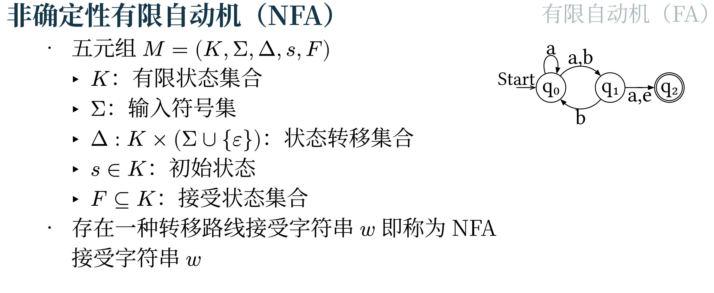
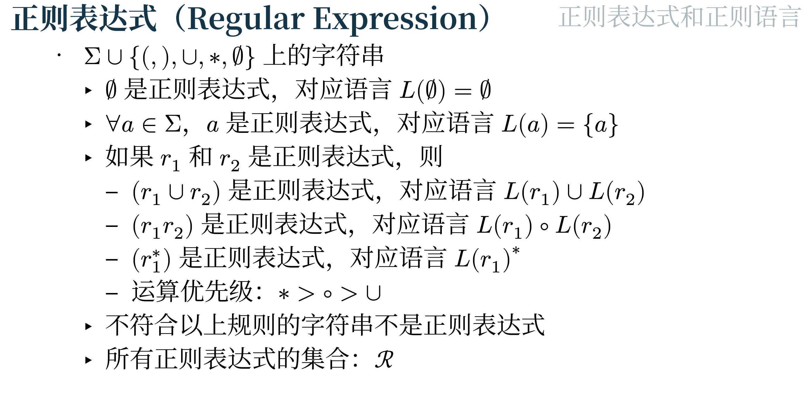
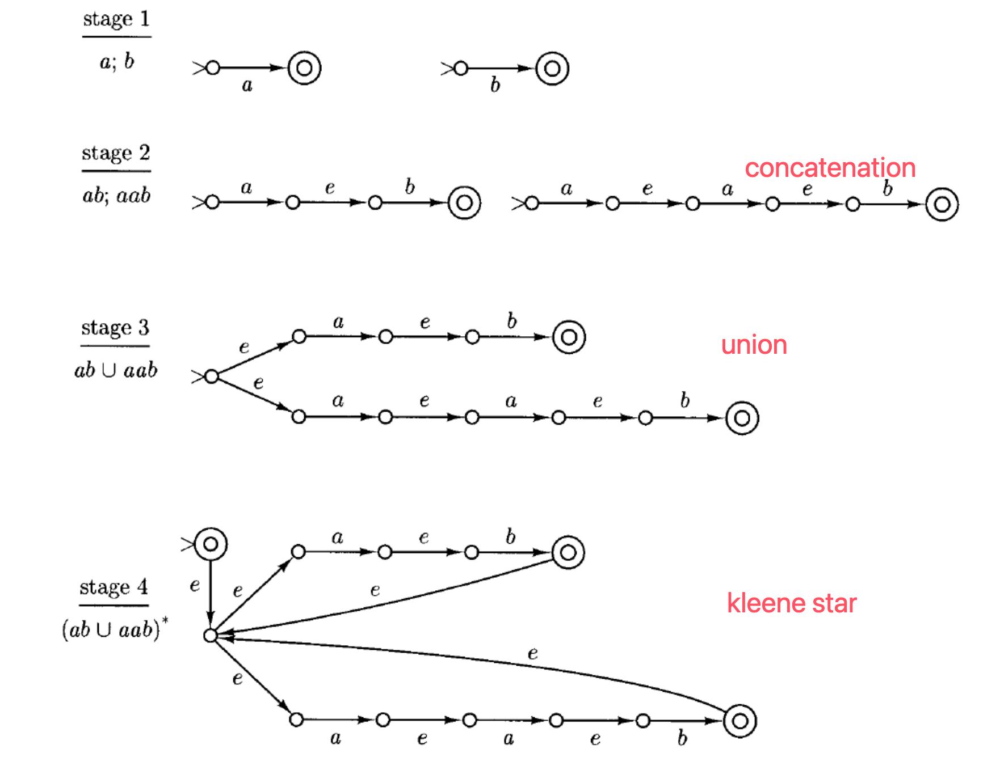
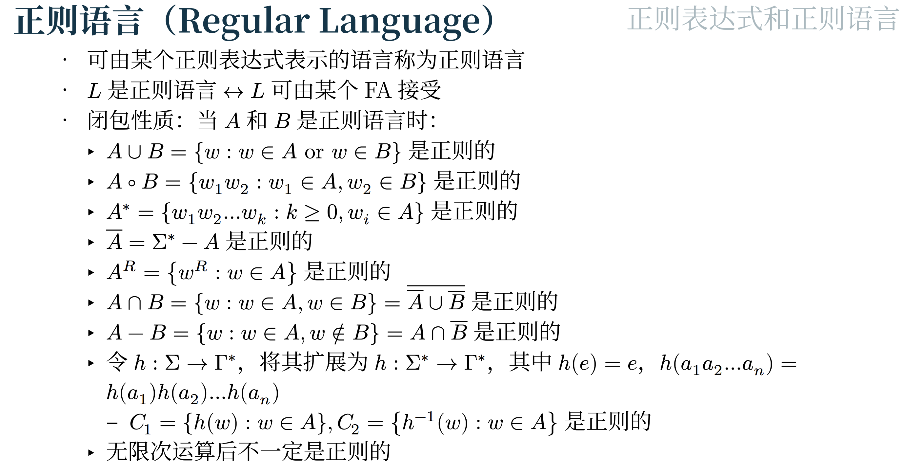

# Finite Automata

## Deterministic Finite Automata

- DFA有一个起始状态，从输入带每读入一个字符，就由转移方程决定下一个状态，确定性意味着任何情况下只会有唯一的答案

- 我们用一个严格的“五元组” (quintuple) 来定义一个DFA，即 $M = (K, \Sigma, \delta, s, F)$：

1. **K**：一个有限的 **状态 (states)** 集合。

2. **$\Sigma$** (Sigma)：一个 **字母表 (alphabet)**。

3. **$\delta$** (Delta)：**转移函数 (transition function)**。

4. **s**：**初始状态 (initial state)**。

5. **F**：一个 **终止状态 (final states)** 的集合。

- **configuration**是DFA某个时刻的快照，包含了**当前状态**和**未读字符串**，例如 $(q_0, aabaa)$

- **二元关系**$\vdash_M$：$(q, w)\vdash_M (q', w')$表示前者可以**一步变化**到后者，也就是存在$a\in \Sigma$，使得$w = aw'$, $\delta(q,a) = q'$；我们说 **$(q,w)$ yields $(q',w')$ in one step**

- 实际上 $\vdash_M$ 是从 $K \times \Sigma^+$ 到 $K \times \Sigma^*$ 的一个函数，也就是说，除了形如 $(q,e)$ 的配置外，每个配置都有唯一确定的下一个配置。形如 $(q,e)$ 的配置表示图灵机 $M$ 已经消耗完所有输入，因此在此处停止运行

- 我们将 $\vdash_M$ 的 **reflexive, transitive closure** 记作 $\vdash_M^*$. $(q,w) \vdash_M^* (q', w')$ 被读作 **$(q,w)$ yields $(q',w')$**（在若干步（可能是零步）之后生成）

- A string $w \in \Sigma^*$ is said to be **accepted** by $M$ 当且仅当存在某个状态 $q \in F$，使得 $(s,w) \vdash_M^*(q,e)$；能被接受的字符串，就是能被读完，读到最后得到$(q,e)$，$q$是一个终止状态；

- 如果最后得到的$q$并不是终止状态，而且发现状态无论如何怎么转移都还是$q$，说明自动机陷入了 **dead state（也叫 trapped）**

- $L(M)$就是$M$所能接受的所有字符串所形成的语言

---

## Non-Deterministic Finite Automata

- NFA会有多种转移路径，只要有**至少一条**能到final state的路径，就认为这个字符串可以被接受

### NFA到DFA的转换

- 所有 DFA 都是 NFA

- **NFA 可以通过子集构造法转换为等价的 DFA；对于每一个非确定性有限自动机 (NFA)，都存在一个等价的确定性有限自动机 (DFA)**。“等价” (Equivalent) 指的是它们接受的 **语言** (Language) 完全相同 。

- $E(q)$代表了 NFA 中每个状态的 **e-闭包**，即“从状态 $q$ 出发，只通过 $e$ 转移能到达的所有状态的集合”。

**子集构造法：**

1. **求所有状态的$E(q)$**

2. DFA初始状态就是NFA初始状态的$E(q_0)$

3. 然后一个状态集合转移到下一个状态集合，就是对状态集合里的每一个状态进行一次“猜”，得到对应的${q}$，然后对把所有的$E(q)$**并**起来，就是下一个状态集合

## 正则表达式和NFA

### 从正则表达式构建NFA

### 从NFA构建正则表达式

- 简化初始和结束状态

- 消除中间节点

## 判断是否为正则语言

1. **如何证明一个语言 是 正则语言**

要证明一个语言 $L$ 是正则的，你只需要做以下任意一项即可：

- 构造一个 DFA：设计一个接受 $L$ 的确定性有限自动机 (DFA)。

- 构造一个 NFA：设计一个接受 $L$ 的非确定性有限自动机 (NFA)（根据 2.2 节，NFA 和 DFA 的能力等价）。

- 编写一个正则表达式：写出一个能描述 $L$ 的正则表达式 (regular expression)（根据 2.3 节，自动机和正则表达式的能力等价）。

- 使用闭包性质：证明 $L$ 是由 已知的 正则语言通过并集 (union)、连接 (concatenation)、克林星号 (Kleene star)、交集 (intersection) 或 补集 (complementation) 运算得到的。

---

2. **如何证明一个语言 不是 正则语言（泵引理）**

